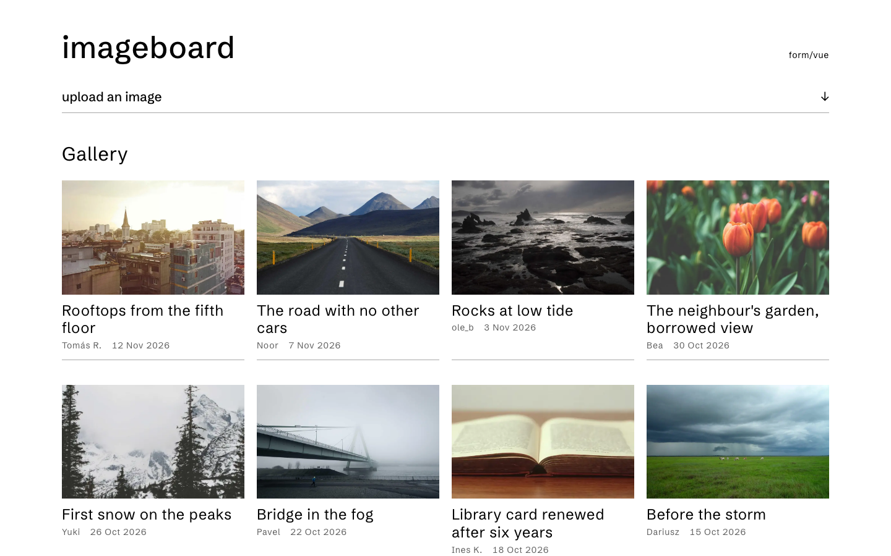
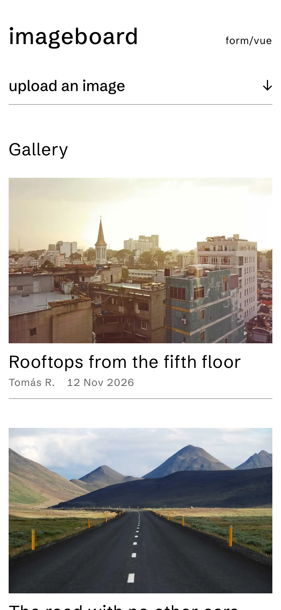
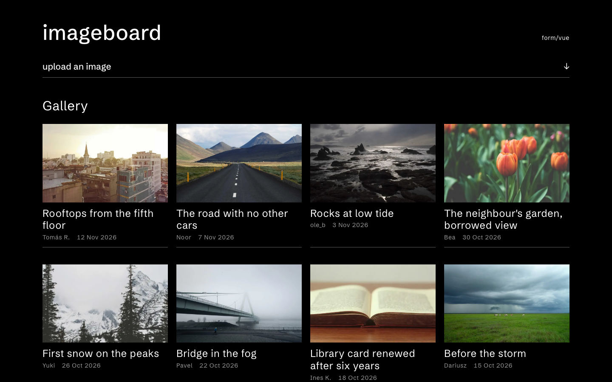
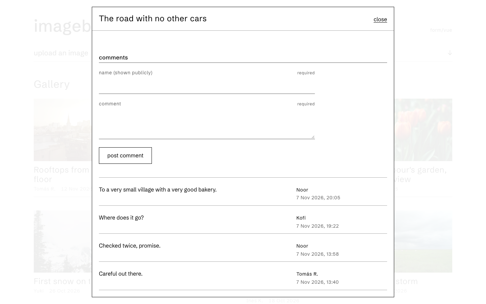
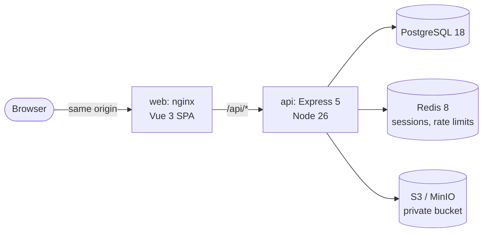

# imageboard

A public image board without accounts: upload a photo, browse the gallery, comment, and delete what you posted. I
rebuilt it from scratch from my 2018 bootcamp project to show how I build a small product today, with the same
features and every problem I found in the old code fixed.

[](https://github.com/Arnoldovna/Imageboard/actions/workflows/ci.yml)
[](https://github.com/Arnoldovna/Imageboard/actions/workflows/release.yml)
[](LICENSE)



| Mobile (390 px)                                                                                              | Dark mode (follows the system setting)                                             |
| ------------------------------------------------------------------------------------------------------------ | ---------------------------------------------------------------------------------- |
|  |  |

Upload, open, delete: the uploaded image becomes the first tile, opens in a dialog with its own URL, and only the
session that uploaded it sees "delete image".




## Features

- **Gallery**: newest first, 12 tiles per page, "load more" with keyset pagination, so uploads and deletes between
  two pages never cause duplicates or gaps. Tiles load a small WebP preview, not the original.
- **Upload**: name, title, optional description and one JPEG, PNG, WebP or GIF up to 5 MB. The server decides the
  type from the file's bytes, re-encodes it with sharp and drops all metadata, including GPS positions from phone
  photos.
- **Image detail**: a native `<dialog>` on its own route (`/images/:id`). Deep links and reloads work, Back closes
  it, Esc closes it, and focus goes back to the tile that opened it.
- **Comments**: newest first, paginated, with inline validation errors and a live-region announcement on success.
- **Delete your own content**: an anonymous session (cookie plus a Redis-backed session) owns what you upload and
  write. Only that session gets the delete control, and the API answers every other session with 403.
- **Safe defaults**: CSRF tokens plus a Fetch Metadata check on every write, a strict CSP, rate limits per route in
  Redis, and RFC 9457 problem details for every error.
- **Accessible**: labelled forms, visible focus, AA contrast in light and dark mode, keyboard-only upload. Every
  end-to-end spec runs axe checks in both colour schemes.

## Tech stack

| Area     | Choice                                                                  | Why                                                                                                                                        |
| -------- | ----------------------------------------------------------------------- | ------------------------------------------------------------------------------------------------------------------------------------------ |
| Frontend | Vue 3.5, Vite 8, Pinia, Vue Router                                      | The 2018 version was Vue 2 as a global script; I kept Vue and moved to single-file components, a real router for `/images/:id` and a store |
| Backend  | Express 5, TypeScript, Zod 4                                            | Express 5 forwards rejected promises to the error handler, which ends the "request hangs forever" class of bugs the old server had         |
| Contract | `packages/shared` with Zod schemas                                      | One definition of every request and response, used by the API for validation and by the client to check what it receives                   |
| Data     | PostgreSQL 18, Drizzle ORM with versioned migrations                    | CHECK constraints mirror the Zod rules, so a blank title is rejected by both the API and the database                                      |
| Sessions | express-session, connect-redis, Redis 8                                 | Ownership without accounts needs a server-side session; Redis also holds the rate-limit counters                                           |
| Files    | S3 API (MinIO locally), AWS SDK v3, sharp, file-type                    | A private bucket; images are served through `/api/media` with the detected content type and `nosniff`                                      |
| Styling  | Tailwind CSS 4 inside BEM CSS files, design tokens, Schibsted Grotesk   | Tailwind only through `@apply` in CSS files, no utility classes in markup; a script and Stylelint check that                               |
| Quality  | Vitest, Supertest + Testcontainers, Playwright + axe, ESLint boundaries | Integration tests run against real Postgres and Redis; ESLint stops one feature module from importing another                              |
| Delivery | GitHub Actions, Docker images (distroless API, unprivileged nginx)      | The same images run in `pnpm demo`, in the e2e job and in production                                                                       |

## Architecture



It is a pnpm monorepo with `apps/web`, `apps/api` and `packages/shared`. The API is split into feature modules
([`apps/api/src/features`](apps/api/src/features): `images`, `comments`, `upload`, `session`), each with routes,
controller, service and repository. Modules never import each other; they talk through small ports that the
composition root ([`apps/api/src/container.ts`](apps/api/src/container.ts)) wires together. Errors are typed
`AppError`s that one middleware turns into `application/problem+json` with a stable code, and the client shows the
message from that code. The frontend mirrors the split in
[`apps/web/src/features`](apps/web/src/features) (`gallery`, `image-detail`, `comments`, `upload`).

Every decision with a trade-off has an ADR in [`docs/architecture/adr/`](docs/architecture/adr/), for example
[anonymous session ownership](docs/architecture/adr/0002-anonymous-session-ownership.md),
[the image ingestion pipeline](docs/architecture/adr/0005-image-ingestion-pipeline.md) and
[keyset pagination](docs/architecture/adr/0007-keyset-pagination.md).

## What changed since the 2018 version

Before I wrote any new code, I read the old project file by file and wrote down everything that was wrong with it:
87 items, in [`docs/BUGS.md`](docs/BUGS.md). Every one of them is fixed and covered by an acceptance criterion in
[`docs/FEATURES.md`](docs/FEATURES.md). A few examples:

| 2018 bootcamp version                                                                         | 2026 rebuild                                                                                                   |
| --------------------------------------------------------------------------------------------- | -------------------------------------------------------------------------------------------------------------- |
| `POST /delete/:id` deleted any image for any caller, and the button was shown to everyone     | `DELETE /api/images/:id` checks the session's owner id (403 otherwise), behind a CSRF token and a confirmation |
| Any file was accepted; the extension and `Content-Type` came from the browser                 | Allow-list by magic bytes, server-generated object key, re-encoded with sharp, served with `nosniff`           |
| Phone photos were published with their EXIF data, GPS included                                | All metadata is stripped before the file is stored                                                             |
| A deleted image stayed online under its old URL                                               | The object is deleted after the database transaction commits, with retries                                     |
| A failing query left the request hanging; `GET /image/more/abc` could crash the server        | Zod validates params, query and body; every error ends as a problem+json response                              |
| `DELETE FROM images CASCADE` (Postgres reads `CASCADE` as a table alias) plus a second delete | `ON DELETE CASCADE` and one `DELETE` in a transaction                                                          |
| "More" assumed the oldest image had id 1, so it never went away once that image was deleted   | The server returns `nextCursor`; the button only exists while there is a next page                             |
| `DROP TABLE` scripts, seed images in someone else's bucket                                    | Drizzle migrations, an idempotent seed with openly licensed photos in the repo                                 |
| File input hidden with `display: none`, modal as a `div`, `outline: 0`                        | Keyboard-reachable file input, native `<dialog>` with focus handling, `:focus-visible` rings, axe in e2e       |
| ID selectors, one button style copied four times, greys `rgb(157…)` next to `rgb(159…)`       | Design tokens, BEM, Stylelint rules for both                                                                   |
| Node 8, Vue 2 development build copied into `public/`, an S3 client that signs with SigV2     | Node 26, Vue 3 built by Vite, AWS SDK v3                                                                       |
| No tests, no linter, no CI, `npm start` pointed at a file that did not exist                  | `pnpm verify` runs format, lint, types, unit, integration, build, e2e and a secret scan; CI runs the same      |

What I learned: most of the 2018 problems were not clever attacks, they were the server trusting the browser. The
filename, the MIME type, the id in the URL and the username were all taken as given. The rebuild validates at the
edge with one shared schema and checks ownership in the service, and that removed a whole group of bugs at once. I
also learned to write the decisions down before building: the 21 ADRs and a contract-first scaffold made it possible
to build the feature modules in parallel against fixed interfaces. The product stayed as small as it was; the work
went into everything around it.

Left out on purpose: accounts, a moderation UI (there is a removal script,
`pnpm --filter @app/api admin:remove-image`), real-time updates and multi-file uploads.

## Getting started

Requirements: Node 26 (`.nvmrc`), pnpm 10.34.9 (`npm i -g pnpm@10.34.9`), Docker with Compose 2.24.4 or newer.

Try it (production images with seeded photos and comments):

```bash
pnpm install
pnpm demo            # creates .env with generated secrets, starts the stack, prints the URL (http://127.0.0.1:8080)
```

Stop it with `pnpm stack:down`.

Develop:

```bash
pnpm install
pnpm dev:setup       # .env with generated secrets (never overwritten), Postgres, Redis, MinIO, migrations, seed
pnpm dev             # web on http://localhost:5173, API on http://localhost:3000
```

`pnpm dev:setup` is idempotent: running it again changes nothing.

## Scripts

| Script                                        | What it does                                                                                                     |
| --------------------------------------------- | ---------------------------------------------------------------------------------------------------------------- |
| `pnpm demo`                                   | production images with demo data on http://127.0.0.1:8080                                                        |
| `pnpm dev:setup`                              | one-time local setup (idempotent)                                                                                |
| `pnpm dev`                                    | web and API in watch mode                                                                                        |
| `pnpm build`                                  | builds the shared package, the API and the web app                                                               |
| `pnpm verify`                                 | everything CI runs: format, lint, Stylelint, utility-class check, types, unit, integration, build, e2e, gitleaks |
| `pnpm test` / `test:integration` / `test:e2e` | unit tests / API against real Postgres and Redis / browser tests with axe against the production images          |
| `pnpm db:generate` / `db:migrate` / `db:seed` | new migration from the Drizzle schema / apply migrations / demo data                                             |
| `pnpm stack:up` / `stack:down`                | production images on the dev compose project                                                                     |
| `pnpm media:readme`                           | regenerates the screenshots and the upload clip in `docs/media` against a running `pnpm demo`                    |

## Testing

- **Unit** (Vitest): the shared schemas, the image sniffer and processor, services with fake ports, Vue components
  and composables with Testing Library.
- **Integration** (Vitest, Supertest, Testcontainers): the real Express app against real PostgreSQL and Redis
  containers. Every test file gets its own database cloned from a migrated template, so files run in parallel.
  Covers ownership, CSRF, rate limits, security headers, database constraints, migrations and the seed.
- **End to end** (Playwright): the production images in an isolated compose project (`imageboard-e2e`, nothing
  shared with dev or demo). Desktop Chromium at 1440 px, a 390 px mobile profile, and WebKit for the smoke and
  detail-dialog journeys. Every spec file runs axe checks, in light and dark mode.

Run them with `pnpm test`, `pnpm test:integration` and `pnpm test:e2e` (Docker must be running for the last two).

## CI/CD

[`ci.yml`](.github/workflows/ci.yml) runs on every pull request and on `main`: lint (with a schema drift check),
types, unit and integration tests, build, a twice-run `dev:setup` smoke test and a gitleaks scan of the full
history. The e2e job runs on pull requests only. [`release.yml`](.github/workflows/release.yml) builds the web and API
images from commits that passed CI on `main` and pushes them to GHCR; while the repository is private it is skipped.
The deploy job is prepared but switched off until a host exists (`DEPLOY_ENABLED`). A weekly
[`audit.yml`](.github/workflows/audit.yml) runs `pnpm audit` outside the pull request gate, and Dependabot keeps
dependencies and SHA-pinned actions current.

## Credits

- Typeface: Schibsted Grotesk by the Schibsted Grotesk Project Authors, SIL Open Font License 1.1 (see
  [LICENSES/OFL-SchibstedGrotesk.txt](LICENSES/OFL-SchibstedGrotesk.txt)). Self-hosted via @fontsource.
- Seed photographs: 16 photos from [Unsplash](https://unsplash.com) under the
  [Unsplash License](https://unsplash.com/license), fetched through [Lorem Picsum](https://picsum.photos). The
  photographers are Jay Mantri, Robin Röcker, Carli Jean, Yamon Figurs, Alberto Restifo, Aleksandra Boguslawska,
  Sam Wheeler, Oscar Nilsson, Crucifix Jean-Luc, Alejandro Escamilla, Liane Metzler, Sylwia Bartyzel, Leigh
  Kendell, Lee Miller, Bec Brown and Igor Ovsyannykov; each photo's source link is in
  [`apps/api/seed/images/CREDITS.md`](apps/api/seed/images/CREDITS.md). The recording above re-uploads one of them
  (Jay Mantri's) under a new title.

## License

MIT, see [LICENSE](LICENSE).
