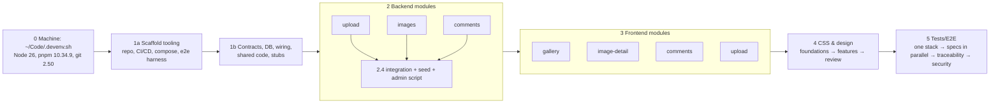

# Imageboard: Build Order

Status: proposed (revised after the architecture critique, round 1, and the consistency-pass review, ADR 0020/0021) ·
Date: 15 Nov 2026

The ordered build phases for this repository, matching `~/Code/PLAN.md` Etappe 2:
**Scaffold (incl. CI/CD) → Backend modules (parallel) → Frontend modules (parallel) → CSS & design → Tests/E2E**.
The scaffold is split into two gated steps (1a tooling, 1b contracts) because one PR with half the app in it cannot
be reviewed properly by a single `/code-review` pass. Every phase ends with the **quality gate** (`quality-gate`
skill): `pnpm verify` → `/code-review high` with real fixes → `/simplify` → `pnpm verify` → Conventional Commit on
the phase branch → push → PR → `gh pr checks --watch` → squash-merge on green (max. 3 fix attempts on red, then stop
and report).

Ground rules for every phase:

- **Every shell command of every agent starts with `source /Users/marina/Code/.devenv.sh && `** (Phase 0). The cwd
  is reset between calls, so use absolute paths.
- `project-scaffold/references/conventions.md` is binding for everything shared by the three projects (Phase 0
  tool versions, which `.devenv.sh` provides, repo bootstrap, branch per phase, parallel model, script names, e2e and integration-test isolation, cookie
  names, digest pins, CI/audit/release workflows). This file only adds imageboard specifics.
- Read `OVERVIEW.md`, `DATA-MODEL.md`, `API.md` and the ADRs before writing code. They are binding; a needed change
  is made in the docs first (and flagged), never silently in code.
- All code, comments and docs in English. Legacy code is reference only; nothing is copied; no value from
  `~/Code/_legacy` (secrets!) ever enters the repo.
- One branch per phase (`feat/scaffold-tooling`, `feat/scaffold-contracts`, `feat/backend-modules`,
  `feat/frontend-modules`, `feat/css-design`, `test/e2e`). Parallel agents of a phase work in the same working tree
  on **disjoint files** and do not commit; the gate commits once per phase.
- A parallel agent may only create or edit the files listed for its module. If it needs a change to a shared file,
  a new dependency or a migration, it stops and reports; the orchestrator applies it between waves (ADR 0017).
  "Frozen" (phase-1 files) applies to parallel agents. The sequential steps 2.4, 4.1, 4.3, 5.2 and 5.3 are
  orchestrator-run steps between waves and may edit exactly the frozen files listed for them here (ADR 0021 §2).
- **The shared tree stays importable** (ADR 0021 §2). The API integration app imports every module's `index.ts`, and
  web components render other features' components. So an agent writes its internal files first and switches its
  stubbed `index.ts` to the real implementation **last**: after its internal files are complete and its unit tests
  pass. Its integration tests then run through the swapped `index.ts`, which must never throw at import or at
  `create*Module()` time. Every saved file must parse. Tests that render another feature's public component stub it. A failure caused by a sibling's file is
  reported, never fixed.
- Exported signatures of the scaffold stubs are frozen during phases 2 and 3 (exact types in ADR 0017).
- Tests are part of each module, not deferred: phase 5 adds the cross-cutting E2E journeys and closes gaps.
- **Parallel agents run only their own checks**, never the full suite, because siblings' half-written files would
  make it red:
  - API agents: `pnpm exec vitest run --project unit:api --project integration:api apps/api/src/features/<module>`
    and `pnpm exec eslint apps/api/src/features/<module>`.
  - Web agents: `pnpm exec vitest run --project unit:web apps/web/src/features/<module>` and
    `pnpm exec eslint apps/web/src/features/<module>`; CSS agents additionally
    `pnpm exec stylelint "apps/web/src/features/<module>/**/*.css"` and
    `node scripts/check-no-utilities.mjs apps/web` (whole app, because the checker needs all CSS; fix only findings in
    their own files).
  - Typecheck runs for the whole package (`pnpm --filter <pkg> typecheck`); an agent fixes only errors in its own
    files and reports others.
  - Only the orchestrator runs `pnpm verify`, after all agents of a wave have finished.

---

## Phase 0: Machine prerequisites (done: `/Users/marina/Code/.devenv.sh`)

Phase 0 is **already satisfied** by `/Users/marina/Code/.devenv.sh` (PLAN.md Etappe 0; ADR 0021 §1). The script
changes nothing on the system, only the current shell:

- `PATH` starts with `~/.local/node/current/bin`: Node **26.13.1** (checksum-verified install), plus the corepack
  shims `pnpm`/`pnpx`. Corepack runs exactly `package.json#packageManager` (`pnpm@10.34.9`), and
  `COREPACK_ENABLE_DOWNLOAD_PROMPT=0` keeps it non-interactive.
- `/usr/bin` comes next, so Apple Git **2.50** wins over the old `/usr/local/bin/git` 2.23 (lefthook 2 needs ≥ 2.31).
- Docker Desktop is running (Compose 5.6.1, enough for `!reset`/`!override`, which need ≥ 2.24.4), gitleaks 8.30.1,
  and `gh` is logged in as Arnoldovna.

Rules:

- Start every agent shell command with `source /Users/marina/Code/.devenv.sh && `.
- Do **not** install fnm, Homebrew git or a global pnpm (`npm i -g`), and do not edit `~/.zshrc` or other rc files.
  Conventions §1 still describes fnm; PLAN.md wins on conflict (flagged for Marina).
- Check once per session: `source /Users/marina/Code/.devenv.sh && node -v && pnpm -v && git --version` prints
  `v26.x`, `10.34.9` and `git version 2.50.x`. If it does not, stop and report; never repair the machine.
- `.npmrc` `engine-strict=true` (phase 1a) turns a shell without the script into an install error instead of a
  warning.
- Playwright browsers are not part of Phase 0. They need the lockfile's Playwright version, so 1a.2 installs them.

---

## Phase 1a: Scaffold tooling (incl. CI/CD)

Sequential, orchestrator plus one agent. Skills: `project-scaffold`.

### 1a.1 Repository

1. `~/Code/imageboard` already exists with `docs/`. Do **not** clone into it. Instead:
   `cd ~/Code/imageboard && git init -b main && git add docs && git commit -m "docs: architecture and requirements"`,
   then `gh repo create Arnoldovna/imageboard --private --source=. --remote=origin --push`.
   The first commit on `main` is **docs only**: no workflows exist yet, so nothing runs on a tree without a lockfile
   or scripts, and nothing bypasses the gate.
2. `git switch -c feat/scaffold-tooling`.

### 1a.2 Template and tooling (files)

1. `cp -R project-scaffold/templates/monorepo/. imageboard/`; replace `<slug>` with `imageboard`. After the first
   `pnpm install`, run `pnpm format` once. The template's `.prettierignore` does not exclude `docs/`, and the
   hand-written Markdown fails `format:check` (checked 16 Nov 2026: 21 files). Prettier only aligns tables, adds blank
   lines and turns `*x*` into `_x_`; the wording does not change. Later doc edits are formatted by lint-staged on
   commit. Do not add `docs/` to `.prettierignore` (ADR 0021 §9).
2. Apply the tooling rows of OVERVIEW §16: `.npmrc` (`engine-strict=true`, from the template), `.nvmrc` 26, remove auth/argon2/
   `SEED_DEMO_PASSWORD`/`cors`, health paths, nginx template (`apps/web/templates/default.conf.template` with
   `API_MAX_BODY_SIZE`, `CSP_IMG_SRC_EXTRA`, forwarded-proto map, `/api/health` deny, gzip for assets), compose
   healthcheck via `node -e fetch(...)` against the api container, `docker-compose.e2e.yml`, `scripts/run-e2e.mjs`
   (+ root scripts `test:e2e`, `e2e:up`, `e2e:down`; infra `ports: !reset []`, `volumes: !reset []` + `tmpfs`, web
   `ports: !override ['127.0.0.1:${E2E_PORT:-8181}:8080']`, `E2E_PORT` resolved once from env, `.env` or 8181, ADR 0015),
   `scripts/setup-env.mjs` (`setup:env`; merge, never overwrite),
   `scripts/dev-setup.mjs` (`dev:setup`), root script `demo`, `playwright.config.ts` (no `webServer`, `baseURL` from
   the required `E2E_BASE_URL`, `retries: 0`, projects desktop/mobile/WebKit smoke), every image pinned by digest
   (compose, Dockerfiles, `apps/api/test/images.ts`), `eslint.shared.js` + `import-x/no-cycle`,
   `ci.yml` (jobs per OVERVIEW §16 incl. schema drift and `dev-setup-smoke`; `e2e` with
   `if: github.event_name == 'pull_request'` and without the template's "Stack logs"/"Tear down" steps; the
   `db:seed:check` step is added in 2.4, when the seed exists), `audit.yml`, `release.yml` (`workflow_run` after green
   CI; `images` only when `github.event.repository.private == false`; `deploy` also `vars.DEPLOY_ENABLED`;
   `RELEASE_SHA` from `workflow_run.head_sha`; ADR 0020), Dependabot (+ `docker-compose`). `apps/api` scripts:
   `db:generate` = `pnpm --filter @app/shared build && drizzle-kit generate`, `db:migrate`, `db:seed` =
   `SEED_ALLOW=true tsx --conditions=development --env-file-if-exists=../../.env src/scripts/seed-cli.ts`.
3. `scripts/check-no-utilities.mjs`, `stylelint.config.mjs` from `modular-css-tailwind4`; `tokens.css` from
   `maw-design-system` verbatim except `--color-accent: var(--color-sky)` (the template already has
   `--container-gallery-4: 72rem`, ADR 0012).
4. `LICENSE` (MIT, `Copyright (c) 2026 Arnoldovna`), `LICENSES/OFL-SchibstedGrotesk.txt`, README stub.
   After the first `pnpm install` the orchestrator installs Playwright's browsers once on this machine:
   `pnpm exec playwright install chromium webkit` (macOS needs no `--with-deps`). Without them `pnpm verify` cannot
   run the desktop, mobile and WebKit smoke projects.
5. Minimal apps so every tool has something to run: API with `server.ts`, `config/env.ts` (+ test), health routes and
   the template's app skeleton; web with `index.html`, `main.ts`, an `App.vue` showing the wordmark; `packages/shared`
   with `index.ts` and one schema test; no schema yet (`apps/api/drizzle/meta/_journal.json` with empty `entries`,
   conventions §3; 1b generates `0000_init.sql`); `apps/api/src/scripts/seed-cli.ts` as a stub (`SEED_ALLOW` guard
   that never reads `NODE_ENV`, "nothing to seed yet", exit 0; `db:seed` sets `SEED_ALLOW=true` from 1a, 2.4 fills
   the CLI); `apps/api/test/{global-setup,images,test-app}.ts` (template harness with digest-pinned images, auth
   removed; 1b replaces it with the template-DB harness); `apps/api/test/health.int.test.ts` (readiness against Testcontainers; Vitest
   exits 1 when a selected project has no test files, so `test:integration` needs one from 1a on; extended in 1b);
   `e2e/smoke.spec.ts` (page loads, CSP header present, `/api/health` → 404 from outside, no console CSP errors).

### 1a.3 Done when

`pnpm install` refuses Node < 26; `pnpm verify` green locally (e2e via the isolated project on 8181, also while
`pnpm demo` serves 8080) and in CI. On the PR, the `e2e` job runs and builds both production images. After the merge,
the push run on `main` skips `e2e`, and the `release.yml` run it triggers shows `images` and `deploy` as **skipped**
because the repository is private (ADR 0020). Images are not expected in GHCR. actionlint reports nothing on
`.github/workflows/*` (run as `docker run --rm -v "$PWD":/repo -w /repo rhysd/actionlint`; the image is already
pulled on this Mac, no install). `pnpm dev:setup` run twice leaves `.env` secrets unchanged. `pnpm install && pnpm demo` on a clean clone
ends with the app shell at `http://127.0.0.1:8080` (seed content arrives in 2.4). The orchestrator runs it in a
temporary clone after `pnpm stack:down && pnpm infra:down` in the working tree, with
`COMPOSE_PROJECT_NAME=imageboard-clean`. The fresh `.env` there has other secrets and must not meet the dev volumes,
and the env var overrides the compose file's `name:`. Afterwards it runs
`docker compose -p imageboard-clean --profile app down -v`.
`git ls-files | grep -E '\.env$|\.pem$|secrets'` is empty; `gitleaks git` clean. Gate on `feat/scaffold-tooling`.

---

## Phase 1b: Scaffold contracts, shared code and stubs

Sequential, one agent at a time (backend-builder for `apps/api` + `packages/shared`, then frontend-builder for
`apps/web`, then the orchestrator for `e2e/`). Skills: `express-feature-module`, `modular-css-tailwind4`,
`maw-design-system`.

### 1b.1 Backend source

Backend source from `express-feature-module/templates` (`src/`, `test/`, `drizzle.config.ts`,
`vitest.integration.config.ts`), then apply the remaining project changes in OVERVIEW §16 (session → anonymous
owner with provisional lifetime and identity limiter, `GET /api/session`, `field` in validation issues, sharp,
static fontsource, vuejs-accessibility, extended `ObjectStorage`, shared multipart parser, template-DB test harness,
boundaries elements `app`/`scripts`).

### 1b.2 Shared files created here (frozen contracts for later phases)

These are the files that more than one later module depends on. They are created **complete** (or as stubs with
final signatures where marked) before any parallel work starts. Exact types: ADR 0017.

| Area               | Files                                                                                                                                                                                                                                                                                                                                | Notes                                                                                                                                                            |
| ------------------ | ------------------------------------------------------------------------------------------------------------------------------------------------------------------------------------------------------------------------------------------------------------------------------------------------------------------------------------ | ---------------------------------------------------------------------------------------------------------------------------------------------------------------- |
| Contract           | `packages/shared/src/{index,limits,text,ids,pagination,images,comments,session,problem,health,messages}.ts`, `testing/text-vectors.ts` + `__tests__/*.test.ts`                                                                                                                                                                       | complete, unit-tested (F-D3 Zod side, F-18/F-29 rules, F-44); tolerant response DTOs                                                                             |
| DB                 | `apps/api/src/db/{client,migrate}.ts`, `db/schema/{index,images,comments,text-checks}.ts`, `apps/api/drizzle/0000_init.sql` + `meta/*`                                                                                                                                                                                               | complete (DATA-MODEL.md); review the generated CHECKs                                                                                                            |
| Composition root   | `apps/api/src/{server,container,app}.ts`, `config/{app,env}.ts`                                                                                                                                                                                                                                                                      | final wiring of session, images, comments, upload, all limiters, `overrides.uploadPort` seam                                                                     |
| API shared         | `shared/errors/*`, `shared/http/{problem,validate,require-json,multipart,health}.ts`, `shared/logging/logger.ts`, `shared/redis/redis.ts`, `shared/security/{session,csrf,fetch-metadata,security}.ts`, `shared/session/actor.ts`, `shared/pagination/cursor.ts`, `shared/storage/object-storage.ts`, `shared/ports/image-upload.ts` | complete with unit tests                                                                                                                                         |
| API module stubs   | `features/upload/index.ts`, `features/images/index.ts`, `features/comments/index.ts`                                                                                                                                                                                                                                                 | **stubs**, final signatures (ADR 0017)                                                                                                                           |
| API session module | `features/session/**`                                                                                                                                                                                                                                                                                                                | complete (needed by every integration test)                                                                                                                      |
| API test harness   | `apps/api/vitest.integration.config.ts` (`setupFiles`), `test/{global-setup,setup-database,test-db,test-app,images,fakes,http,fixtures}.ts`, `test/{migrations,db-constraints,health,security-headers}.int.test.ts`                                                                                                                  | complete; conventions §7: template `imageboard_template`, one `t_<random>` clone per file, no `TRUNCATE`, Redis prefix `test-<uuid>` per app (ADR 0015, 0021 §3) |
| Web shell          | `apps/web/index.html`, `src/main.ts`, `src/env.d.ts`, `src/app/**` (App, router, HomePage, NotFoundPage, SiteHeader, SiteFooter, `profile-links.ts` + CSS + router test)                                                                                                                                                             | complete; HomePage already wires feature events; the HomePage layout puts the upload panel as a one-row sticky bar (ADR 0012)                                    |
| Web shared         | `src/shared/**` (http client, api-error, session store, announcer with region stack + LiveAnnouncer, focus return, document title, date/bytes format, `ui/*` components incl. `ModalDialog` with its own live region + CSS + tests)                                                                                                  | complete                                                                                                                                                         |
| Web feature stubs  | `features/{gallery,image-detail,comments,upload}/index.ts` + placeholder components; `features/gallery/gallery.store.ts` with final public API                                                                                                                                                                                       | **stubs**                                                                                                                                                        |
| Styles             | `src/styles/{main,tokens,base,utilities}.css`                                                                                                                                                                                                                                                                                        | complete (base incl. focus-visible, `:root:has(dialog[open])` scroll lock)                                                                                       |
| E2E harness        | `e2e/a11y.ts`, `e2e/support/{api,files}.ts`, `e2e/fixtures/*`                                                                                                                                                                                                                                                                        | complete; `support/api.ts` takes `page.request`                                                                                                                  |

### 1b.3 Covers

F-D1, F-D3, F-34, F-39, F-41, F-42, F-44, F-45, F-46, F-47, F-49, F-53, F-58, F-59, F-61 (enforcement), F-64
(setup) · B-01, B-03, B-10, B-13 to B-18, B-27, B-29 to B-33, B-37 to B-40, B-42, B-43, B-50, B-51, B-59, B-61,
B-62, B-64, B-71, B-73, B-77 to B-84 (enforcement), B-86, B-87.

### 1b.4 Done when

`pnpm verify` green locally and in CI; `pnpm db:generate` on the committed schema produces no diff (verifies the
`@app/shared` build-first rule, ADR 0021 §6); `pnpm stack:up` serves the shell at `http://127.0.0.1:8080` and
`docker compose ps` reports `api` healthy; integration files demonstrably run in parallel (Vitest output) without
shared rows; the PR description lists the open question "LinkedIn URL (Marina to confirm)". Gate on
`feat/scaffold-contracts`.

---

## Phase 2: Backend modules (parallel)

Three agents (backend-builder ×3) in parallel, then one short sequential integration step. Skill:
`express-feature-module`. Each module ships unit + integration tests and runs only its own (ground rules). Every
integration test builds the full app, which imports all three `index.ts` files. So each agent keeps its stub
`index.ts` until its internal files are complete and its unit tests pass, then swaps it and runs its integration
tests (ADR 0021 §2). Until agent A swaps, `createTestApp()`
wires the upload stub (the media router is always the upload module's own, ADR 0017). Agent B's route tests pass
their own fake upload port.

### 2.1 Module `upload` (agent A)

| Files (create/edit only these)                                                                                                          |
| --------------------------------------------------------------------------------------------------------------------------------------- |
| `apps/api/src/features/upload/index.ts` (replace stub body; keep signature)                                                             |
| `apps/api/src/features/upload/{upload.config,image-sniffer,image-processor,object-key,upload.service,media.controller,media.routes}.ts` |
| `apps/api/src/features/upload/__tests__/{image-sniffer,image-processor,object-key,upload.service}.test.ts`                              |
| `apps/api/src/features/upload/__tests__/{media.routes,s3-storage}.int.test.ts`                                                          |

Responsibilities: magic-byte allow-list (APNG → PNG); header inspection (pixels per frame, frame cap); sharp
pipeline (rotate, resize inside `IMAGE_MAX_EDGE`, same-format re-encode, metadata stripped); WebP preview (ADR
0018); key generation (original + preview); `ingest` (incl. fixed `objectKey` option for the seed), `discard` (both
keys, 3 attempts + error log), `publicUrl`, `previewUrl`; media routes for originals and previews with key
validation, headers, HEAD, 304, 404; S3 adapter test against MinIO (put/get/304/`NoSuchKey`/delete). Multipart
parsing is **not** this agent's: it is the scaffold's `shared/http/multipart.ts`.

Covers: F-19, F-20 (server), F-21, F-22, F-23 (storage side), F-36 (media 404), F-48 · B-04, B-05, B-06, B-07
(discard), B-08, B-19, B-20, B-34, B-35, B-36.

### 2.2 Module `images` (agent B)

| Files (create/edit only these)                                                                                                     |
| ---------------------------------------------------------------------------------------------------------------------------------- |
| `apps/api/src/features/images/index.ts` (replace stub body; keep signature)                                                        |
| `apps/api/src/features/images/{images.schema,images.repository,images.service,images.controller,images.routes}.ts`                 |
| `apps/api/src/features/images/__tests__/{fakes.ts,images.service.test.ts,images.repository.int.test.ts,images.routes.int.test.ts}` |

Responsibilities: list (keyset, clamp, `nextCursor`), get, create (route order per ADR 0017: `requireOwnerSession` →
upload limiters → injected `parseMultipart` → fields + file presence validation → injected `ImageUploadPort.ingest`
→ insert → compensation → `markSessionActive`), delete (`deleteOwned` + 403/404 + post-commit discard),
`exists`, `adminRemove`, DTO mapping with `canDelete`, `url` and `previewUrl`. Integration tests use
`createTestApp({ upload: fakeUploadPort })`; the router still runs the real multipart parser.

Covers: F-01, F-02, F-04, F-05, F-13, F-18, F-23 (DB side), F-25, F-35, F-36, F-43, F-44, F-D2 · B-02, B-13,
B-21, B-22, B-23, B-24, B-25, B-28, B-46 (server), B-63.

### 2.3 Module `comments` (agent C)

| Files (create/edit only these)                                                                                                             |
| ------------------------------------------------------------------------------------------------------------------------------------------ |
| `apps/api/src/features/comments/index.ts` (replace stub body; keep signature)                                                              |
| `apps/api/src/features/comments/{comments.schema,comments.repository,comments.service,comments.controller,comments.routes}.ts`             |
| `apps/api/src/features/comments/__tests__/{fakes.ts,comments.service.test.ts,comments.repository.int.test.ts,comments.routes.int.test.ts}` |

Responsibilities: list per image (keyset newest first, 404 for unknown image via injected `imageExists` when the
first page is empty), create (`requireJson`, Zod, FK `23503` → 404, `markSessionActive`, `201` **without**
`Location`), delete (owner only), DTO with `canDelete`. Index assertion: run the list query's `EXPLAIN (FORMAT JSON)`
inside a transaction with `SET LOCAL enable_seqscan = off` and `SET LOCAL enable_bitmapscan = off`; assert an Index
Scan on `comments_image_id_created_at_id_idx` and no Sort node. (Without the `SET LOCAL`s the planner picks
Seq Scan + Sort on a small table and the assertion is flaky; do not weaken it instead.)

Covers: F-26 (API), F-27, F-29, F-31, F-32 · B-26, B-40, B-41, B-45.

### 2.4 Backend integration (sequential, after 2.1–2.3)

One agent, run by the orchestrator after the wave (a between-waves step, so the frozen files below are its own).
Files: `apps/api/test/flows/{upload-flow,delete-flow}.int.test.ts`, `apps/api/test/rate-limits.int.test.ts`,
`apps/api/test/seed.int.test.ts` (idempotency plus `seedMode`: a write run without `SEED_ALLOW` refuses, `--check`
needs none), `apps/api/test/admin-remove-image.int.test.ts`,
`apps/api/src/scripts/{seed,seed-cli,seed-content,fetch-seed-images,admin-remove-image}.ts` (`seed-cli.ts` replaces
the 1a stub), `apps/api/seed/images/*` (+ `manifest.json`, `CREDITS.md`), `apps/api/package.json`: `db:seed` already
exists from 1a (`SEED_ALLOW=true …`). Add `db:seed:check`, `seed:fetch-images` and `admin:remove-image`, all as
`tsx --conditions=development --env-file-if-exists=../../.env src/scripts/<file>.ts` (ADR 0014).

Also `.github/workflows/ci.yml`: add the step `pnpm --filter @app/api db:seed:check` to `dev-setup-smoke`, after the
second `pnpm dev:setup`.

Covers: F-18 to F-23 end to end, F-36, F-40, F-63 · B-07, B-09, B-11, B-22, B-25, B-44.

Gate: quality gate on `feat/backend-modules`.

---

## Phase 3: Frontend modules (parallel)

Four agents (frontend-builder ×4) in parallel. Skills: `vue-best-practices` plugin, `modular-css-tailwind4`,
`maw-design-system`. Each component gets its `.css` file with **structural** rules that pass stylelint and the
utility checker (every BEM class used in markup is defined); visual polish is phase 4. Components use
`shared/ui/*` primitives. Unit tests per module; each agent runs only its own (ground rules).

### 3.1 Module `gallery` (agent D)

| Files (create/edit only these)                                                                  |
| ----------------------------------------------------------------------------------------------- |
| `apps/web/src/features/gallery/index.ts` (keep exports)                                         |
| `apps/web/src/features/gallery/{gallery.api,gallery.store}.ts`                                  |
| `apps/web/src/features/gallery/components/{GallerySection,ImageTile,GallerySkeleton}.{vue,css}` |
| `apps/web/src/features/gallery/__tests__/{gallery.store,GallerySection}.test.ts`                |

Responsibilities: first page load with `aria-busy` skeleton; grid of tiles (one `<a>` per tile with
`aria-labelledby` → the visible title element, preview `` from `previewUrl`, `width`/`height`,
`loading="lazy"` except the first 4, `decoding="async"`); "load more" only with `nextCursor`, disabled "Loading…"
while in flight, announcement; empty state with "upload an image" button (emits `request-upload`); inline error
with "try again" keeping loaded items; `focusTile(id)` exposed; `h2` "Gallery" with `tabindex="-1"`.

Covers: F-01, F-03 to F-10 (UI), F-55 (tiles) · B-46, B-47, B-57, B-65, B-68.

### 3.2 Module `image-detail` (agent E)

| Files (create/edit only these)                                                                                   |
| ---------------------------------------------------------------------------------------------------------------- |
| `apps/web/src/features/image-detail/index.ts` (keep exports)                                                     |
| `apps/web/src/features/image-detail/{image-detail.api,use-image-detail}.ts`                                      |
| `apps/web/src/features/image-detail/components/{ImageDetailDialog,ImageDetailBody,DeleteImageControl}.{vue,css}` |
| `apps/web/src/features/image-detail/__tests__/{use-image-detail,ImageDetailDialog}.test.ts`                      |

Responsibilities: route component in `ModalDialog`; states loading/ready/notFound/error; abort on id change; large
image (`url`, `alt` = title), `h2` title, description (preserving line breaks via CSS `white-space: pre-line`, never
`v-html`), author, `<time>`; document title; close/Esc/Back behaviour (ADR 0011); owner-only "delete image" with
`ConfirmDialog` (focus on "cancel"), emits `deleted(id)`, announcements through the announcer store (which routes
them into the open dialog's live region); embeds `CommentsSection` from `features/comments/index.ts`.
`ImageDetailDialog.test.ts` stubs `CommentsSection` (`global: { stubs: { CommentsSection: true } }`), so agent F's
work in progress never breaks agent E's tests (ADR 0021 §2).

Covers: F-11 to F-16, F-35 (UI), F-37, F-53 (detail title), F-54 (dialog heading), F-55 (dialog image) · B-48,
B-49, B-56, B-60, B-69.

### 3.3 Module `comments` (agent F)

| Files (create/edit only these)                                                                  |
| ----------------------------------------------------------------------------------------------- |
| `apps/web/src/features/comments/index.ts` (keep exports)                                        |
| `apps/web/src/features/comments/{comments.api,use-comments}.ts`                                 |
| `apps/web/src/features/comments/components/{CommentsSection,CommentItem,CommentForm}.{vue,css}` |
| `apps/web/src/features/comments/__tests__/{use-comments,CommentForm,CommentsSection}.test.ts`   |

Responsibilities: `h3` "Comments"; list as `<ol>` of `<article>`; empty text "No comments yet. Start the
conversation."; "show older comments" only with `nextCursor`; form Name ("Name (shown publicly)") then Comment,
labels, `maxlength`, inline errors, disabled while sending, reset on success / keep on error, new comment on top;
owner-only "delete comment" per comment with `aria-describedby` → author and time; announcements.

Covers: F-26, F-28, F-30, F-31 (UI), F-32 (UI), F-33, F-38 · B-52, B-55, B-66, B-70, B-74.

### 3.4 Module `upload` (agent G)

| Files (create/edit only these)                                                                  |
| ----------------------------------------------------------------------------------------------- |
| `apps/web/src/features/upload/index.ts` (keep exports)                                          |
| `apps/web/src/features/upload/{upload.api,use-upload-form,client-file-check}.ts`                |
| `apps/web/src/features/upload/components/{UploadPanel,UploadForm,FilePicker}.{vue,css}`         |
| `apps/web/src/features/upload/__tests__/{use-upload-form,client-file-check,UploadForm}.test.ts` |

Responsibilities: one-row sticky bar with `<h2><button aria-expanded aria-controls>Upload an image</button></h2>`
on every width, form in normal flow below it (ADR 0012), `open()` exposed (expands and focuses Name); real
`<form>` with Name (shown publicly), Title, Description (optional), Image; client type/size check with shared
messages and `uploadMaxBytes`; keyboard-operable file picker (`accept="image/jpeg,image/png,image/webp,image/gif"`)
with filename and preview (object URL revoked); "Uploading…" disabled submit; reset all fields including the file
input on success; keep values on error; focus first invalid field; emits `uploaded(image)`; announcement "Image
uploaded.".

Covers: F-17, F-20 (client), F-24, F-38, F-56 (upload), F-57 (disclosure) · B-12, B-54, B-66, B-67, B-74.

Gate: quality gate on `feat/frontend-modules`.

---

## Phase 4: CSS & design

Agents: css-architect, then design-critic. Skills: `maw-design-system` (priority), `modular-css-tailwind4`,
`design-taste-frontend` (review lens only, per PLAN).

| Step                | Mode                                                      | Files                                                                                                                                                                                                                                                                                                                                                                                                                                                                                                                                                                                                        |
| ------------------- | --------------------------------------------------------- | ------------------------------------------------------------------------------------------------------------------------------------------------------------------------------------------------------------------------------------------------------------------------------------------------------------------------------------------------------------------------------------------------------------------------------------------------------------------------------------------------------------------------------------------------------------------------------------------------------------ |
| 4.1 Foundations     | sequential                                                | `src/styles/{tokens,base,utilities,main}.css`, `src/shared/ui/*.css`, `src/shared/a11y/LiveAnnouncer.css`, `src/app/**/*.css`                                                                                                                                                                                                                                                                                                                                                                                                                                                                                |
| 4.2 Feature styling | parallel, one agent per feature folder, `.css` files only | `features/gallery/components/*.css` · `features/image-detail/components/*.css` · `features/comments/components/*.css` · `features/upload/components/*.css`                                                                                                                                                                                                                                                                                                                                                                                                                                                   |
| 4.3 Design review   | sequential                                                | against the **seeded demo stack** on `http://127.0.0.1:8080`. The **orchestrator** runs `pnpm demo` (= `dev:setup` + `stack:up`) before the review, `pnpm stack:up` again after CSS fixes (rebuilds the web image) and `pnpm stack:down` afterwards. The design-critic only drives a browser against the URL and never runs stack, compose or e2e commands. e2e never writes into this stack. Screenshots 390×844, 768×1024, 1440×900, dark 1440, row hover, focus state, upload bar collapsed and expanded; `references/review-rubric.md` ≥ 24/30, anti-AI gate clean; fixes go back to the owning CSS file |

Markup changes in 4.2 are limited to adding/removing BEM classes in the matching `.vue` file of the same folder.

Covers: F-09 (layout stability), F-10, F-51, F-52, F-57 (sticky), F-60, F-61 · B-58, B-71, B-72, B-75, B-76,
B-77 to B-84.

Gate: quality gate on `feat/css-design` (includes the design-review score in the PR description).

---

## Phase 5: Tests / E2E

Agents: test-writer ×N in parallel (one per spec file), then security-auditor and a traceability pass.

Before wave 5.1 the orchestrator starts **one** e2e stack: `pnpm e2e:up` (project `imageboard-e2e`, `E2E_PORT` 8181,
built once; prints `E2E_BASE_URL`). Test-writers run only
`E2E_BASE_URL=<printed URL, default http://127.0.0.1:8181> pnpm exec playwright test e2e/<their spec> --output=test-results/<spec> --reporter=list --workers=2`
against it (own output folder, conventions §4; two workers each, because seven units share one machine, ADR 0021
§8). None of them runs `pnpm test:e2e`, `pnpm e2e:*` or any `docker compose` command, so no builds or container
recreations race. A spec that exposes an application bug is reported, not worked around. The orchestrator applies
the fix in the owning file between waves and rebuilds with `pnpm e2e:down && pnpm e2e:up`. After the wave the
orchestrator runs `pnpm e2e:down` and then the full `pnpm verify` once.

| Step | Mode       | Files                                                                                                                                                      | Covers                                                            |
| ---- | ---------- | ---------------------------------------------------------------------------------------------------------------------------------------------------------- | ----------------------------------------------------------------- |
| 5.1  | parallel   | `e2e/gallery.spec.ts`                                                                                                                                      | F-01, F-03 to F-10                                                |
| 5.1  | parallel   | `e2e/detail.spec.ts`                                                                                                                                       | F-11 to F-16, F-53, F-54, F-55                                    |
| 5.1  | parallel   | `e2e/upload.spec.ts`                                                                                                                                       | F-17, F-20, F-24, F-25, F-38                                      |
| 5.1  | parallel   | `e2e/comments.spec.ts`                                                                                                                                     | F-26 to F-33                                                      |
| 5.1  | parallel   | `e2e/delete.spec.ts`                                                                                                                                       | F-35 to F-37                                                      |
| 5.1  | parallel   | `e2e/a11y.spec.ts`                                                                                                                                         | F-50, F-51, F-52, F-56 (incl. live region inside the open dialog) |
| 5.1  | parallel   | `e2e/layout.spec.ts`                                                                                                                                       | F-09, F-10, F-57 to F-60                                          |
| 5.2  | sequential | gaps found by the traceability check: any `F-xx` or `B-xx` without a passing test or a documented static proof gets one (in the owning module's test file) | all                                                               |
| 5.3  | sequential | `/security-review`, gitleaks, `pnpm audit --prod --audit-level=high` (by hand; not a PR check); fixes in the owning files                                  | B-01 to B-13 re-check                                             |

Data rules for every spec: create own data through `e2e/support/api.ts` with `page.request` (owned by the page's
session) or a separate request context ("foreign"); unique titles; never count- or seed-based (ADR 0015). Other
workers upload at the same time, so a spec finds its tiles with `revealTiles` (`e2e/support/screens.ts`), never by
assuming they are on the first gallery page.

Traceability check: a small script (`scripts/check-traceability.mjs`, created in 5.2) greps test titles for every
`F-xx` and `B-xx` id from `docs/FEATURES.md` and `docs/BUGS.md` and lists the missing ones; items proven statically
(lint, stylelint, docs) are listed in an allow-file with the proof named (OVERVIEW §15/§17).

Gate: quality gate on `test/e2e`. After merge the Definition of Done in PLAN.md is checked item by item; the README
and screenshots follow in Etappe 3 (Presentation, `portfolio-readme`; setup section uses `pnpm dev:setup`, OVERVIEW
§16; LinkedIn URL confirmed by Marina).

---

## Etappe 3: Presentation

Branch `docs/presentation`. Units in parallel, then one integration step and the quality gate.

| Unit      | Files                                                                                                | Covers                     |
| --------- | ---------------------------------------------------------------------------------------------------- | -------------------------- |
| readme    | `README.md`, `docs/media/{desktop,mobile}-{light,dark}.png`, `desktop-detail-light.png`, upload GIF  | B-85, F-64 (setup in docs) |
| canvas    | `docs/media/social-preview.png` (1280×640), `cover.png`, `design-philosophy.md` (canvas-design, OFL) | PLAN Etappe 3              |
| security  | `/security-review`, gitleaks, `pnpm audit --prod --audit-level=high`; fixes in the owning files      | B-01 to B-13 re-check      |
| integrate | `e2e/readme-media.spec.ts`, `playwright.media.config.ts`, `pnpm media:readme`, traceability evidence | README media reproducible  |

README media is regenerated, never hand-cropped: `pnpm demo`, then `E2E_BASE_URL=<printed URL> pnpm media:readme`
(the clip uploads one image and deletes it again; the GIF command is in the spec's header). The social preview is
uploaded by Marina in the repository settings (no API).

Done when: README follows `portfolio-readme` (hero screenshot, GIF < 3 MB, PNGs < 1 MB, Mermaid diagram, 2018 vs
2026 table, getting started with `pnpm demo` and `pnpm dev:setup`, credits, MIT), no secrets or legal name in it,
`pnpm verify` green. Open for Marina: the LinkedIn URL in `PROFILE_LINKS`, the social preview upload, and the
public switch with CodeQL and branch rulesets.

---

## Summary

