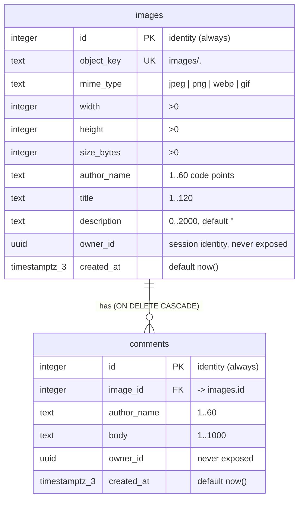

# Imageboard: Data Model

Status: proposed (revised after the architecture critique, round 1; test isolation, seed scripts and `db:generate`
aligned in the consistency-pass review, ADR 0021) · Date: 15 Nov 2026 · Related: ADR [0006](./adr/0006-data-model-and-constraints.md),
[0007](./adr/0007-keyset-pagination.md), [0014](./adr/0014-seed-content.md)

PostgreSQL 18, Drizzle ORM 0.45.4 (`casing: 'snake_case'` in both `drizzle()` and `drizzle.config.ts`), migrations
generated by drizzle-kit 0.31.11 and committed in `apps/api/drizzle/`. Two tables. There is no users table: the
owner is an anonymous session identity (`owner_id uuid`, ADR [0002](./adr/0002-anonymous-session-ownership.md)).



## 1. Conventions

| Rule                                                            | Why                                                                                                                                                      |
| --------------------------------------------------------------- | -------------------------------------------------------------------------------------------------------------------------------------------------------- |
| `integer … generated always as identity` primary keys           | No serial sequences to own; ids are public but not secret (deletion needs the session)                                                                   |
| `text` + `CHECK` instead of `varchar(n)`                        | Lengths live in one place each (Zod and the same numbers in CHECK), no truncation (B-43)                                                                 |
| `timestamptz(3) NOT NULL DEFAULT now()`                         | Unambiguous instants (B-42); **millisecond precision** so a JS `Date` in a keyset cursor round-trips exactly (ADR 0007)                                  |
| Lengths counted in **code points**                              | Postgres `char_length` counts code points; the shared Zod helper counts `[...s].length` (not UTF-16 units) so both agree                                 |
| Values stored with `\n` line breaks, NFC-normalised and trimmed | Done by the Zod transform; CHECK constraints reject leading/trailing whitespace, `\r` and forbidden characters with the **same** explicit classes (§1.1) |
| Explicit `ON DELETE` on every FK                                | `cascade` for owned children (comments) (B-39)                                                                                                           |
| One composite index per keyset ordering                         | Gallery and comment lists never sort in memory (B-40)                                                                                                    |
| Repositories select explicit columns                            | No `SELECT *`; `owner_id` read only for ownership checks (B-28, F-43)                                                                                    |

### 1.1 Text rules (one definition for Zod and SQL)

`packages/shared/src/text.ts` exports three code-point classes as strings of `\uXXXX` escapes, which mean the same
in a JS `RegExp` (with the `u` flag) and in a Postgres ARE (`standard_conforming_strings = on`). The CHECKs below
embed them; nothing locale-dependent (`[[:cntrl:]]`, `[[:space:]]`, `btrim`) is used. Rationale in ADR
[0006](./adr/0006-data-model-and-constraints.md).

| Constant                | Code points                                                                                                                                                                     | Used for                                          |
| ----------------------- | ------------------------------------------------------------------------------------------------------------------------------------------------------------------------------- | ------------------------------------------------- |
| `WHITESPACE`            | `\u0009-\u000D`, `\u0020`, `\u00A0`, `\u1680`, `\u2000-\u200A`, `\u2028`, `\u2029`, `\u202F`, `\u205F`, `\u3000`, `\uFEFF` (exactly the set JS `trim()` removes)                | no leading/trailing whitespace in any text column |
| `FORBIDDEN_SINGLE_LINE` | `\u0001-\u001F`, `\u007F-\u009F`, `\u2028`, `\u2029`, `\u202A-\u202E`, `\u2066-\u2069`                                                                                          | `author_name`, `title`                            |
| `FORBIDDEN_MULTI_LINE`  | `\u0001-\u0009`, `\u000B-\u001F`, `\u007F-\u009F`, `\u2028`, `\u2029` (so `\n` is the only allowed control character; `\r` is forbidden because Zod normalises `\r\n?` to `\n`) | `description`, `body`                             |

Zod order for every text field: (multi-line only) replace `\r\n?` with `\n` → NFC → `trim()` → count code points
(`[...s].length`, equal to Postgres `char_length`) → reject U+0000 and the forbidden class. Limits on blank lines are
a UI concern only. The shared vector file `@app/shared/testing` (ADR 0015) is run by both `text.test.ts` and
`db-constraints.int.test.ts`.

## 2. Drizzle schema

`apps/api/src/db/schema/text-checks.ts`

```ts
import { FORBIDDEN_MULTI_LINE, FORBIDDEN_SINGLE_LINE, WHITESPACE } from '@app/shared';
import { sql, type SQL } from 'drizzle-orm';
import type { AnyPgColumn } from 'drizzle-orm/pg-core';

// The class strings contain only `\uXXXX` escapes and `-` (asserted by a unit test), so embedding them with
// sql.raw is safe; they are compile-time constants, never user input.
const pattern = (body: string): SQL => sql.raw(`'${body}'`);

export const singleLine = (col: AnyPgColumn, min: number, max: number): SQL =>
  sql`char_length(${col}) BETWEEN ${sql.raw(String(min))} AND ${sql.raw(String(max))}
      AND ${col} !~ ${pattern(`^[${WHITESPACE}]|[${WHITESPACE}]$`)}
      AND ${col} !~ ${pattern(`[${FORBIDDEN_SINGLE_LINE}]`)}`;

export const multiLine = (col: AnyPgColumn, min: number, max: number): SQL =>
  sql`char_length(${col}) BETWEEN ${sql.raw(String(min))} AND ${sql.raw(String(max))}
      AND ${col} !~ ${pattern(`^[${WHITESPACE}]|[${WHITESPACE}]$`)}
      AND ${col} !~ ${pattern(`[${FORBIDDEN_MULTI_LINE}]`)}`;
```

`apps/api/src/db/schema/images.ts`

```ts
import { LIMITS } from '@app/shared';
import { sql } from 'drizzle-orm';
import { check, index, integer, pgTable, text, timestamp, uuid } from 'drizzle-orm/pg-core';

import { multiLine, singleLine } from './text-checks.js';

export const IMAGE_MIME_TYPES_SQL = sql`('image/jpeg', 'image/png', 'image/webp', 'image/gif')`;

export const images = pgTable(
  'images',
  {
    id: integer().primaryKey().generatedAlwaysAsIdentity(),
    objectKey: text().notNull().unique('images_object_key_key'),
    mimeType: text().notNull(),
    width: integer().notNull(),
    height: integer().notNull(),
    sizeBytes: integer().notNull(),
    authorName: text().notNull(),
    title: text().notNull(),
    description: text().notNull().default(''),
    ownerId: uuid().notNull(),
    createdAt: timestamp({ withTimezone: true, precision: 3 }).notNull().defaultNow(),
  },
  (t) => [
    // Keyset pagination: ORDER BY created_at DESC, id DESC (F-01, F-04).
    index('images_created_at_id_idx').on(t.createdAt.desc(), t.id.desc()),

    check(
      'images_object_key_format',
      sql`${t.objectKey} ~ '^images/[0-9a-f]{8}-[0-9a-f]{4}-4[0-9a-f]{3}-[89ab][0-9a-f]{3}-[0-9a-f]{12}\\.(jpg|png|webp|gif)$'`,
    ),
    check('images_mime_type_allowed', sql`${t.mimeType} IN ${IMAGE_MIME_TYPES_SQL}`),
    // Extension and MIME type must agree (B-05).
    check(
      'images_object_key_matches_mime',
      sql`substring(${t.objectKey} from '\\.([a-z]+)$') = CASE ${t.mimeType}
            WHEN 'image/jpeg' THEN 'jpg' WHEN 'image/png' THEN 'png'
            WHEN 'image/webp' THEN 'webp' WHEN 'image/gif' THEN 'gif' END`,
    ),
    check('images_dimensions_positive', sql`${t.width} > 0 AND ${t.height} > 0`),
    check('images_size_positive', sql`${t.sizeBytes} > 0`),
    check('images_author_name_valid', singleLine(t.authorName, 1, LIMITS.authorName.max)), // 1..60
    check('images_title_valid', singleLine(t.title, 1, LIMITS.title.max)), // 1..120
    check('images_description_valid', multiLine(t.description, 0, LIMITS.description.max)), // 0..2000
  ],
);

export type ImageRow = typeof images.$inferSelect;
export type NewImageRow = typeof images.$inferInsert;
```

`apps/api/src/db/schema/comments.ts`

```ts
import { LIMITS } from '@app/shared';
import { check, index, integer, pgTable, text, timestamp, uuid } from 'drizzle-orm/pg-core';

import { images } from './images.js';
import { multiLine, singleLine } from './text-checks.js';

export const comments = pgTable(
  'comments',
  {
    id: integer().primaryKey().generatedAlwaysAsIdentity(),
    imageId: integer()
      .notNull()
      .references(() => images.id, { onDelete: 'cascade', onUpdate: 'restrict' }),
    authorName: text().notNull(),
    body: text().notNull(),
    ownerId: uuid().notNull(),
    createdAt: timestamp({ withTimezone: true, precision: 3 }).notNull().defaultNow(),
  },
  (t) => [
    // FK lookup + keyset order in one index (B-40, F-27, F-31).
    index('comments_image_id_created_at_id_idx').on(t.imageId, t.createdAt.desc(), t.id.desc()),
    check('comments_author_name_valid', singleLine(t.authorName, 1, LIMITS.authorName.max)), // 1..60
    check('comments_body_valid', multiLine(t.body, 1, LIMITS.commentBody.max)), // 1..1000
  ],
);

export type CommentRow = typeof comments.$inferSelect;
export type NewCommentRow = typeof comments.$inferInsert;
```

`apps/api/src/db/schema/index.ts` re-exports both tables. The CHECK numbers and character classes are **imported**
from `packages/shared` (`db/**` may import `@app/shared`, OVERVIEW §6), and drizzle-kit renders them as literals into
the migration; changing a limit therefore shows up as schema drift (CI step `db:generate` + `git diff --exit-code`,
OVERVIEW §16) until a new migration is generated. `test/db-constraints.int.test.ts` runs the shared vectors as
direct inserts (one character over each limit fails, at the limit succeeds; CRLF, C0/C1, U+2028, bidi, leading NBSP
fail) so Zod and SQL cannot drift silently (F-D3). Postgres `23514` is additionally mapped to `400` (ADR 0009).

Note on escaping: inside a TS template literal `\\.` becomes `\.` in SQL; with `standard_conforming_strings = on`
Postgres passes `\.` and `\uXXXX` (also inside bracket expressions) to the regex engine unchanged (ARE syntax). The builder **must review the
generated `0000_init.sql`** and verify each CHECK in `db-constraints.int.test.ts`; if drizzle-kit renders a check
differently than intended, fix the schema, not the migration.

### Owner column visibility

`owner_id` has no index: it is only compared after a primary-key lookup (`WHERE id = $1 AND owner_id = $2`).
It is read by repositories for `canDelete` and ownership checks and **never** mapped into a DTO (service unit tests
assert the exact DTO key set).

## 3. Expected migration (`drizzle/0000_init.sql`, abridged)

```sql
CREATE TABLE "images" (
  "id" integer PRIMARY KEY GENERATED ALWAYS AS IDENTITY (sequence name "images_id_seq" …),
  "object_key" text NOT NULL,
  "mime_type" text NOT NULL,
  "width" integer NOT NULL,
  "height" integer NOT NULL,
  "size_bytes" integer NOT NULL,
  "author_name" text NOT NULL,
  "title" text NOT NULL,
  "description" text DEFAULT '' NOT NULL,
  "owner_id" uuid NOT NULL,
  "created_at" timestamp (3) with time zone DEFAULT now() NOT NULL,
  CONSTRAINT "images_object_key_key" UNIQUE("object_key"),
  CONSTRAINT "images_object_key_format" CHECK (…),
  CONSTRAINT "images_mime_type_allowed" CHECK (…),
  CONSTRAINT "images_object_key_matches_mime" CHECK (…),
  CONSTRAINT "images_dimensions_positive" CHECK (…),
  CONSTRAINT "images_size_positive" CHECK (…),
  CONSTRAINT "images_author_name_valid" CHECK (…),
  CONSTRAINT "images_title_valid" CHECK (…),
  CONSTRAINT "images_description_valid" CHECK (…)
);
CREATE TABLE "comments" (
  "id" integer PRIMARY KEY GENERATED ALWAYS AS IDENTITY (…),
  "image_id" integer NOT NULL,
  "author_name" text NOT NULL,
  "body" text NOT NULL,
  "owner_id" uuid NOT NULL,
  "created_at" timestamp (3) with time zone DEFAULT now() NOT NULL,
  CONSTRAINT "comments_author_name_valid" CHECK (…),
  CONSTRAINT "comments_body_valid" CHECK (…)
);
ALTER TABLE "comments" ADD CONSTRAINT "comments_image_id_images_id_fk"
  FOREIGN KEY ("image_id") REFERENCES "public"."images"("id") ON DELETE cascade ON UPDATE restrict;
CREATE INDEX "images_created_at_id_idx" ON "images" USING btree ("created_at" DESC NULLS LAST, "id" DESC NULLS LAST);
CREATE INDEX "comments_image_id_created_at_id_idx" ON "comments" USING btree ("image_id", "created_at" DESC NULLS LAST, "id" DESC NULLS LAST);
```

## 4. Queries the repositories run

| Repository method                                    | SQL shape                                                                                                                                    | Index                                 |
| ---------------------------------------------------- | -------------------------------------------------------------------------------------------------------------------------------------------- | ------------------------------------- |
| `images.list({ limit, after? })`                     | `SELECT <dto cols>, owner_id FROM images WHERE (created_at, id) < ($t::timestamptz, $id) ORDER BY created_at DESC, id DESC LIMIT $limit + 1` | `images_created_at_id_idx`            |
| `images.findById(id)`                                | `SELECT <dto cols>, owner_id FROM images WHERE id = $1`                                                                                      | PK                                    |
| `images.exists(id)`                                  | `SELECT 1 FROM images WHERE id = $1`                                                                                                         | PK                                    |
| `images.insert(row)`                                 | `INSERT … RETURNING <dto cols>, owner_id`                                                                                                    |                                       |
| `images.deleteOwned(id, ownerId)`                    | `DELETE FROM images WHERE id = $1 AND owner_id = $2 RETURNING object_key` (comments cascade in the same statement)                           | PK                                    |
| `comments.listForImage(imageId, { limit, after? })`  | `SELECT … FROM comments WHERE image_id = $1 AND (created_at, id) < (…) ORDER BY created_at DESC, id DESC LIMIT $limit + 1`                   | `comments_image_id_created_at_id_idx` |
| `comments.insert(row)`                               | `INSERT … RETURNING …`; FK violation `23503` → `undefined` → service throws 404                                                              |                                       |
| `comments.findById(id)` / `deleteOwned(id, ownerId)` | as for images                                                                                                                                | PK                                    |

The cursor timestamp is always passed as an ISO string with an explicit `::timestamptz` cast, never as a raw
`Date` parameter (no dependency on driver time-zone conversion).

`deleteOwned` returning zero rows triggers `findById`/`exists` to decide 404 vs 403. Between the two statements the
row could disappear (concurrent delete by the owner); then the answer is 404, which is correct.

## 5. Migration plan

| Step                         | Command                                                                                                                                                                                                                                                                   | Where                                                          |
| ---------------------------- | ------------------------------------------------------------------------------------------------------------------------------------------------------------------------------------------------------------------------------------------------------------------------- | -------------------------------------------------------------- |
| Generate after schema change | `pnpm db:generate` (`pnpm --filter @app/shared build && drizzle-kit generate`, offline; the build is needed because drizzle-kit loads the schema, which imports `@app/shared`, without the `development` condition, ADR 0021 §6)                                          | developer machine; review SQL; commit `drizzle/` with the code |
| Apply locally                | `pnpm db:migrate` (tsx `src/db/migrate.ts`, reads `.env`)                                                                                                                                                                                                                 | dev                                                            |
| Apply in the stack           | compose one-shot service `migrate` (`node dist/db/migrate.js`) before `api` starts                                                                                                                                                                                        | Docker / production                                            |
| Apply in tests               | `test/global-setup.ts` runs `runMigrations(url)` once on the template database `imageboard_template`; the setup file `test/setup-database.ts` gives every test file its own clone (`CREATE DATABASE "t_<random>" TEMPLATE imageboard_template`, conventions §7, ADR 0015) | integration tests                                              |
| Detect drift                 | CI: `pnpm --filter @app/api db:generate` (builds `@app/shared` first) then `git diff --exit-code -- apps/api/drizzle` and no untracked files there                                                                                                                        | lint job                                                       |
| Never                        | `drizzle-kit push`, editing applied migrations, migrating from the web process at boot, `DROP TABLE` scripts                                                                                                                                                              | (B-37)                                                         |

`0000_init.sql` is the only migration for the first release. Later changes add `0001_…`.
F-D1 is proven by `test/migrations.int.test.ts`: it creates its **own empty database** (`createEmptyDatabase()`, not
the template, which is already migrated), migrates it, migrates again, and asserts no error and the same
`drizzle.__drizzle_migrations` row count.

## 6. Seed plan

`pnpm db:seed` → `SEED_ALLOW=true tsx --conditions=development --env-file-if-exists=../../.env src/scripts/seed-cli.ts`
→ `runSeed({ db, upload, logger })` from `src/scripts/seed.ts`,
where `upload` is the real `ImageUploadPort` built by `createUploadModule` on the configured storage (the function is
exported so `test/seed.int.test.ts` can run it twice against its own Testcontainers database and a fake storage).
`pnpm --filter @app/api db:seed:check` (`seed-cli.ts --check`, same `tsx` flags, no `SEED_ALLOW`) only verifies
(16 seed rows, 60 comments, both objects per row reachable through `storage.get`) and exits non-zero otherwise. CI's
`dev-setup-smoke` job uses it. ADR [0014](./adr/0014-seed-content.md).

### 6.1 Rules

- Runs only with an explicit `SEED_ALLOW=true` (set by the `db:seed` script; conventions §8). The check is in the
  entry point: `seed-cli.ts` exports `seedMode(argv, env)` → `'seed' | 'check'`, which throws for a write run without
  `SEED_ALLOW === 'true'`. `main()` runs only under `if (import.meta.main)`. `seed.int.test.ts` asserts the refusal,
  and that `--check` needs no switch. `NODE_ENV` is never consulted. `SEED_ALLOW` is not an `.env` key. The seed never
  deletes or resets anything. It needs no secrets beyond the normal `.env` (no demo password, no accounts).
- **Idempotent**: each seed image has a fixed object key (UUID v4 generated once and committed in
  `manifest.json`). For each entry: if a row with that `object_key` exists, skip it entirely; otherwise process the
  file through the **same pipeline as uploads** (`upload.ingest(file, { objectKey })`, which also stores the preview,
  ADR 0018), insert the row, insert its comments. Running twice yields the same rows and objects.
- Owner of all seed rows: constant `SEED_OWNER_ID = '5eed0000-0000-4000-8000-000000000001'`, which no session can
  ever hold, so visitors cannot delete demo content.
- Fixed `created_at` values (not "now minus x") so README screenshots are reproducible. Dates span
  21 Sep 2026 to 12 Nov 2026, at plausible local times; comments are 10 minutes to 3 days after their image.
- Images live in the bucket; nothing points at third-party URLs at runtime (B-44).

### 6.2 Seed images: source, licence, attribution

- Source: **Lorem Picsum** (`picsum.photos`), which serves photographs from Unsplash. Each photo is under the
  [Unsplash License](https://unsplash.com/license) (free to use, attribution not required). We attribute anyway.
- One-off fetch: `pnpm --filter @app/api seed:fetch-images` runs `src/scripts/fetch-seed-images.ts`, which reads
  the list of chosen Picsum ids from `seed/images/manifest.json`, calls `https://picsum.photos/id/<id>/info`
  (author, Unsplash URL), downloads `download_url`, resizes to ≤ 1600 px long edge (JPEG q80, metadata stripped)
  and writes `seed/images/<slug>.jpg` plus the author/source fields back into the manifest. The output is
  **committed** (about 16 × 250 KB); `db:seed` itself works offline. The script is run once by the phase-2.4 agent;
  if picsum.photos is unreachable from the build environment, the fallback in ADR 0014 applies.
- Selection criteria (maw "real content", anti-AI-look): ordinary, personal-feeling photographs (landscapes,
  streets, weather, animals, objects on a table). No posed business people, no laptops-with-coffee stock look, no
  recognisable faces, no logos or brands, nothing AI-generated. The builder browses
  `https://picsum.photos/v2/list?page=<n>&limit=100`, picks one id per slot in §6.4 that fits the subject, and
  **adjusts the title/description to what is actually in the photo** (the subjects below are briefs, not claims).
- `seed/images/CREDITS.md` (generated from the manifest) lists: file, title, photographer, Unsplash URL, Picsum id,
  licence. The README links it in its credits section.

`manifest.json` entry shape (validated with Zod in the seed script):

```json
{
  "slug": "fog-over-the-pines",
  "picsumId": 0,
  "objectKey": "images/3f6d2c1e-8a4b-4c1d-9e2f-0a1b2c3d4e5f.jpg",
  "author": "filled by fetch script",
  "sourceUrl": "filled by fetch script (unsplash.com/photos/…)",
  "licence": "Unsplash License",
  "fetchedAt": "2026-11-16"
}
```

(`picsumId` and `objectKey` above are placeholders; the builder chooses real ids and generates the UUIDs once.)

### 6.3 Seed authors

Display names are free text in this product, so seeds use the kind of names people actually type: `Marit`,
`Tomás R.`, `wen`, `Jonas from Leipzig`, `Kofi`, `Anouk`, `Pavel`, `Lucía`, `Ines K.`, `Noor`, `Henrik`, `Bea`,
`ole_b`, `Sanne`, `Dariusz`, `Yuki`. No "Jane Doe", no "Acme", no lorem.

### 6.4 Seed content (16 images, 60 comments)

Dates are `created_at` in UTC. "Comments" lists author → body, oldest first (the API shows newest first).

| #   | Slug / subject brief                                                 | Title                                 | Author             | Description                                                                                   | Date (UTC)        | Comments                                                                                                                                                    |
| --- | -------------------------------------------------------------------- | ------------------------------------- | ------------------ | --------------------------------------------------------------------------------------------- | ----------------- | ----------------------------------------------------------------------------------------------------------------------------------------------------------- |
| 1   | `fog-over-the-pines` — mist in a conifer forest                      | Fog over the pines                    | Marit              | Took the early bus out of town just for this. Twenty minutes later the sun burned it all off. | 21 Sep 2026 06:42 | Henrik → "Worth the early bus." · Bea → "This is exactly what I needed on a Monday."                                                                        |
| 2   | `last-tram-gone` — empty street or square at night with lights       | Last tram already gone                | Jonas from Leipzig | Walking home it is, then. The city is very quiet after one.                                   | 24 Sep 2026 23:58 | Noor → "The light on the wet road is lovely." · Pavel → "Been there. Many times." · Jonas from Leipzig → "Forty minutes on foot, for the record."           |
| 3   | `second-coffee` — a cup or mug on a table                            | Second coffee, first idea             | wen                | Desk by the window, no meetings until eleven.                                                 | 27 Sep 2026 09:15 | (none: shows the empty comments state)                                                                                                                      |
| 4   | `dog-refuses-to-pose` — a dog                                        | Bruno refuses to pose                 | Anouk              | This was attempt number nine. He knew exactly what I wanted and did the opposite.             | 30 Sep 2026 17:20 | Lucía → "Attempt nine is the winner though." · Kofi → "Give Bruno a treat from me." · Anouk → "He got two." · Sanne → "That look."                          |
| 5   | `lake-twice` — still mountain lake with reflection                   | The ridge, twice                      | Henrik             | No wind at all for about ten minutes, so the lake did the rest.                               | 3 Oct 2026 07:05  | Marit → "Where is this? I want to go." · Henrik → "Two hours by train, then a long walk uphill."                                                            |
| 6   | `north-sea-october` — sea, beach or coastline                        | North Sea in October                  | Sanne              | Cold enough for a hat, warm enough to sit on the dunes for an hour.                           | 6 Oct 2026 15:31  | **25 comments** (see §6.5; demonstrates "Show older comments")                                                                                              |
| 7   | `long-way-round` — bicycle, road or path                             | Commute, the long way round           | Kofi               | Added four kilometres to the ride home because the evening was too good to waste.             | 9 Oct 2026 18:47  | Dariusz → "Best kind of detour." · Yuki → "Is that the canal path?" · Kofi → "Yes, the stretch after the lock."                                             |
| 8   | `balconies` — building facade, windows, architecture                 | Every balcony different               | Lucía              | Same building, forty balconies, forty ideas about plants.                                     | 12 Oct 2026 11:02 | Ines K. → "Third row, second from the left. That one."                                                                                                      |
| 9   | `before-the-storm` — field, meadow or open landscape under a big sky | Before the storm                      | Dariusz            | It started raining about five minutes after this. I was not dressed for it.                   | 15 Oct 2026 16:10 | ole_b → "The colour of that sky." · Dariusz → "Soaked to the bone, still worth it."                                                                         |
| 10  | `library-card` — books, shelves or a reading place                   | Library card renewed after six years  | Ines K.            | They still had my old address. Starting with something short.                                 | 18 Oct 2026 13:44 | Bea → "What did you pick?" · Ines K. → "A slim book of short stories, due in three weeks." · wen → "Libraries are the best."                                |
| 11  | `bridge-in-the-rain` — bridge, river or rain                         | Bridge in the rain                    | Pavel              | Umbrella in one hand, phone in the other, no regrets.                                         | 22 Oct 2026 08:26 | Anouk → "Moody in the best way."                                                                                                                            |
| 12  | `first-snow` — snow on mountains or trees                            | First snow on the ridge               | Yuki               | Overnight, without any warning. The valley is still green.                                    | 26 Oct 2026 07:58 | Henrik → "Early this year." · Marit → "Skis are coming out of the cellar." · Yuki → "Not yet, give it a month."                                             |
| 13  | `borrowed-view` — flowers or plants                                  | The neighbour's garden, borrowed view | Bea                | I have no garden, but my kitchen window looks onto this.                                      | 30 Oct 2026 10:12 | Lucía → "Best kind of garden: someone else waters it." · Bea → "Exactly my philosophy."                                                                     |
| 14  | `low-tide` — rocks, shore or water texture                           | Rocks at low tide                     | ole_b              | The water came back faster than I expected. Wet shoes all the way home.                       | 3 Nov 2026 14:39  | Sanne → "Classic." · Noor → "Lovely textures."                                                                                                              |
| 15  | `no-other-cars` — road through a landscape                           | The road with no other cars           | Noor               | Saw maybe three cars in an hour. Stopped in the middle of the road for this one.              | 7 Nov 2026 12:05  | Tomás R. → "Careful out there." · Noor → "Checked twice, promise." · Kofi → "Where does it go?" · Noor → "To a very small village with a very good bakery." |
| 16  | `fifth-floor` — rooftops, skyline or view from above                 | Rooftops from the fifth floor         | Tomás R.           | New flat, no lift, but this view makes the stairs bearable.                                   | 12 Nov 2026 19:23 | Jonas from Leipzig → "Congratulations on the new place." · Pavel → "Five floors builds character." · Tomás R. → "Thank you both. Ask me again in winter."   |

That is 16 images, 35 comments in the table plus 25 on image 6 = **60 comments**. Image 3 has none (empty state).

### 6.5 Comments for "North Sea in October" (image 6)

Twenty-five comments, so the first page (20) shows a "Show older comments" button. Times start at
6 Oct 2026 15:52 and step forward irregularly (8 to 190 minutes) over three days.

1. Marit → "That sky is doing a lot of work."
2. Kofi → "Which beach is this?"
3. Sanne → "A long way past the last car park. Worth the walk."
4. Kofi → "Noted for next year."
5. Henrik → "The light up there in autumn is something else."
6. Bea → "I can almost hear the wind."
7. Pavel → "Hat weather indeed."
8. Lucía → "We went in September and it was already freezing."
9. Sanne → "Still saw two people swimming. Brave."
10. Dariusz → "Brave or something else."
11. Noor → "This makes me want to book a train ticket right now."
12. wen → "Do it."
13. Ines K. → "The grass on the dunes looks almost silver."
14. Yuki → "Is that a ship on the horizon?"
15. Sanne → "Container ship, there is always one."
16. ole_b → "Good composition, the horizon is right where it should be."
17. Anouk → "Bruno would lose his mind on that beach."
18. Sanne → "Bring him, there were dogs everywhere."
19. Tomás R. → "Saving this as my wallpaper, hope that is fine."
20. Sanne → "Of course."
21. Jonas from Leipzig → "Fish sandwich afterwards, I hope."
22. Sanne → "Two. It was cold."
23. Marit → "Correct decision."
24. Henrik → "Coming back to this one a lot."
25. Lucía → "Same. It is very calm to look at."

### 6.6 Seed image processing

Seed files go through `upload.ingest()` with the same limits as uploads, so `width`, `height`, `size_bytes` and
`mime_type` are real values of the stored object (all `image/jpeg`, `.jpg` keys), and each image also gets its
`previews/<uuid>.webp` rendition (32 objects in total). With 16 images and `IMAGES_PAGE_SIZE = 12`, the seeded dev
gallery shows "Load more" on first load, which the README screenshot and the phase-4 design review rely on. **E2E
tests do not rely on the seed**: the e2e stack is a separate, unseeded compose project, and the "Load more" e2e test
creates its own 13 images (ADR 0015).

### 6.7 Test data (not seed)

Every integration test file works in **its own database**. The setup file `test/setup-database.ts` clones it from
`imageboard_template` in `beforeAll` and drops it in `afterAll`, and `createTestApp()` uses it by default (ADR 0015,
conventions §7). Vitest runs files in parallel, so a shared database would let files wipe each other's rows and reset
each other's ids. There is no `TRUNCATE`. A `describe` block that needs a pristine table (exact pages, known ids)
takes an extra clone from `createTestDatabase()` and drops it afterwards. E2E tests create their own images through the API (`page.request`, so the browser session
owns them) with unique titles and never depend on seed data or on counts.
