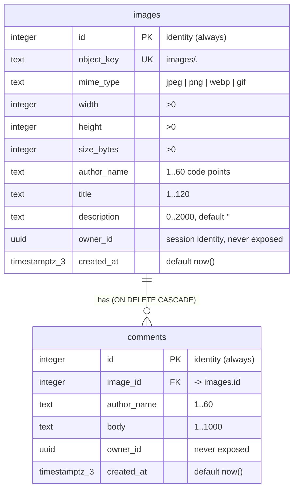

# Imageboard: Data Model

Status: proposed (revised after the architecture critique, round 1; test isolation, seed scripts and `db:generate`
aligned in the consistency-pass review, ADR 0021) · Date: 15 Nov 2026 · Related: ADR [0006](./adr/0006-data-model-and-constraints.md),
[0007](./adr/0007-keyset-pagination.md), [0014](./adr/0014-seed-content.md)

PostgreSQL 18, Drizzle ORM 0.45.4 (`casing: 'snake_case'` in both `drizzle()` and `drizzle.config.ts`), migrations
generated by drizzle-kit 0.31.11 and committed in `apps/api/drizzle/`. Two tables. There is no users table: the
owner is an anonymous session identity (`owner_id uuid`, ADR [0002](./adr/0002-anonymous-session-ownership.md)).



## 1. Conventions

| Rule                                                            | Why                                                                                                                                                      |
| --------------------------------------------------------------- | -------------------------------------------------------------------------------------------------------------------------------------------------------- |
| `integer … generated always as identity` primary keys           | No serial sequences to own; ids are public but not secret (deletion needs the session)                                                                   |
| `text` + `CHECK` instead of `varchar(n)`                        | Lengths live in one place each (Zod and the same numbers in CHECK), no truncation (B-43)                                                                 |
| `timestamptz(3) NOT NULL DEFAULT now()`                         | Unambiguous instants (B-42); **millisecond precision** so a JS `Date` in a keyset cursor round-trips exactly (ADR 0007)                                  |
| Lengths counted in **code points**                              | Postgres `char_length` counts code points; the shared Zod helper counts `[...s].length` (not UTF-16 units) so both agree                                 |
| Values stored with `\n` line breaks, NFC-normalised and trimmed | Done by the Zod transform; CHECK constraints reject leading/trailing whitespace, `\r` and forbidden characters with the **same** explicit classes (§1.1) |
| Explicit `ON DELETE` on every FK                                | `cascade` for owned children (comments) (B-39)                                                                                                           |
| One composite index per keyset ordering                         | Gallery and comment lists never sort in memory (B-40)                                                                                                    |
| Repositories select explicit columns                            | No `SELECT *`; `owner_id` read only for ownership checks (B-28, F-43)                                                                                    |

### 1.1 Text rules (one definition for Zod and SQL)

`packages/shared/src/text.ts` exports three code-point classes as strings of `\uXXXX` escapes, which mean the same
in a JS `RegExp` (with the `u` flag) and in a Postgres ARE (`standard_conforming_strings = on`). The CHECKs below
embed them; nothing locale-dependent (`[[:cntrl:]]`, `[[:space:]]`, `btrim`) is used. Rationale in ADR
[0006](./adr/0006-data-model-and-constraints.md).

| Constant                | Code points                                                                                                                                                                     | Used for                                          |
| ----------------------- | ------------------------------------------------------------------------------------------------------------------------------------------------------------------------------- | ------------------------------------------------- |
| `WHITESPACE`            | `\u0009-\u000D`, `\u0020`, `\u00A0`, `\u1680`, `\u2000-\u200A`, `\u2028`, `\u2029`, `\u202F`, `\u205F`, `\u3000`, `\uFEFF` (exactly the set JS `trim()` removes)                | no leading/trailing whitespace in any text column |
| `FORBIDDEN_SINGLE_LINE` | `\u0001-\u001F`, `\u007F-\u009F`, `\u2028`, `\u2029`, `\u202A-\u202E`, `\u2066-\u2069`                                                                                          | `author_name`, `title`                            |
| `FORBIDDEN_MULTI_LINE`  | `\u0001-\u0009`, `\u000B-\u001F`, `\u007F-\u009F`, `\u2028`, `\u2029` (so `\n` is the only allowed control character; `\r` is forbidden because Zod normalises `\r\n?` to `\n`) | `description`, `body`                             |

Zod order for every text field: (multi-line only) replace `\r\n?` with `\n` → NFC → `trim()` → count code points
(`[...s].length`, equal to Postgres `char_length`) → reject U+0000 and the forbidden class. Limits on blank lines are
a UI concern only. The shared vector file `@app/shared/testing` (ADR 0015) is run by both `text.test.ts` and
`db-constraints.int.test.ts`.

## 2. Drizzle schema

`apps/api/src/db/schema/text-checks.ts`

```ts
import { FORBIDDEN_MULTI_LINE, FORBIDDEN_SINGLE_LINE, WHITESPACE } from '@app/shared';
import { sql, type SQL } from 'drizzle-orm';
import type { AnyPgColumn } from 'drizzle-orm/pg-core';

// The class strings contain only `\uXXXX` escapes and `-` (asserted by a unit test), so embedding them with
// sql.raw is safe; they are compile-time constants, never user input.
const pattern = (body: string): SQL => sql.raw(`'${body}'`);

export const singleLine = (col: AnyPgColumn, min: number, max: number): SQL =>
  sql`char_length(${col}) BETWEEN ${sql.raw(String(min))} AND ${sql.raw(String(max))}
      AND ${col} !~ ${pattern(`^[${WHITESPACE}]|[${WHITESPACE}]$`)}
      AND ${col} !~ ${pattern(`[${FORBIDDEN_SINGLE_LINE}]`)}`;

export const multiLine = (col: AnyPgColumn, min: number, max: number): SQL =>
  sql`char_length(${col}) BETWEEN ${sql.raw(String(min))} AND ${sql.raw(String(max))}
      AND ${col} !~ ${pattern(`^[${WHITESPACE}]|[${WHITESPACE}]$`)}
      AND ${col} !~ ${pattern(`[${FORBIDDEN_MULTI_LINE}]`)}`;
```

`apps/api/src/db/schema/images.ts`

```ts
import { LIMITS } from '@app/shared';
import { sql } from 'drizzle-orm';
import { check, index, integer, pgTable, text, timestamp, uuid } from 'drizzle-orm/pg-core';

import { multiLine, singleLine } from './text-checks.js';

export const IMAGE_MIME_TYPES_SQL = sql`('image/jpeg', 'image/png', 'image/webp', 'image/gif')`;

export const images = pgTable(
  'images',
  {
    id: integer().primaryKey().generatedAlwaysAsIdentity(),
    objectKey: text().notNull().unique('images_object_key_key'),
    mimeType: text().notNull(),
    width: integer().notNull(),
    height: integer().notNull(),
    sizeBytes: integer().notNull(),
    authorName: text().notNull(),
    title: text().notNull(),
    description: text().notNull().default(''),
    ownerId: uuid().notNull(),
    createdAt: timestamp({ withTimezone: true, precision: 3 }).notNull().defaultNow(),
  },
  (t) => [
    // Keyset pagination: ORDER BY created_at DESC, id DESC (F-01, F-04). `DESC` means `DESC NULLS FIRST` in
    // PostgreSQL; drizzle-kit's default index order is `DESC NULLS LAST`, which the planner cannot use for that
    // ORDER BY (it adds a Sort node, B-40). The columns are NOT NULL, so null ordering is otherwise irrelevant.
    index('images_created_at_id_idx').on(t.createdAt.desc().nullsFirst(), t.id.desc().nullsFirst()),

    check(
      'images_object_key_format',
      sql`${t.objectKey} ~ '^images/[0-9a-f]{8}-[0-9a-f]{4}-4[0-9a-f]{3}-[89ab][0-9a-f]{3}-[0-9a-f]{12}\\.(jpg|png|webp|gif)$'`,
    ),
    check('images_mime_type_allowed', sql`${t.mimeType} IN ${IMAGE_MIME_TYPES_SQL}`),
    // Extension and MIME type must agree (B-05).
    check(
      'images_object_key_matches_mime',
      sql`substring(${t.objectKey} from '\\.([a-z]+)$') = CASE ${t.mimeType}
            WHEN 'image/jpeg' THEN 'jpg' WHEN 'image/png' THEN 'png'
            WHEN 'image/webp' THEN 'webp' WHEN 'image/gif' THEN 'gif' END`,
    ),
    check('images_dimensions_positive', sql`${t.width} > 0 AND ${t.height} > 0`),
    check('images_size_positive', sql`${t.sizeBytes} > 0`),
    check('images_author_name_valid', singleLine(t.authorName, 1, LIMITS.authorName.max)), // 1..60
    check('images_title_valid', singleLine(t.title, 1, LIMITS.title.max)), // 1..120
    check('images_description_valid', multiLine(t.description, 0, LIMITS.description.max)), // 0..2000
  ],
);

export type ImageRow = typeof images.$inferSelect;
export type NewImageRow = typeof images.$inferInsert;
```

`apps/api/src/db/schema/comments.ts`

```ts
import { LIMITS } from '@app/shared';
import { check, index, integer, pgTable, text, timestamp, uuid } from 'drizzle-orm/pg-core';

import { images } from './images.js';
import { multiLine, singleLine } from './text-checks.js';

export const comments = pgTable(
  'comments',
  {
    id: integer().primaryKey().generatedAlwaysAsIdentity(),
    imageId: integer()
      .notNull()
      .references(() => images.id, { onDelete: 'cascade', onUpdate: 'restrict' }),
    authorName: text().notNull(),
    body: text().notNull(),
    ownerId: uuid().notNull(),
    createdAt: timestamp({ withTimezone: true, precision: 3 }).notNull().defaultNow(),
  },
  (t) => [
    // FK lookup + keyset order in one index (B-40, F-27, F-31); NULLS FIRST as for images (no Sort node).
    index('comments_image_id_created_at_id_idx').on(
      t.imageId,
      t.createdAt.desc().nullsFirst(),
      t.id.desc().nullsFirst(),
    ),
    check('comments_author_name_valid', singleLine(t.authorName, 1, LIMITS.authorName.max)), // 1..60
    check('comments_body_valid', multiLine(t.body, 1, LIMITS.commentBody.max)), // 1..1000
  ],
);

export type CommentRow = typeof comments.$inferSelect;
export type NewCommentRow = typeof comments.$inferInsert;
```

`apps/api/src/db/schema/index.ts` re-exports both tables. The CHECK numbers and character classes are **imported**
from `packages/shared` (`db/**` may import `@app/shared`, OVERVIEW §6), and drizzle-kit renders them as literals into
the migration; changing a limit therefore shows up as schema drift (CI step `db:generate` + `git diff --exit-code`,
OVERVIEW §16) until a new migration is generated. `test/db-constraints.int.test.ts` runs the shared vectors as
direct inserts (one character over each limit fails, at the limit succeeds; CRLF, C0/C1, U+2028, bidi, leading NBSP
fail) so Zod and SQL cannot drift silently (F-D3). Postgres `23514` is additionally mapped to `400` (ADR 0009).

Note on escaping: inside a TS template literal `\\.` becomes `\.` in SQL; with `standard_conforming_strings = on`
Postgres passes `\.` and `\uXXXX` (also inside bracket expressions) to the regex engine unchanged (ARE syntax). The builder **must review the
generated `0000_init.sql`** and verify each CHECK in `db-constraints.int.test.ts`; if drizzle-kit renders a check
differently than intended, fix the schema, not the migration.

### Owner column visibility

`owner_id` has no index: it is only compared after a primary-key lookup (`WHERE id = $1 AND owner_id = $2`).
It is read by repositories for `canDelete` and ownership checks and **never** mapped into a DTO (service unit tests
assert the exact DTO key set).

## 3. Expected migration (`drizzle/0000_init.sql`, abridged)

```sql
CREATE TABLE "images" (
  "id" integer PRIMARY KEY GENERATED ALWAYS AS IDENTITY (sequence name "images_id_seq" …),
  "object_key" text NOT NULL,
  "mime_type" text NOT NULL,
  "width" integer NOT NULL,
  "height" integer NOT NULL,
  "size_bytes" integer NOT NULL,
  "author_name" text NOT NULL,
  "title" text NOT NULL,
  "description" text DEFAULT '' NOT NULL,
  "owner_id" uuid NOT NULL,
  "created_at" timestamp (3) with time zone DEFAULT now() NOT NULL,
  CONSTRAINT "images_object_key_key" UNIQUE("object_key"),
  CONSTRAINT "images_object_key_format" CHECK (…),
  CONSTRAINT "images_mime_type_allowed" CHECK (…),
  CONSTRAINT "images_object_key_matches_mime" CHECK (…),
  CONSTRAINT "images_dimensions_positive" CHECK (…),
  CONSTRAINT "images_size_positive" CHECK (…),
  CONSTRAINT "images_author_name_valid" CHECK (…),
  CONSTRAINT "images_title_valid" CHECK (…),
  CONSTRAINT "images_description_valid" CHECK (…)
);
CREATE TABLE "comments" (
  "id" integer PRIMARY KEY GENERATED ALWAYS AS IDENTITY (…),
  "image_id" integer NOT NULL,
  "author_name" text NOT NULL,
  "body" text NOT NULL,
  "owner_id" uuid NOT NULL,
  "created_at" timestamp (3) with time zone DEFAULT now() NOT NULL,
  CONSTRAINT "comments_author_name_valid" CHECK (…),
  CONSTRAINT "comments_body_valid" CHECK (…)
);
ALTER TABLE "comments" ADD CONSTRAINT "comments_image_id_images_id_fk"
  FOREIGN KEY ("image_id") REFERENCES "public"."images"("id") ON DELETE cascade ON UPDATE restrict;
CREATE INDEX "images_created_at_id_idx" ON "images" USING btree ("created_at" DESC NULLS FIRST, "id" DESC NULLS FIRST);
CREATE INDEX "comments_image_id_created_at_id_idx" ON "comments" USING btree ("image_id", "created_at" DESC NULLS FIRST, "id" DESC NULLS FIRST);
```

## 4. Queries the repositories run

| Repository method                                    | SQL shape                                                                                                                                    | Index                                 |
| ---------------------------------------------------- | -------------------------------------------------------------------------------------------------------------------------------------------- | ------------------------------------- |
| `images.list({ limit, after? })`                     | `SELECT <dto cols>, owner_id FROM images WHERE (created_at, id) < ($t::timestamptz, $id) ORDER BY created_at DESC, id DESC LIMIT $limit + 1` | `images_created_at_id_idx`            |
| `images.findById(id)`                                | `SELECT <dto cols>, owner_id FROM images WHERE id = $1`                                                                                      | PK                                    |
| `images.exists(id)`                                  | `SELECT 1 FROM images WHERE id = $1`                                                                                                         | PK                                    |
| `images.insert(row)`                                 | `INSERT … RETURNING <dto cols>, owner_id`                                                                                                    |                                       |
| `images.deleteOwned(id, ownerId)`                    | `DELETE FROM images WHERE id = $1 AND owner_id = $2 RETURNING object_key` (comments cascade in the same statement)                           | PK                                    |
| `comments.listForImage(imageId, { limit, after? })`  | `SELECT … FROM comments WHERE image_id = $1 AND (created_at, id) < (…) ORDER BY created_at DESC, id DESC LIMIT $limit + 1`                   | `comments_image_id_created_at_id_idx` |
| `comments.insert(row)`                               | `INSERT … RETURNING …`; FK violation `23503` → `undefined` → service throws 404                                                              |                                       |
| `comments.findById(id)` / `deleteOwned(id, ownerId)` | as for images                                                                                                                                | PK                                    |

The cursor timestamp is always passed as an ISO string with an explicit `::timestamptz` cast, never as a raw
`Date` parameter (no dependency on driver time-zone conversion). Both repositories build the row comparison with the
one helper `olderThan(createdAt, id, after)` in `src/db/keyset.ts`. `decodeCursor` refuses a timestamp in year 0000
(`400 invalid-cursor`): it is valid ISO 8601, but Postgres has no year 0 and would fail the query with `22008`.

`deleteOwned` returning zero rows triggers `findById`/`exists` to decide 404 vs 403. Between the two statements the
row could disappear (concurrent delete by the owner); then the answer is 404, which is correct.

## 5. Migration plan

| Step                         | Command                                                                                                                                                                                                                                                                   | Where                                                          |
| ---------------------------- | ------------------------------------------------------------------------------------------------------------------------------------------------------------------------------------------------------------------------------------------------------------------------- | -------------------------------------------------------------- |
| Generate after schema change | `pnpm db:generate` (`pnpm --filter @app/shared build && drizzle-kit generate`, offline; the build is needed because drizzle-kit loads the schema, which imports `@app/shared`, without the `development` condition, ADR 0021 §6)                                          | developer machine; review SQL; commit `drizzle/` with the code |
| Apply locally                | `pnpm db:migrate` (tsx `src/db/migrate.ts`, reads `.env`)                                                                                                                                                                                                                 | dev                                                            |
| Apply in the stack           | compose one-shot service `migrate` (`node dist/db/migrate.js`) before `api` starts                                                                                                                                                                                        | Docker / production                                            |
| Apply in tests               | `test/global-setup.ts` runs `runMigrations(url)` once on the template database `imageboard_template`; the setup file `test/setup-database.ts` gives every test file its own clone (`CREATE DATABASE "t_<random>" TEMPLATE imageboard_template`, conventions §7, ADR 0015) | integration tests                                              |
| Detect drift                 | CI: `pnpm --filter @app/api db:generate` (builds `@app/shared` first) then `git diff --exit-code -- apps/api/drizzle` and no untracked files there                                                                                                                        | lint job                                                       |
| Never                        | `drizzle-kit push`, editing applied migrations, migrating from the web process at boot, `DROP TABLE` scripts                                                                                                                                                              | (B-37)                                                         |

`0000_init.sql` is the only migration for the first release. Later changes add `0001_…`.
F-D1 is proven by `test/migrations.int.test.ts`: it creates its **own empty database** (`createEmptyDatabase()`, not
the template, which is already migrated), migrates it, migrates again, and asserts no error and the same
`drizzle.__drizzle_migrations` row count.

## 6. Seed plan

`pnpm db:seed` → `SEED_ALLOW=true tsx --conditions=development --env-file-if-exists=../../.env src/scripts/seed-cli.ts`
→ `runSeed({ db, upload, storage, logger })` from `src/scripts/seed.ts`,
where `upload` is the real `ImageUploadPort` built by `createUploadModule` on the configured `storage` (the function is
exported so `test/seed.int.test.ts` can run it twice against its own Testcontainers database and a fake storage).
`pnpm --filter @app/api db:seed:check` (`seed-cli.ts --check`, same `tsx` flags, no `SEED_ALLOW`) only verifies
(16 seed rows, 60 comments, both objects per row reachable through `storage.get`) and exits non-zero otherwise. CI's
`dev-setup-smoke` job uses it. ADR [0014](./adr/0014-seed-content.md).

### 6.1 Rules

- Runs only with an explicit `SEED_ALLOW=true` (set by the `db:seed` script; conventions §8). The check is in the
  entry point: `seed-cli.ts` exports `seedMode(argv, env)` → `'seed' | 'check'`, which throws for a write run without
  `SEED_ALLOW === 'true'`. `main()` runs only under `if (import.meta.main)`. `seed.int.test.ts` asserts the refusal,
  and that `--check` needs no switch. `NODE_ENV` is never consulted. `SEED_ALLOW` is not an `.env` key. The seed resets
  nothing; the only rows it deletes are seed-owner images whose key is no longer in the manifest (retired seed content, ADR
  0014), after the current pictures are in place and together with their comments; `db:seed:check` reports any that
  are left. It needs no secrets beyond the normal `.env` (no demo password, no accounts).
- **Idempotent**: each seed image has a fixed object key (UUID v4 generated once and committed in
  `manifest.json`). For each entry: if a row with that `object_key` exists and both its objects are in storage, skip
  it (two reads, no write); if the row exists but its original or preview is missing (for example after the MinIO
  volume was reset while the Postgres volume was kept), ingest the file again with the same key and leave the row and
  its comments untouched; otherwise process the file through the **same pipeline as uploads**
  (`upload.ingest(file, { objectKey })`, which also stores the preview, ADR 0018), insert the row, insert its
  comments. Running twice yields the same rows and objects, and a re-run repairs what `db:seed:check` reports as a
  missing object.
- Owner of all seed rows: constant `SEED_OWNER_ID = '5eed0000-0000-4000-8000-000000000001'`, which no session can
  ever hold, so visitors cannot delete demo content.
- Fixed `created_at` values (not "now minus x") so README screenshots are reproducible. Dates span
  21 Sep 2026 to 12 Nov 2026, at plausible local times; comments are 10 minutes to 3 days after their image.
- Images live in the bucket; nothing points at third-party URLs at runtime (B-44).

### 6.2 Seed images: origin, licence, generation

- The sixteen pictures are **original artwork drawn in code**, inspired by Art Nouveau (Jugendstil) and Art Deco in
  general: botanical motifs on a vertical axis (iris, tulip, lotus, whiplash stems), repeats and friezes, framed
  medallions, a thin blue line drawing, Deco geometry (sunbursts, ziggurats, fans, thin gold on black) and a few
  reduced bold graphics (a mirrored black ink form on red-orange). Matte palette with a light paper grain. Nothing is downloaded, traced or copied, no named artist's style is imitated, no AI image service is
  used, and no picture contains text. ADR [0014](./adr/0014-seed-content.md).
- Licence: part of this repository, MIT like the code. `seed/images/CREDITS.md` (generated) says so and lists file,
  title and size; the README links it in its credits section.
- Generation: `pnpm --filter @app/api seed:generate-art` runs `src/scripts/generate-seed-art.ts`. Each piece in
  `src/scripts/seed-art/pieces.ts` is a function of its canvas and its own seeded random source (`seed-art/svg.ts`
  holds the SVG helpers and the PRNG). sharp renders the SVG and writes `seed/images/<slug>.jpg` (long edge 1600 px,
  JPEG q82, no metadata). The generator refuses to write anything unless artwork, content (§6.4) and manifest name the
  same slugs in the same order. The output is **committed** (about 2 MB); `db:seed` and the Pages demo work offline.
- Formats are mixed (portrait 3:4 and 2:3, landscape 3:2, 16:10 and 16:9, square). The gallery shows a centred 16:10
  crop, so portrait pieces keep their subject in the middle band; the detail dialog shows the whole picture.

`manifest.json` entry shape (validated with Zod in the seed script):

```json
{
  "slug": "peacock",
  "objectKey": "images/4641e8a6-63eb-4e17-ada2-6646e21fae81.jpg"
}
```

### 6.3 Seed authors

Display names are free text in this product, so seeds use the kind of names people actually type: `Marit`,
`Tomás R.`, `wen`, `Jonas from Leipzig`, `Kofi`, `Anouk`, `Pavel`, `Lucía`, `Ines K.`, `Noor`, `Henrik`, `Bea`,
`ole_b`, `Sanne`, `Dariusz`, `Yuki`. No "Jane Doe", no "Acme", no lorem. The fiction: people sharing their own
illustrations and prints.

### 6.4 Seed content (16 images, 60 comments)

Dates are `created_at` in UTC. "Comments" lists author → body, oldest first (the API shows newest first). The source
of truth is `src/scripts/seed-content.ts`; this table mirrors it.

| #   | Slug / picture, size (px)                                                              | Title                         | Author             | Description                                                                                                          | Date (UTC)        | Comments                                                                                                                                                             |
| --- | -------------------------------------------------------------------------------------- | ----------------------------- | ------------------ | -------------------------------------------------------------------------------------------------------------------- | ----------------- | -------------------------------------------------------------------------------------------------------------------------------------------------------------------- |
| 1   | `peacock` — peacock with a fan tail on a stepped plinth, 1600×1600                     | Peacock                       | ole_b              | Every feather is the same shape, which makes it much easier than it looks.                                           | 21 Sep 2026 06:42 | Sanne → "Easier than it looks, he says." · Noor → "The gold on black is beautiful."                                                                                  |
| 2   | `liner-at-sunset` — ocean liner, banded sun, scalloped sea, 1600×1067                  | Liner at sunset               | Yuki               | My grandfather worked on ships like this. Three funnels, because he always said the good ones had three.             | 24 Sep 2026 23:58 | Henrik → "Your grandfather was right." · Marit → "The waves are so neat." · Yuki → "Rows of half circles and a lot of patience."                                     |
| 3   | `tulips-on-petrol` — tulip wallpaper repeat on petrol, 1600×1600                       | Tulips on petrol              | wen                | A wallpaper repeat I wanted to draw since I saw tiles like this in an old stairwell. Every other column is mirrored. | 27 Sep 2026 09:15 | (none: shows the empty comments state)                                                                                                                               |
| 4   | `lighthouse-for-my-brother` — striped lighthouse, beams, scalloped waves, 1200×1600    | Lighthouse for my brother     | Anouk              | He keeps a photo of the real one on his fridge, so this one is for next to it. Red and white, like the original.     | 30 Sep 2026 17:20 | Lucía → "He is going to love it." · Kofi → "The beams are great." · Anouk → "He already asked for a second one for the hallway." · Sanne → "Those little waves."     |
| 5   | `door-i-would-like` — stepped doorway with a sunburst arch, 1067×1600                  | The door I would like to have | Henrik             | Drew the sunburst first and built the door around it. Our real front door is brown and sticks in winter.             | 3 Oct 2026 07:05  | Marit → "Where is this? I want to live there." · Henrik → "Only in my sketchbook, sadly."                                                                            |
| 6   | `fans-all-the-way-down` — fan/scallop repeat pattern, 1600×1600                        | Fans all the way down         | Sanne              | A repeat pattern, about six hours of compass work. In my head it is already wallpaper.                               | 6 Oct 2026 15:31  | **25 comments** (see §6.5; demonstrates "Show older comments")                                                                                                       |
| 7   | `tower-at-sunrise` — ziggurat tower in front of a sunburst, 1200×1600                  | Tower at sunrise              | Tomás R.           | New flat, no lift, and a lot of time spent looking at the tower across the road. It is less golden in real life.     | 9 Oct 2026 18:47  | Jonas from Leipzig → "Congratulations on the new place." · Pavel → "Less golden, but still good?" · Tomás R. → "Ask me again in winter."                             |
| 8   | `antelope-mid-leap` — geometric antelope across a striped sun, 1200×1600               | Antelope, mid-leap            | Lucía              | The legs were the hard part. Version eleven is the first one that looks like it could land.                          | 12 Oct 2026 11:02 | Ines K. → "The stripes across the sun are perfect."                                                                                                                  |
| 9   | `leaf-net-in-blue` — thin blue line branch with leaf veins, red dots, 1600×1067        | Leaf net in blue              | Dariusz            | One blue pen, one branch, no plan. The red dots came later, when it looked too tidy.                                 | 15 Oct 2026 16:10 | ole_b → "The red dots make it." · Dariusz → "They were almost a mistake. Kept them."                                                                                 |
| 10  | `fountain-in-the-courtyard` — tiered fountain with arcing jets under arches, 1200×1600 | Fountain in the courtyard     | Ines K.            | Based on the one in the library courtyard, with a bit more ambition. The real one has two jets.                      | 18 Oct 2026 13:44 | Bea → "Which library?" · Ines K. → "The old one by the river. Go in spring, when it is switched on." · wen → "Libraries are the best."                               |
| 11  | `gold-on-black` — thin gold-line panel: chevrons, medallion, fan, 1067×1600            | Gold on black                 | Pavel              | One colour of ink, a ruler and most of the weekend.                                                                  | 22 Oct 2026 08:26 | Anouk → "So much patience in this."                                                                                                                                  |
| 12  | `lotus-frieze` — lotus frieze with budding tendrils and borders, 1600×900              | Lotus frieze                  | Jonas from Leipzig | Meant as a border for the top of a wall. Four flowers, then it repeats, in theory forever.                           | 26 Oct 2026 07:58 | Noor → "The buds curling between the flowers!" · Pavel → "Very calm. I like the water lines." · Jonas from Leipzig → "Took four tries to get the repeat to line up." |
| 13  | `red-and-black-folded` — mirrored black ink form on red-orange, 1600×1600              | Red and black, folded         | Bea                | Print club this week: black ink on red paper, folded in half while it was wet. Everyone made one, I kept mine.       | 30 Oct 2026 10:12 | Lucía → "It looks like a face. Or a moth." · Bea → "Everyone sees something else. That is the fun."                                                                  |
| 14  | `iris-on-the-axis` — symmetric iris with whiplash stems in an arched frame, 1067×1600  | Iris on the axis              | Marit              | Everything mirrored down the middle, except my patience. The curls on the stems took the longest.                    | 3 Nov 2026 14:39  | Henrik → "The little curls on the stems are lovely." · Bea → "This would make a great book cover."                                                                   |
| 15  | `night-train-south` — streamline train under a ringed moon, 1600×1000                  | Night train south             | Noor               | Sketched on the actual night train, then drawn again at home on a table that did not shake.                          | 7 Nov 2026 12:05  | Tomás R. → "Where were you going?" · Noor → "Vienna. Slept surprisingly well." · Kofi → "The moon is great." · Noor → "It followed us most of the night."            |
| 16  | `medallion-with-stars` — oval medallion with moon, stars and corner emblems, 1200×1600 | Medallion with stars          | Kofi               | A frame for a moon. The stars took longer than the moon, and the moon took longer than the frame.                    | 12 Nov 2026 19:23 | Dariusz → "The chevron borders are great." · Yuki → "Is the lotus at the bottom on purpose?" · Kofi → "Yes, it looked empty without it."                             |

That is 16 images, 35 comments in the table plus 25 on image 6 = **60 comments**. Image 3 has none (empty state).

### 6.5 Comments for "Fans all the way down" (image 6)

Twenty-five comments, so the first page (20) shows a "Show older comments" button. Times start at
6 Oct 2026 15:52 and step forward irregularly (8 to 190 minutes) over three days.

1. Marit → "This must have taken forever."
2. Kofi → "Is it drawn by hand?"
3. Sanne → "Compass, pencil and a lot of tea. Coloured on the computer afterwards."
4. Kofi → "Respect."
5. Henrik → "From far away it looks like fish scales."
6. Bea → "I would wear this as a dress."
7. Pavel → "Wallpaper, definitely."
8. Lucía → "My grandmother had tiles like this in her bathroom."
9. Sanne → "Then I need to see that bathroom."
10. Dariusz → "The gold rows are my favourite."
11. Noor → "I keep finding new patterns in it."
12. wen → "Same. Diagonals now."
13. Ines K. → "Could you print it on fabric?"
14. Yuki → "How many fans are there?"
15. Sanne → "I stopped counting at a hundred."
16. ole_b → "The thin black outline on each one is what makes it work."
17. Anouk → "This would make a very good blanket."
18. Sanne → "Working on it, actually."
19. Tomás R. → "Saving this as my wallpaper, hope that is fine."
20. Sanne → "Of course."
21. Jonas from Leipzig → "Bring it to the print club, they would love it."
22. Sanne → "In two colours? That would be a challenge."
23. Marit → "You like a challenge."
24. Henrik → "Coming back to this one a lot."
25. Lucía → "Same. It is very calm to look at."

### 6.6 Seed image processing

Seed files go through `upload.ingest()` with the same limits as uploads, so `width`, `height`, `size_bytes` and
`mime_type` are real values of the stored object (all `image/jpeg`, `.jpg` keys), and each image also gets its
`previews/<uuid>.webp` rendition (32 objects in total). With 16 images and `IMAGES_PAGE_SIZE = 12`, the seeded dev
gallery shows "Load more" on first load, which the README screenshot and the phase-4 design review rely on. **E2E
tests do not rely on the seed**: the e2e stack is a separate, unseeded compose project, and the "Load more" e2e test
creates its own 13 images (ADR 0015).

### 6.7 Test data (not seed)

Every integration test file works in **its own database**. The setup file `test/setup-database.ts` clones it from
`imageboard_template` in `beforeAll` and drops it in `afterAll`, and `createTestApp()` uses it by default (ADR 0015,
conventions §7). Vitest runs files in parallel, so a shared database would let files wipe each other's rows and reset
each other's ids. There is no `TRUNCATE`. A `describe` block that needs a pristine table (exact pages, known ids)
takes an extra clone from `createTestDatabase()` and drops it afterwards. E2E tests create their own images through the API (`page.request`, so the browser session
owns them) with unique titles and never depend on seed data or on counts.
