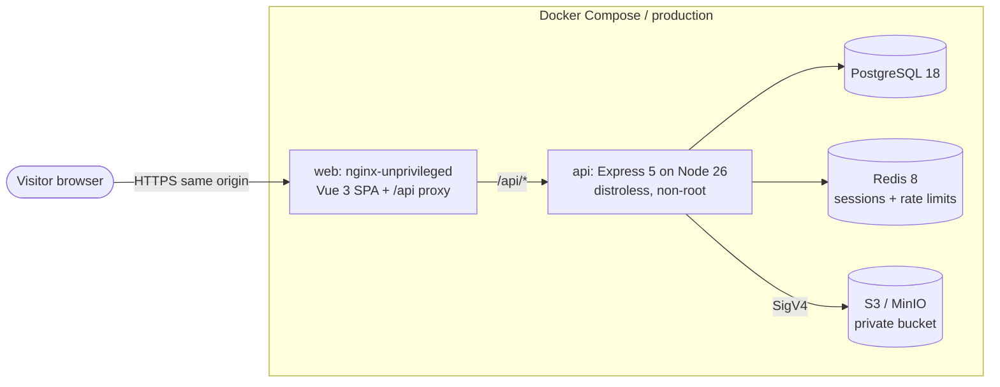
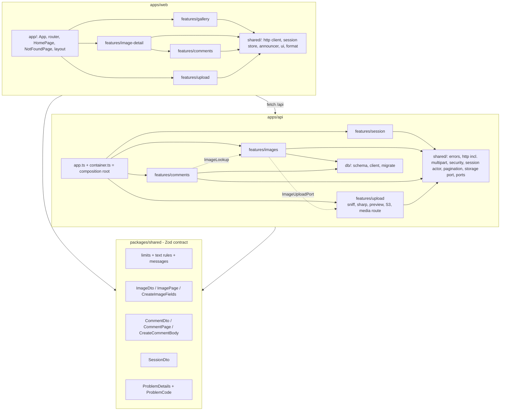

# Imageboard: Architecture Overview

Status: proposed, revision 2 (architecture critique round 1 and the consistency-pass review applied; see §0) · Date: 16 Nov 2026

This is the binding technical design for the rebuilt Imageboard. It implements
[`docs/FEATURES.md`](../FEATURES.md) (acceptance criteria `F-xx`) and resolves every item in
[`docs/BUGS.md`](../BUGS.md) (`B-xx`, traceability in §17). It follows `~/Code/PLAN.md`
(target architecture, quality gate, definition of done) and the skills `project-scaffold`,
`express-feature-module`, `maw-design-system` and `modular-css-tailwind4`. Where this document deviates from a
skill template, the deviation is listed in §16 and justified in an ADR.

Companion documents:

| Document                             | Content                                                           |
| ------------------------------------ | ----------------------------------------------------------------- |
| [`DATA-MODEL.md`](./DATA-MODEL.md)   | Drizzle schema, constraints, indexes, migrations, seed plan       |
| [`API.md`](./API.md)                 | Every endpoint with auth, request/response schema and error cases |
| [`BUILD-ORDER.md`](./BUILD-ORDER.md) | Build phases, parallel modules, files per module, F/B coverage    |
| [`adr/`](./adr/)                     | Architecture decision records 0001 to 0021                        |

## 0. Revision 1 (architecture critique)

| Finding                                                     | Resolution                                                                                                                                                                                  | Where                              |
| ----------------------------------------------------------- | ------------------------------------------------------------------------------------------------------------------------------------------------------------------------------------------- | ---------------------------------- |
| Integration files shared one DB, production limiter budgets | Database per test file cloned from a migrated template; test apps default all limits to 100000                                                                                              | ADR 0015, §15, DATA-MODEL §6.7     |
| Frozen stub contracts incomplete                            | Exact TS signatures for ports, module deps, `ObjectStorage.get`, `createTestApp`; multer moved to `shared/http/multipart.ts`                                                                | ADR 0017, §5                       |
| E2E polluted dev data and hit global/media limits           | Isolated compose project `imageboard-e2e` (tmpfs, own port, all limits raised, `down -v`), no `webServer` reuse, no seed reliance                                                           | ADR 0015, §16                      |
| Anonymous sessions could flood Redis                        | Identity limiter, 24 h provisional sessions, production Redis layout                                                                                                                        | ADR 0002, 0013                     |
| Live region inert behind modal dialogs                      | Live region per `ModalDialog`, announcer routes to the top-most dialog                                                                                                                      | ADR 0010, 0011                     |
| Tile accessible name duplicated; ambiguous delete labels    | Tile `alt=""`, link holds only preview + title; "delete image" / "delete comment"                                                                                                           | ADR 0012, FEATURES §14             |
| Scroll-lock selector fails stylelint                        | `:root:has(dialog[open])`                                                                                                                                                                   | ADR 0011, §8.2                     |
| CRLF vs LF, locale-dependent control classes                | `\r\n?` → `\n`, explicit shared code-point classes for Zod and SQL, 23514 → 400                                                                                                             | ADR 0006, DATA-MODEL §1.1          |
| Public, unlimited `/api/health`                             | Internal only (nginx deny), 3 s cached readiness                                                                                                                                            | ADR 0013                           |
| APNG, animated pixel limit, `accept`                        | APNG as PNG, per-frame pixels + frame cap, explicit `accept`                                                                                                                                | ADR 0005                           |
| Client parsed responses too strictly                        | Tolerant reader (`z.object`, open `code`), `unexpected-response`, nginx body size from env                                                                                                  | ADR 0009, 0010, 0013               |
| Flaky `EXPLAIN` assertion                                   | `SET LOCAL enable_seqscan/bitmapscan = off`, assert no Sort                                                                                                                                 | ADR 0015, BUILD-ORDER 2.3          |
| CI gaps                                                     | audit in its own non-PR workflow, schema drift check, dev-setup smoke job, WebKit smoke                                                                                                     | §16                                |
| DX / one-command setup                                      | `git init` in place, docs-only first commit, Node 26 (machine: `~/.devenv.sh`, BUILD-ORDER Phase 0) + `engine-strict`, `pnpm dev:setup`, non-overwriting `setup-env.mjs` (`pnpm setup:env`) | §16, BUILD-ORDER 1a                |
| Parallel agents collide                                     | Agents run only their own paths; one orchestrated e2e stack; phase 1 split into 1a/1b                                                                                                       | BUILD-ORDER                        |
| Full-size images in tiles; no gzip                          | One WebP preview rendition; gzip for static assets                                                                                                                                          | ADR 0018, §16                      |
| Whole upload form sticky                                    | One-row sticky bar, form in normal flow                                                                                                                                                     | ADR 0012                           |
| Pre-deploy gaps                                             | Forwarded scheme map, nginx template (CSP/body size), takedown script, global upload cap, IP truncation, checklist                                                                          | ADR 0019                           |
| CORS unused                                                 | Removed; guard uses `APP_ORIGIN` or the request's own origin                                                                                                                                | ADR 0003                           |
| Contradictions                                              | F-40 deviations flagged, comment `Location` dropped, theme-toggle rationale fixed, pnpm 10 stated as own choice, profile URLs to be confirmed                                               | FEATURES §14, ADR 0001, 0012, §8.3 |

### Revision 2 (consistency-pass review)

The cross-project consistency pass (`project-scaffold/references/conventions.md`, 15 Nov 2026) changed shared rules
after round 1. An adversarial re-review found these contradictions and steps that could not be built as written:

| Finding                                                                                                                                                                               | Resolution                                                                                                                                                                               | Where                                       |
| ------------------------------------------------------------------------------------------------------------------------------------------------------------------------------------- | ---------------------------------------------------------------------------------------------------------------------------------------------------------------------------------------- | ------------------------------------------- |
| Phase 0 told agents to install fnm, Node and brew git; PLAN.md says Phase 0 is done via `~/.devenv.sh` without system changes                                                         | Phase 0 = `source ~/.devenv.sh` (Node 26.13.1, pnpm 10.34.9 corepack shim, Apple Git 2.50); Playwright browsers installed once in 1a                                                     | ADR 0021 §1, BUILD-ORDER Phase 0            |
| Integration harness used `imageboard_tpl`, `f_<uuid>`, clone per `createTestApp()` and allowed `TRUNCATE` (conventions §7: `<slug>_template`, setup file, no `TRUNCATE`)              | `imageboard_template`, `test/setup-database.ts` (`t_<random>` per file), `createTestDatabase()` for pristine blocks, no `TRUNCATE`; Redis prefix `test-<uuid>` for sessions and limiters | ADR 0015, 0017, 0021 §3, DATA-MODEL §5/§6.7 |
| One working tree: every unit's integration app imports all modules, so a sibling's half-done `index.ts` turns everyone red                                                            | Swap `index.ts` last, saved files parse, stub cross-feature components in tests, sequential steps own their listed frozen files                                                          | ADR 0017, 0021 §2, BUILD-ORDER              |
| E2E override appended `8181` to the base `8080` (Compose concatenates `ports`), so e2e collided with `pnpm demo`                                                                      | `ports: !override` for web, tmpfs mounts, `E2E_PORT` resolved once in `run-e2e.mjs`; template CI log/teardown steps removed                                                              | ADR 0015, 0021 §4, §16                      |
| `db:seed` without `SEED_ALLOW` in 1a (the stub refuses); `seed-cli.ts --check` called without `.env` or the `development` condition; seed CLI "refuses production" (`NODE_ENV`)       | `db:seed` with `SEED_ALLOW=true` from 1a; `db:seed:check` script; guard only in `seed-cli.ts` (`seedMode`), never `NODE_ENV`                                                             | ADR 0014, 0021 §5, DATA-MODEL §6            |
| Schema drift step runs drizzle-kit on a schema that imports `@app/shared` in a job that never built it                                                                                | `db:generate` builds `@app/shared` first                                                                                                                                                 | ADR 0021 §6, DATA-MODEL §5                  |
| CSRF cookie named only for the secure case                                                                                                                                            | `__Host-imageboard.x-csrf-token` / `imageboard.x-csrf-token`                                                                                                                             | §11, ADR 0021 §7                            |
| CI cost rule (decided) missing; "release builds both images on `main`" impossible for a private repository; release tag used `github.sha` under `workflow_run`                        | e2e on `pull_request` only; `images` only when `github.event.repository.private == false`; deploy also `DEPLOY_ENABLED`; `RELEASE_SHA` = `workflow_run.head_sha`                         | ADR 0020, §16, BUILD-ORDER 1a               |
| Seven phase-5 units with default Playwright workers on one machine                                                                                                                    | `--workers=2` per unit; only the orchestrator starts or rebuilds stacks                                                                                                                  | ADR 0021 §8, BUILD-ORDER 4.3, 5             |
| `pnpm format:check` (first `verify` step) covers `docs/**/*.md`, and the committed docs fail it (21 files); a clean-clone `pnpm demo` would share the dev compose project and volumes | `pnpm format` once in 1a (layout only); clean-clone check with `COMPOSE_PROJECT_NAME=imageboard-clean`                                                                                   | ADR 0021 §9, BUILD-ORDER 1a                 |

---

## 1. Context

A public, account-less image board: visitors upload an image with a display name, title and description, browse a
gallery newest first, open an image in a dialog, comment on it, and delete what **they** uploaded or wrote. The
2018 bootcamp version (Vue 2 global script, Express 4, knox/S3, raw SQL) had no auth, no validation and committed
credentials (see BUGS). The rebuild keeps the product small and makes everything around it production grade.



Scope boundaries (from FEATURES §13): no accounts, no moderation UI (an admin removal script exists, ADR 0019), no
real-time, one file per upload, no thumbnail sets (exactly one preview rendition, ADR 0018).

## 2. Repository shape

pnpm monorepo (ADR [0001](./adr/0001-monorepo-with-feature-modules.md)):

| Package                           | Role                                                       | Depends on    |
| --------------------------------- | ---------------------------------------------------------- | ------------- |
| `apps/web` (`@app/web`)           | Vue 3.5 + Vite 8 + Pinia 4 + Vue Router 5 SPA              | `@app/shared` |
| `apps/api` (`@app/api`)           | Express 5.3 REST API, Drizzle ORM, S3 client               | `@app/shared` |
| `packages/shared` (`@app/shared`) | Zod 4 schemas = API contract, limits, user-facing messages | `zod` only    |

## 3. Module and feature map

Backend features (`apps/api/src/features/*`) and frontend features (`apps/web/src/features/*`). PLAN.md names
the modules _images, comments, upload_; `session` is the small cross-cutting feature for the anonymous identity
and is built in the scaffold phase because every other module's tests need it.



Dotted arrows are **ports injected by the composition root** (`app.ts`), not imports: `images` receives an
`ImageUploadPort` (type in `shared/ports/image-upload.ts`), the multipart parser and its limiters; `comments`
receives an `imageExists(id)` function and its limiters. No backend feature imports another feature. The exact
TypeScript signatures of every port, module deps object and `createTestApp` are frozen in ADR
[0017](./adr/0017-contract-first-stubs-for-parallel-builds.md).

## 4. Request flows

### 4.1 Middleware order (`apps/api/src/app.ts`)

```
x-powered-by off → trust proxy (TRUST_PROXY = hop count) → query parser 'simple' → pino-http (request id, truncated IP)
→ /api/health router (mounted before helmet, session and rate limits; JSON only; cached 3 s; not routed by nginx)
→ helmet (strict CSP for API responses, nosniff, X-Frame-Options DENY, CORP same-origin) + HSTS when cookies are
  Secure and the request came over https (`req.secure`, RFC 6797 §7.2)
→ /api/media router (own media limiter; no session, no CSRF, no body parsing)
→ global rate limiter (300 / 5 min / IP; before body parsing, so malformed or oversized bodies count too, ADR 0013)
→ fetch-metadata guard (unsafe methods: Sec-Fetch-Site must be same-origin|none, else Origin = APP_ORIGIN or own origin;
  headers only, so a cross-site request is refused before its body is parsed or its session is loaded and renewed)
→ express.json({ limit: '16kb', strict: true })            (no CORS middleware: same origin only, ADR 0003)
→ express-session (Redis store) → cookie-parser
→ GET /api/session (identity limiter only when creating an ownerId) → csrf-csrf doubleCsrfProtection (unsafe methods only)
→ /api/images/:imageId/comments, /api/comments, /api/images routers (per-route limiters, requireJson, multipart parser)
→ 404 problem handler (unknown /api/*) → central RFC 9457 error handler
```

### 4.2 Upload (`POST /api/images`)

```mermaid
sequenceDiagram
  autonumber
  participant B as Browser (upload feature)
  participant N as nginx
  participant A as API (images + upload)
  participant S as S3 / MinIO
  participant P as Postgres
  B->>B: client check (Zod fields, type, size ≤ uploadMaxBytes)
  B->>N: POST /api/images multipart + x-csrf-token + session cookie
  N->>A: proxy (X-Forwarded-*, X-Request-Id)
  A->>A: global limiter → fetch-metadata → CSRF → requireOwnerSession → upload limiters (10/h/IP, 200/day all)
  A->>A: shared multipart parser: multer memory (1 file, ≤ UPLOAD_MAX_BYTES, 3 fields ≤ 16 KiB) → 413/400/415
  A->>A: Zod fields (strict, CRLF → LF) + file present → 400 with errors[]
  A->>A: upload port: file-type magic bytes → 415 unless jpeg/png(+apng)/webp/gif
  A->>A: sharp metadata: pixels per frame, frame cap → 400
  A->>A: sharp: rotate(), resize inside 2560, re-encode same format, metadata stripped; WebP preview ≤ 960
  A->>S: PutObject images/<uuid>.<ext> (ContentType = detected), then previews/<uuid>.webp
  A->>P: INSERT images … RETURNING
  alt insert fails
    A->>S: DeleteObject both keys (compensation) and rethrow → 500 problem
  end
  A->>A: markSessionActive (session lifetime 24 h → 180 days)
  A-->>B: 201 ImageDto (canDelete: true) + Location
  B->>B: gallery.prepend(image), reset form, announce "Image uploaded."
```

### 4.3 Delete image (`DELETE /api/images/:id`)

`DELETE FROM images WHERE id = $1 AND owner_id = $2 RETURNING object_key` (comments go by `ON DELETE CASCADE`
in the same statement). Zero rows → a second lookup decides `404` (no such id) or `403` (not owner). After the
statement has committed, the upload port deletes original and preview with 3 attempts each and exponential backoff;
a final failure is logged at `error` with the keys (orphan, never a client error). Response `204`. Details: ADR
[0008](./adr/0008-upload-and-delete-consistency.md).

### 4.4 Page load

1. nginx serves `index.html` (history fallback) and hashed assets.
2. `main.ts` mounts the app; the session store calls `GET /api/session` once (creates a provisional anonymous
   identity, returns `{ csrfToken, uploadMaxBytes }`), the token stays in memory. If it fails (e.g. identity limiter
   429), browsing continues; only mutations report the error.
3. The gallery store loads `GET /api/images` (first page, 12); the router may already be on `/images/:id`, in which
   case the detail dialog opens over the gallery and fetches `GET /api/images/:id` and its comments.

## 5. Folder tree (file level)

Legend: `[S]` created in the scaffold phase (1a tooling or 1b contracts, see BUILD-ORDER; complete or as a contract stub), `[B]` backend phase,
`[F]` frontend phase, `[C]` CSS & design phase, `[T]` tests/E2E phase, `[P]` presentation (Etappe 3). Owners per file are in BUILD-ORDER.md.

```
imageboard/
├── .github/
│   ├── actions/setup/action.yml                         [S] node 26 + pnpm 10.34.9 + cache + install
│   ├── workflows/ci.yml                                 [S] lint (+ schema drift) · typecheck · unit · integration · build · e2e (+ WebKit smoke; pull_request only, ADR 0020) · dev-setup-smoke · gitleaks
│   ├── workflows/audit.yml                              [S] pnpm audit: weekly, on lockfile change on main, manual; not a PR check
│   ├── workflows/release.yml                            [S] workflow_run after green CI on main: GHCR images (api, web) only if the repository is public; deploy also gated by vars.DEPLOY_ENABLED (ADR 0020)
│   ├── dependabot.yml                                   [S] npm, github-actions, docker (apps/*), docker-compose (/)
│   └── pull_request_template.md                         [S]
├── apps/
│   ├── api/
│   │   ├── Dockerfile                                   [S] multi-stage, pnpm deploy --prod, distroless nonroot
│   │   ├── drizzle.config.ts                            [S] casing snake_case
│   │   ├── package.json                                 [S] db:generate (builds @app/shared first), db:migrate, db:seed (SEED_ALLOW=true); 2.4 adds db:seed:check, seed:generate-art, admin:remove-image
│   │   ├── tsconfig.json · tsconfig.build.json          [S]
│   │   ├── vitest.config.ts · vitest.integration.config.ts [S] integration include: src/**/*.int.test.ts + test/**/*.int.test.ts; setupFiles: test/setup-database.ts
│   │   ├── drizzle/
│   │   │   ├── 0000_init.sql                            [S] generated + reviewed (images, comments)
│   │   │   └── meta/_journal.json · meta/0000_snapshot.json [S]
│   │   ├── seed/
│   │   │   ├── images/*.jpg                             [B] 16 original artworks, ≤ 1600 px long edge (generated, committed)
│   │   │   ├── images/manifest.json                     [B] slug → fixed objectKey
│   │   │   └── images/CREDITS.md                        [B] human-readable attribution
│   │   ├── src/
│   │   │   ├── server.ts                                [S] loadEnv → logger → container → createApp → listen; graceful shutdown (shared/http/graceful-shutdown.ts)
│   │   │   ├── container.ts                             [S] pg pool, redis, S3 client, session mw, limiter stores, readiness
│   │   │   ├── app.ts                                   [S] middleware order §4.1, mounts all modules (final wiring)
│   │   │   ├── config/
│   │   │   │   ├── app.ts                               [S] APP_SLUG = 'imageboard', fixed windows of rate limits, HTTP, readiness and S3 timeouts
│   │   │   │   ├── env.ts                               [S] Zod env schema (§12)
│   │   │   │   └── env.test.ts                          [S]
│   │   │   ├── db/
│   │   │   │   ├── client.ts                            [S] drizzle({ client: pool, schema, casing: 'snake_case' }), ping, close
│   │   │   │   ├── migrate.ts                           [S]
│   │   │   │   ├── keyset.ts                            [B] olderThan(createdAt, id, after): the keyset row comparison of both repositories (§4 of DATA-MODEL)
│   │   │   │   └── schema/{index,images,comments,text-checks}.ts [S] see DATA-MODEL.md
│   │   │   ├── shared/
│   │   │   │   ├── errors/app-error.ts                  [S] AppError + subclasses (codes in §10)
│   │   │   │   ├── errors/db-errors.ts                  [S] pgErrorCode(err) through Drizzle cause chain (23503, 23505, 23514 → field by constraint name)
│   │   │   │   ├── http/problem.ts                      [S] toProblem, errorHandler, notFoundHandler
│   │   │   │   ├── http/validate.ts                     [S] validate({ params, query, body }, handler)
│   │   │   │   ├── http/require-json.ts                 [S] 415 unless application/json
│   │   │   │   ├── http/no-store.ts                     [B] Cache-Control: no-store on every response of a router (problems included)
│   │   │   │   ├── http/multipart.ts                    [S] createMultipartParser({ maxFileBytes }) (ADR 0017)
│   │   │   │   ├── http/health.ts                       [S] GET /api/health (ready, cached 3 s, single flight), /api/health/live
│   │   │   │   ├── http/__tests__/{problem,validate,require-json,multipart,health}.test.ts [S]
│   │   │   │   ├── logging/logger.ts                    [S] pino + pino-http, redaction, request id, IP truncation
│   │   │   │   ├── logging/__tests__/logger.test.ts     [S]
│   │   │   │   ├── redis/redis.ts                       [S]
│   │   │   │   ├── security/session.ts                  [S] express-session + connect-redis, 180-day rolling cookie
│   │   │   │   ├── security/csrf.ts                     [S] csrf-csrf bound to session id, header source
│   │   │   │   ├── security/fetch-metadata.ts           [S] Sec-Fetch-Site / Origin guard (ADR 0003)
│   │   │   │   ├── security/security.ts                 [S] helmet, rateLimiter(), Redis stores (no CORS)
│   │   │   │   ├── security/__tests__/fetch-metadata.test.ts [S]
│   │   │   │   ├── session/actor.ts                     [S] SessionData { ownerId, active }, actorOf, requireOwnerSession, requireOwnerId (services), markSessionActive
│   │   │   │   ├── pagination/cursor.ts                 [S] encode/decode keyset cursor, toPage(rows, limit)
│   │   │   │   ├── pagination/__tests__/cursor.test.ts  [S]
│   │   │   │   ├── storage/object-storage.ts            [S] ObjectStorage port (get with ifNoneMatch/304, ObjectNotFoundError) + S3 adapter (connect and request timeouts)
│   │   │   │   └── ports/image-upload.ts                [S] ImageUploadPort, StoredImage, IncomingFile, IngestOptions (types only)
│   │   │   ├── features/
│   │   │   │   ├── session/                             [S] complete in scaffold
│   │   │   │   │   ├── index.ts · session.routes.ts · session.controller.ts · session.service.ts  (identity limiter, provisional lifetime)
│   │   │   │   │   └── __tests__/session.int.test.ts      cookie lifetime (Expires) + Redis TTL 24 h → 180 days
│   │   │   │   ├── upload/                              [B] index.ts is a [S] stub with the final signature
│   │   │   │   │   ├── index.ts                         createUploadModule(deps) → { port, mediaRouter }; previewKeyOf() (ADR 0017)
│   │   │   │   │   ├── upload.config.ts                 encoder settings, preview size, frame cap defaults
│   │   │   │   │   ├── image-sniffer.ts                 file-type → ImageMimeType (apng → png) | 415
│   │   │   │   │   ├── image-processor.ts               metadata inspection, sharp pipeline → { original, preview, width, height, size }
│   │   │   │   │   ├── object-key.ts                    images/<uuid v4>.<ext>, previews/<uuid>.webp, MEDIA_KEY_PATTERN, PREVIEW_KEY_PATTERN
│   │   │   │   │   ├── upload.service.ts                ingest(file, { objectKey? }), discard() both keys with retry, publicUrl(), previewUrl()
│   │   │   │   │   ├── media.controller.ts · media.routes.ts  GET/HEAD /api/media/images/:file, /api/media/previews/:file
│   │   │   │   │   └── __tests__/
│   │   │   │   │       ├── image-sniffer.test.ts · image-processor.test.ts · object-key.test.ts
│   │   │   │   │       ├── upload.service.test.ts       fake storage: preview put failure, retry, logging
│   │   │   │   │       ├── media.routes.int.test.ts     key validation, headers, HEAD, 304, 404 after delete
│   │   │   │   │       └── s3-storage.int.test.ts       real MinIO container (GenericContainer): put/get/304/NoSuchKey/delete
│   │   │   │   ├── images/                              [B] index.ts is a [S] stub
│   │   │   │   │   ├── index.ts                         createImagesModule(deps: ImagesModuleDeps) → { router, exists, adminRemove }
│   │   │   │   │   ├── images.schema.ts                 re-exports @app/shared + server-only param schemas
│   │   │   │   │   ├── images.repository.ts             interface + Drizzle impl (explicit columns)
│   │   │   │   │   ├── images.service.ts                list/get/create/remove/exists, canDelete, DTO mapping
│   │   │   │   │   ├── images.controller.ts · images.routes.ts
│   │   │   │   │   └── __tests__/
│   │   │   │   │       ├── fakes.ts                     in-memory repository + fake upload port (router still uses the real multipart parser)
│   │   │   │   │       ├── images.service.test.ts
│   │   │   │   │       ├── images.repository.int.test.ts keyset order, cascade, explicit columns (own database)
│   │   │   │   │       └── images.routes.int.test.ts    status codes, problem+json, CSRF, ownership, limits
│   │   │   │   └── comments/                            [B] index.ts is a [S] stub
│   │   │   │       ├── index.ts                         createCommentsModule(deps: CommentsModuleDeps) → { imageCommentsRouter, commentsRouter }
│   │   │   │       ├── comments.schema.ts · comments.repository.ts · comments.service.ts
│   │   │   │       ├── comments.controller.ts · comments.routes.ts
│   │   │   │       └── __tests__/{fakes.ts, comments.service.test.ts, comments.repository.int.test.ts, comments.routes.int.test.ts}
│   │   │   └── scripts/
│   │   │       ├── seed.ts                              [B] runSeed({ db, upload, storage, logger }) idempotent, via upload.ingest with fixed keys; restores missing objects of seed rows
│   │   │       ├── seed-cli.ts                          [S] stub in 1a → [B] 2.4: seedMode() guard (SEED_ALLOW=true, never NODE_ENV) → connections → runSeed; --check (read-only) verifies rows + objects
│   │   │       ├── admin-remove-image.ts                [B] takedown: imagesModule.adminRemove(id), requires --yes (ADR 0019); compiled into the API image
│   │   │       ├── script-runtime.ts                    [B] withScriptContext (env, logger, db, storage; always closed), createScriptUploadPort
│   │   │       ├── script-cli.ts                        [B] cliArgs, runCli (no env/db imports; also for the offline art generator)
│   │   │       ├── seed-content.ts                      [B] titles, names, descriptions, comments, dates (DATA-MODEL §6.4)
│   │   │       └── generate-seed-art.ts                 [B] draws seed-art/pieces.ts → seed/images/*.jpg + CREDITS
│   │   └── test/
│   │       ├── global-setup.ts                          [S] Postgres 18 + Redis 8 containers, migrated template DB imageboard_template, provide()
│   │       ├── images.ts                                [S] Testcontainers images pinned by digest (postgres, redis, minio; same digests as compose)
│   │       ├── setup-database.ts                        [S] setupFiles: clone t_<random> per test file in beforeAll, DROP … WITH (FORCE) in afterAll
│   │       ├── test-db.ts                               [S] currentDatabaseUrl(), createTestDatabase() (extra clone), createEmptyDatabase()
│   │       ├── test-app.ts                              [S] createTestApp(options?: TestAppOptions) exactly as in ADR 0017 (file database, Redis prefix test-<uuid>)
│   │       ├── fakes.ts                                 [S] createFakeStorage({ failPut?, failDelete? }) incl. etag/304, silent logger
│   │       ├── http.ts                                  [S] agentWithSession(app) → { agent, csrfToken }
│   │       ├── fixtures.ts                              [S] hand-encoded with Node built-ins (not sharp): jpeg (GPS EXIF)/png/apng/webp/gif (150, 201 frames), svg, html-as-png, pdf, oversize
│   │       ├── migrations.int.test.ts                   [S] F-D1 migrate an own empty database twice
│   │       ├── db-constraints.int.test.ts               [S] F-D3 shared text vectors as direct inserts
│   │       ├── health.int.test.ts                       [S] F-47
│   │       ├── security-headers.int.test.ts             [S] F-42 (API side)
│   │       ├── rate-limits.int.test.ts                  [B]  F-40, app built with tiny limits (every limiter)
│   │       ├── seed.int.test.ts                         [B]  F-63 idempotency (own database)
│   │       ├── admin-remove-image.int.test.ts           [B]  takedown script path
│   │       └── flows/
│   │           ├── upload-flow.int.test.ts              [B]  real upload module + fake storage end to end
│   │           └── delete-flow.int.test.ts              [B]  cascade + both objects gone + media 404
│   └── web/
│       ├── Dockerfile                                   [S] nginx-unprivileged; ENV API_MAX_BODY_SIZE=6m, CSP_IMG_SRC_EXTRA="", TRUSTED_PROXY_CIDR
│       ├── templates/default.conf.template              [S] CSP (img-src from env), /api proxy, X-Forwarded-Proto only from TRUSTED_PROXY_CIDR, /api/health deny, gzip for assets, history fallback
│       ├── index.html                                   [S] lang="en", charset, viewport, title "Imageboard"
│       ├── package.json · vite.config.ts · vitest.config.ts · eslint.config.js [S]
│       ├── tsconfig.json · tsconfig.app.json · tsconfig.node.json [S]
│       ├── public/favicon.svg                           [S] flat sky square with black "i" (self-made)
│       └── src/
│           ├── main.ts                                  [S] fonts 400/500, main.css, pinia, router, mount
│           ├── env.d.ts                                 [S]
│           ├── app/
│           │   ├── App.vue · App.css                    [S] skip link, header, <RouterView>, footer, live region
│           │   ├── router.ts                            [S] routes §8.2, title handling, scroll behaviour
│           │   ├── pages/HomePage.vue · HomePage.css    [S] composes UploadPanel + GallerySection + nested RouterView
│           │   ├── pages/NotFoundPage.vue · NotFoundPage.css [S]
│           │   ├── layout/SiteHeader.vue · SiteHeader.css [S] h1 wordmark "imageboard", tagline "form/vue"
│           │   ├── layout/SiteFooter.vue · SiteFooter.css [S] GitHub, LinkedIn text links
│           │   ├── layout/profile-links.ts              [S] PROFILE_LINKS constant, marked "Marina to confirm" (§8.3)
│           │   └── __tests__/router.test.ts             [S]
│           ├── shared/
│           │   ├── api/http.ts                          [S] request(): fetch, CSRF header, problem parsing, tolerant Zod parse, retry-once on csrf-invalid
│           │   ├── api/api-error.ts                     [S] ApiError { status, code (ProblemCode | 'network' | 'unexpected-response' | string), detail, fieldErrors }
│           │   ├── api/__tests__/http.test.ts           [S]
│           │   ├── session/session.store.ts             [S] Pinia: csrfToken (memory), uploadMaxBytes, ensure()
│           │   ├── session/__tests__/session.store.test.ts [S]
│           │   ├── a11y/announcer.store.ts · LiveAnnouncer.vue · LiveAnnouncer.css [S] aria-live="polite", region stack (top-most dialog wins)
│           │   ├── a11y/use-focus-return.ts             [S]
│           │   ├── dom/use-document-title.ts            [S]
│           │   ├── dom/use-published-block-size.ts      measured height of a pinned row as a root custom property (header, upload bar)
│           │   ├── format/date.ts · format/bytes.ts     [S] Intl.DateTimeFormat('en-GB'), "5 MB"
│           │   ├── format/__tests__/{date,bytes}.test.ts [S]
│           │   └── ui/                                  [S] (BEM block per component, one CSS file each)
│           │       ├── AppButton.vue · AppButton.css    variants: text (A), outlined (B), accent (B+accent); busy (aria-disabled, keeps focus)
│           │       ├── TextField.vue · TextField.css    label, hint, error, aria-describedby/aria-invalid; input|textarea
│           │       ├── ModalDialog.vue · ModalDialog.css native <dialog>, showModal, cancel → emit close, own LiveAnnouncer region
│           │       ├── ConfirmDialog.vue · ConfirmDialog.css
│           │       ├── InlineError.vue · InlineError.css role="alert", "try again" button
│           │       ├── EmptyState.vue · EmptyState.css
│           │       └── __tests__/{AppButton,TextField,ModalDialog,ConfirmDialog}.test.ts
│           ├── features/
│           │   ├── gallery/                             [F] index.ts + store public API are [S] stubs
│           │   │   ├── index.ts                         export { GallerySection, useGalleryStore }
│           │   │   ├── gallery.api.ts · gallery.store.ts
│           │   │   ├── components/GallerySection.vue · .css  h2 "Gallery", grid, load more, states
│           │   │   ├── components/ImageTile.vue · .css       single <a> (preview  + title), author + date beside it
│           │   │   ├── components/GallerySkeleton.vue · .css aria-busy skeleton tiles
│           │   │   └── __tests__/{gallery.store.test.ts, GallerySection.test.ts}
│           │   ├── image-detail/                        [F] index.ts is a [S] stub
│           │   │   ├── index.ts                         export { ImageDetailDialog }
│           │   │   ├── image-detail.api.ts · use-image-detail.ts
│           │   │   ├── components/ImageDetailDialog.vue · .css   route component, emits deleted(id)
│           │   │   ├── components/ImageDetailBody.vue · .css     image, h2 title, description, meta
│           │   │   ├── components/DeleteImageControl.vue · .css  owner-only, ConfirmDialog
│           │   │   └── __tests__/{use-image-detail.test.ts, ImageDetailDialog.test.ts}
│           │   ├── comments/                            [F] index.ts is a [S] stub
│           │   │   ├── index.ts                         export { CommentsSection }
│           │   │   ├── comments.api.ts · use-comments.ts
│           │   │   ├── components/CommentsSection.vue · .css  h3 "Comments", list, older, form
│           │   │   ├── components/CommentItem.vue · .css      "delete comment" + aria-describedby (author, time)
│           │   │   ├── components/CommentForm.vue · .css
│           │   │   └── __tests__/{use-comments,CommentForm,CommentsSection}.test.ts
│           │   └── upload/                              [F] index.ts is a [S] stub
│           │       ├── index.ts                         export { UploadPanel }
│           │       ├── upload.api.ts · use-upload-form.ts · client-file-check.ts
│           │       ├── components/UploadPanel.vue · .css     sticky one-row bar: h2 > disclosure button "Upload an image"; form in normal flow
│           │       ├── components/UploadForm.vue · .css
│           │       ├── components/FilePicker.vue · .css      visually hidden input (accept=jpeg,png,webp,gif) + label, filename, preview
│           │       └── __tests__/{use-upload-form.test.ts, client-file-check.test.ts, UploadForm.test.ts}
│           └── styles/
│               ├── main.css                             [S] @import "tailwindcss" source(none); tokens; base; utilities
│               ├── tokens.css                           [S] maw tokens verbatim, --color-accent: var(--color-sky) (+1 container token, ADR 0012)
│               ├── base.css                             [S] @layer base, focus-visible, :root:has(dialog[open]) scroll lock
│               └── utilities.css                        [S] .visually-hidden, .skip-link; @utility link-underlined, button-outlined, fade-edge (only via @apply)
├── packages/shared/
│   ├── package.json · tsconfig.json · tsconfig.build.json · vitest.config.ts [S]
│   └── src/
│       ├── index.ts · limits.ts · text.ts · ids.ts · pagination.ts      [S] text.ts exports WHITESPACE, FORBIDDEN_* classes
│       ├── images.ts · comments.ts · session.ts · problem.ts · health.ts · messages.ts [S]
│       ├── testing/text-vectors.ts                      [S] shared accept/reject vectors, exported as @app/shared/testing
│       └── __tests__/{text,ids,pagination,images,comments}.test.ts       [S]
├── e2e/
│   ├── a11y.ts                                          [S] axe helper (WCAG 2.2 AA, fail on serious/critical)
│   ├── support/api.ts                                   [S] createImageViaApi(page.request, …), createCommentViaApi(…): session + CSRF in the page's cookie jar
│   ├── support/files.ts                                 [S] small committed fixtures: e2e/fixtures/*.jpg|png|gif, not-an-image.png, big.jpg generator
│   ├── support/screens.ts, stubs.ts                     [T] shared locators (gallery, tiles, dialog), revealTiles (pages past other workers' uploads); page.route stand-ins (createGate, 500/503 responses)
│   ├── support/stack.ts                                 [P] getAsLoadBalancer: GET from 127.0.0.1 inside the web container, the only trusted proxy in e2e (ADR 0019)
│   ├── fixtures/                                        [S] 3 tiny flat-colour images generated once in the scaffold (no third-party content)
│   ├── smoke.spec.ts                                    [S] also run by the WebKit smoke project
│   ├── {gallery,detail,upload,comments,delete,a11y,layout}.spec.ts [T]
│   └── readme-media.spec.ts                             [P] README screenshots + upload clip (pnpm media:readme against pnpm demo; not in test:e2e)
├── scripts/
│   ├── check-no-utilities.mjs                           [S] copied from modular-css-tailwind4
│   ├── setup-env.mjs                                    [S] pnpm setup:env: creates/merges .env from .env.example; fills only missing keys, never overwrites
│   ├── dev-setup.mjs                                    [S] pnpm dev:setup: setup:env → infra up --wait → db:migrate → db:seed (idempotent)
│   └── run-e2e.mjs                                      [S] pnpm test:e2e / e2e:up / e2e:down: e2e compose project up → playwright → down -v (ADR 0015)
├── LICENSES/OFL-SchibstedGrotesk.txt                    [S]
├── docs/{FEATURES.md, BUGS.md, architecture/**, media/}
├── docker-compose.yml · docker-compose.e2e.yml · .env.example [S]
├── eslint.config.js · eslint.shared.js · stylelint.config.mjs · no-utilities.config.json [S]
├── tsconfig.base.json · tsconfig.json · vitest.config.ts · playwright.config.ts [S]
├── playwright.media.config.ts                           [P] runs only e2e/readme-media.spec.ts (portfolio-readme)
├── lefthook.yml · lint-staged.config.js · commitlint.config.js · .gitleaks.toml · .gitleaks.dir.toml [S]
├── .prettierrc.json · .prettierignore · .editorconfig · .nvmrc (26) · .npmrc (engine-strict=true) · .gitignore · .dockerignore [S]
├── pnpm-workspace.yaml · package.json · LICENSE (MIT, Arnoldovna) · README.md (stub) [S]
```

## 6. Dependency rules

Enforced by `eslint-plugin-boundaries` 7 (`boundaries/dependencies`, `default: 'disallow'`) from
`eslint.shared.js`, plus `no-restricted-imports` where boundaries cannot express it.

**apps/api**

| From                                  | May import                                                                                                                                           |
| ------------------------------------- | ---------------------------------------------------------------------------------------------------------------------------------------------------- |
| `features/<x>/*`                      | own files; `shared/**`, `config/**`, `db/**`; `@app/shared`; **no other feature** (not even its index)                                               |
| `shared/**`                           | `shared/**`, `config/**`; never `features`, never `db/schema`                                                                                        |
| `db/**`                               | `db/**`, `config/**`, `shared/errors`, `@app/shared` (limits and text classes for CHECKs)                                                            |
| `scripts/*` (seed, admin)             | `features/*/index.ts`, `shared`, `config`, `db`                                                                                                      |
| `app.ts`, `container.ts`, `server.ts` | everything (composition root)                                                                                                                        |
| inside a feature                      | `routes → controller → service → repository`; only `*.repository.ts` imports `drizzle-orm` or `db/schema` (`no-restricted-imports` per file pattern) |

**apps/web**

| From             | May import                                                                                                                   |
| ---------------- | ---------------------------------------------------------------------------------------------------------------------------- |
| `app/**`         | `features/*/index.ts`, `shared/**`                                                                                           |
| `features/<x>/*` | own files, `shared/**`; other features **only** `features/<y>/index.ts`. The only allowed edge is `image-detail → comments`. |
| `shared/**`      | `shared/**` only                                                                                                             |
| any              | `@app/shared` (contract), `vue`, `pinia`, `vue-router`; `zod` only via `@app/shared`                                         |

Cross-feature coordination in the web app (upload adds a tile, delete removes one, empty state opens the upload
form, focus returns to a tile) goes through `app/pages/HomePage.vue`, which listens to feature events and calls the
gallery store's public API. Features stay unaware of each other (ADR [0010](./adr/0010-frontend-state-management.md)).

**packages/shared** imports `zod` only; no Node or DOM APIs (it runs in both).

## 7. Shared contracts (`packages/shared/src`)

All request and response shapes exist once, as Zod 4 schemas. The API uses them for validation and for building
DTOs (types); the web app uses them for client-side validation **and** parses every response with them (ADR 0010).
Request schemas are strict; response schemas are tolerant (`z.object`, open problem `code`) so a newer API never
breaks a deployed SPA.
Full field lists per endpoint are in [`API.md`](./API.md).

| File                      | Exports                                                                                                                                                                                                                                                                                                                                   |
| ------------------------- | ----------------------------------------------------------------------------------------------------------------------------------------------------------------------------------------------------------------------------------------------------------------------------------------------------------------------------------------- |
| `limits.ts`               | `LIMITS` (authorName 1..60, title 1..120, description ≤ 2000, commentBody 1..1000, imagesPage default 12 / max 50, commentsPage default 20 / max 50, maxId 2^31−1, cursorMaxLength 200, uploadMaxBytesDefault 5 MiB, uploadMaxFramesDefault 200), `IMAGE_MIME_TYPES`                                                                      |
| `text.ts`                 | `WHITESPACE`, `FORBIDDEN_SINGLE_LINE`, `FORBIDDEN_MULTI_LINE` (code-point classes shared with the SQL CHECKs, DATA-MODEL §1.1); `singleLineText({ min, max, messages })`, `multiLineText(...)`: (multi-line) `\r\n?` → `\n` → NFC → trim → count **code points** (matches Postgres `char_length`) → reject U+0000 and the forbidden class |
| `testing/text-vectors.ts` | accept/reject vectors per field (subpath export `@app/shared/testing`, used by Zod and DB tests)                                                                                                                                                                                                                                          |
| `ids.ts`                  | `IdParam` = `z.coerce.number().int().positive().max(LIMITS.maxId)` (params as strings, `"1e3"`/`"01"` rejected by a `^[1-9]\d{0,9}$` pre-check)                                                                                                                                                                                           |
| `pagination.ts`           | `Cursor` (opaque string, ≤ 200 chars), `pageQuery(defaultLimit, max)` (empty → default, non-integer → 400, out of range → clamped), `pageOf(itemSchema)`                                                                                                                                                                                  |
| `images.ts`               | `ImageMimeType`, `ImageDto` (incl. `previewUrl`), `ImagePage`, `CreateImageFields` (strict: `authorName`, `title`, `description`)                                                                                                                                                                                                         |
| `comments.ts`             | `CommentDto`, `CommentPage`, `CreateCommentBody` (strict: `authorName`, `body`)                                                                                                                                                                                                                                                           |
| `session.ts`              | `SessionDto = { csrfToken, uploadMaxBytes }`                                                                                                                                                                                                                                                                                              |
| `problem.ts`              | `ProblemCode` enum, `FieldError = { field, location, message }`, `ProblemDetails` (`code: ProblemCode.or(z.string())`)                                                                                                                                                                                                                    |
| `health.ts`               | `HealthDto = { status: 'ok' \| 'unavailable' \| 'shutting-down' }`                                                                                                                                                                                                                                                                        |
| `messages.ts`             | user-facing strings shared by API problems and UI (e.g. `"Only JPEG, PNG, WebP or GIF images are allowed."`, `uploadTooLarge(bytes)` → `"The image must be 5 MB or smaller."`, `animationTooLong(frames)`, `animationTooLarge(pixels)`, `serviceUnavailable`)                                                                             |

Package export uses the `development` condition for live types (project-scaffold), so neither app needs a
shared build during `pnpm dev`.

## 8. Frontend design

### 8.1 State management

| State                                                                                    | Where                                        | Why                                                                                                                                                                                                   |
| ---------------------------------------------------------------------------------------- | -------------------------------------------- | ----------------------------------------------------------------------------------------------------------------------------------------------------------------------------------------------------- |
| CSRF token, `uploadMaxBytes`, session readiness                                          | Pinia `useSessionStore` (`shared/session`)   | needed by every mutating request; memory only, never `localStorage`                                                                                                                                   |
| Gallery list: `items`, `nextCursor`, `status` (`idle·loading·ready·error`), `moreStatus` | Pinia `useGalleryStore` (`features/gallery`) | survives opening/closing the dialog (nested route), mutated by upload and delete via HomePage                                                                                                         |
| Detail of one image: `state: loading·ready·notFound·error`                               | composable `useImageDetail(idRef)`           | scoped to the dialog; keyed by the route param; `AbortController` cancels the previous id (F-16, B-48)                                                                                                |
| Comments of the open image: `items`, `nextCursor`, `status`, `submitting`                | composable `useComments(imageIdRef)`         | scoped to the dialog; reset on id change                                                                                                                                                              |
| Upload form: fields, `fieldErrors`, `status`, `file`, `previewUrl`                       | composable `useUploadForm()`                 | local; revokes object URLs on change/unmount                                                                                                                                                          |
| Live announcements                                                                       | Pinia `useAnnouncerStore` (`shared/a11y`)    | `aria-live="polite"` region in `App.vue` plus one inside every open `ModalDialog`; messages go to the top-most open dialog, else to App.vue (F-56; the page behind a modal dialog is inert, ADR 0010) |

Gallery store public API (fixed in the scaffold stub, ADR 0017):
`items`, `nextCursor`, `status`, `moreStatus`, `loadFirst()`, `loadMore()`, `retry()`, `prepend(image)`,
`remove(id)`. `append` deduplicates by `id`. No full reloads after mutations (F-04, F-37, B-47).

HTTP client (`shared/api/http.ts`): `request(method, path, { schema, body, formData, signal })`. It sends
`credentials: 'same-origin'`, adds `x-csrf-token` to non-GET requests after awaiting `session.ensure()`, parses
`application/problem+json` into `ApiError` (with `fieldErrors` keyed by field), validates 2xx bodies with the given
Zod schema (tolerant DTOs), and on `403 csrf-invalid` refreshes the session once and retries once (expired session).
Network failures become `ApiError { code: 'network' }`; a non-2xx response without a problem body (nginx 413, 502, 504) becomes `ApiError { code: 'unexpected-response', status }`. No axios (B-14).

### 8.2 Routes (Vue Router 5, history mode)

| Path                | Name        | Component                                                    | Notes                                                            |
| ------------------- | ----------- | ------------------------------------------------------------ | ---------------------------------------------------------------- |
| `/`                 | `home`      | `app/pages/HomePage.vue`                                     | upload panel + gallery                                           |
| `/images/:id(\\d+)` | `image`     | child of `home`: `features/image-detail` `ImageDetailDialog` | gallery stays mounted behind; title "<image title> · Imageboard" |
| `/:pathMatch(.*)*`  | `not-found` | `app/pages/NotFoundPage.vue`                                 | also for `/images/abc`                                           |

Dialog behaviour (ADR [0011](./adr/0011-detail-dialog-as-nested-route.md)): `showModal()` on mount (focus trap and
inert background are native), `cancel` (Esc) and the "Close" button call `router.back()` when the previous entry
is `home`, else `router.replace({ name: 'home' })`; browser Back unmounts the dialog. On unmount HomePage asks the
gallery to focus the tile with that id, or focuses the "Gallery" heading for deep links. Scrolling behind is
prevented in CSS (`:root:has(dialog[open]) { overflow: hidden }` with `scrollbar-gutter: stable` on `:root`; `html`
as a type selector would fail the copied stylelint `selector-max-type` rule).

### 8.3 Component and heading outline

`h1` wordmark "imageboard" (tagline "form/vue") → `h2` "Upload an image" (UploadPanel; the heading contains the
disclosure button) → `h2` "Gallery" (GallerySection) → in the dialog `h2` image title → `h3` "Comments". Footer:
"GitHub", "LinkedIn" text links to Marina's own profiles (F-54, F-58, F-59).

Gallery tiles: one `<a>` per tile holding only the preview `` and the visible title, so its name is exactly
the title (WCAG 2.5.3); author and date follow as text beside the link and describe it through `aria-describedby` (id
from `useId()`); a stretched pseudo-element keeps the whole tile the click target (F-03, F-55 revised). Delete
buttons: "delete image" in the dialog, "delete comment" per comment with `aria-describedby` → that comment's author and time (B-74).

Profile URLs live in one constant, `app/layout/profile-links.ts`:
`PROFILE_LINKS = { github: 'https://github.com/Arnoldovna', linkedin: 'https://www.linkedin.com/' }` with a
`// Marina to confirm both URLs` comment. The builder must not guess a personal LinkedIn URL: the placeholder stays
until Marina provides it, and the open question is listed in the phase-1b PR description and the Presentation
checklist. E2E asserts only that both links exist with the right accessible names and `rel`.

## 9. Real-time design

None, deliberately (F-62, ADR [0016](./adr/0016-no-real-time-updates.md)). New content appears on the next fetch.

## 10. Upload and storage design

ADRs [0004](./adr/0004-media-storage-and-delivery.md), [0005](./adr/0005-image-ingestion-pipeline.md),
[0008](./adr/0008-upload-and-delete-consistency.md).

- **Bucket** private, no ACLs, Block Public Access on (AWS); locally Chainguard MinIO, bucket created by
  `minio-init`. AWS SDK v3 `@aws-sdk/client-s3` (SigV4), `forcePathStyle` only for MinIO.
- **DB stores only `object_key`** = `images/<uuid v4>.<jpg|png|webp|gif>` (ext from the detected type).
- **Delivery**: `GET /api/media/images/:file` and `/api/media/previews/:file` stream from the bucket through
  `ObjectStorage.get` (extended port, ADR 0017). The key must match `MEDIA_KEY_PATTERN` / `PREVIEW_KEY_PATTERN`;
  anything else is 404 without touching S3. Headers: stored `Content-Type`, `Content-Length`, `ETag`,
  `Last-Modified`, `X-Content-Type-Options: nosniff`, `Content-Disposition: inline`,
  `Cache-Control: public, max-age=86400, immutable`, `Content-Security-Policy: default-src 'none'; sandbox`,
  `Cross-Origin-Resource-Policy: same-origin`; `If-None-Match` → 304; HEAD supported.
  `ImageDto.url` = `${MEDIA_PUBLIC_BASE_URL}/${objectKey}` (default `/api/media`), `ImageDto.previewUrl` =
  `${MEDIA_PUBLIC_BASE_URL}/previews/<uuid>.webp`. A CDN later goes in front of the app origin (or reproduces these
  headers), together with `CSP_IMG_SRC_EXTRA` in the nginx template (ADR 0019); it is not a one-variable change.
- **Ingestion**: shared multipart parser (multer 2 memory storage, `fileSize: UPLOAD_MAX_BYTES`, `files: 1`,
  `fields: 3`, `fieldSize: 16 KiB`, `parts: 4`) → Zod fields → `file-type` sniff (APNG counts as PNG) → sharp header
  inspection (pixels per frame ≤ `UPLOAD_MAX_PIXELS`, frames ≤ `UPLOAD_MAX_FRAMES`, all frames of an animation
  together ≤ `MAX_ANIMATION_PIXELS` = 100 MP, ADR 0005) → `sharp` (`limitInputPixels`
  computed from the inspected frames, `failOn: 'error'`, `animated` for GIF/WebP, `.rotate()`, resize inside
  `IMAGE_MAX_EDGE`, re-encode in the detected format, metadata not kept) → WebP preview ≤ 960 px (first frame) →
  `PutObject` original + preview → insert. No temp files at any point (B-19, B-34).

## 11. Session, ownership and CSRF

ADRs [0002](./adr/0002-anonymous-session-ownership.md), [0003](./adr/0003-csrf-and-fetch-metadata.md).

- `GET /api/session`: if `req.session.ownerId` is missing, run the `identities` limiter (20/h/IP), then set
  `crypto.randomUUID()` with a **provisional** lifetime (`cookie.maxAge` = `SESSION_PROVISIONAL_HOURS`, 24 h);
  respond `{ csrfToken, uploadMaxBytes }` with `Cache-Control: no-store`. Storing `ownerId` makes the session
  persistent (with `saveUninitialized: false`), which also binds the CSRF token to a stable session id.
- After the first successful upload or comment, `markSessionActive(req)` raises `cookie.maxAge` to
  `SESSION_MAX_AGE_DAYS` (180) days (F-34 revised, ADR 0002).
- Cookie: name `__Host-imageboard.sid` when secure, else `imageboard.sid` (app-scoped, conventions §8); `HttpOnly`, `SameSite=Lax`, `Path=/`, `Secure` in production,
  signed by `SESSION_SECRET`, `rolling: true` (renews the session's current lifetime). Store: Redis
  (`imageboard:sess:` prefix; TTL follows `cookie.maxAge`). The cookie carries only the signed session id.
  Production Redis: AOF + `noeviction` for sessions, optional separate limiter instance (ADR 0002).
- `canDelete` = `row.ownerId === actorOf(req).ownerId` computed in services; `owner_id` never leaves the server.
- Mutations: fetch-metadata guard → csrf-csrf (signed double submit, `getSessionIdentifier = req.session.id`,
  cookie `__Host-imageboard.x-csrf-token` when secure, else `imageboard.x-csrf-token`, header `x-csrf-token`) → `requireOwnerSession` (403 `session-required`
  if no `ownerId`) → service ownership check (403 `not-owner`).
- No passwords, so no argon2 (removed from the template).

## 12. Error model

ADR [0009](./adr/0009-error-model-problem-details.md). Every error is `application/problem+json` (RFC 9457):

```json
{
  "type": "tag:arnoldovna.github.io,2026:imageboard:problem:validation-failed",
  "title": "Validation failed",
  "status": 400,
  "detail": "The request contains invalid data.",
  "instance": "/api/images",
  "code": "validation-failed",
  "requestId": "c0f…",
  "errors": [{ "field": "title", "location": "body", "message": "Enter a title." }]
}
```

| Code                       | Status | Raised by                                                                                                                                                                                |
| -------------------------- | ------ | ---------------------------------------------------------------------------------------------------------------------------------------------------------------------------------------- |
| `validation-failed`        | 400    | Zod (params/query/body/file missing); multer `LIMIT_FIELD_VALUE` (that field); Postgres `23514` (defence in depth, field from the constraint name, logged at `warn`); `errors[]` present |
| `invalid-cursor`           | 400    | cursor decode                                                                                                                                                                            |
| `malformed-request`        | 400    | multer (unexpected field, too many files/parts, broken multipart), bad JSON syntax                                                                                                       |
| `invalid-image`            | 400    | sharp cannot decode a file whose magic bytes looked valid, pixels per frame over the limit, too many frames                                                                              |
| `csrf-invalid`             | 403    | csrf-csrf (missing/invalid token)                                                                                                                                                        |
| `cross-origin-request`     | 403    | fetch-metadata guard                                                                                                                                                                     |
| `session-required`         | 403    | mutation without an anonymous identity                                                                                                                                                   |
| `not-owner`                | 403    | service ownership check                                                                                                                                                                  |
| `not-found`                | 404    | unknown id, unknown `/api/*` route, bad media key                                                                                                                                        |
| `payload-too-large`        | 413    | multer `LIMIT_FILE_SIZE` (detail from `messages.uploadTooLarge`), JSON body > 16 KB                                                                                                      |
| `unsupported-image-type`   | 415    | magic-byte check                                                                                                                                                                         |
| `unsupported-content-type` | 415    | JSON endpoint without `application/json`, upload without `multipart/form-data`                                                                                                           |
| `rate-limited`             | 429    | any limiter; `Retry-After` + `RateLimit`/`RateLimit-Policy` (draft-8) headers                                                                                                            |
| `internal-error`           | 500    | anything unexpected; detail "An unexpected error occurred."                                                                                                                              |

Client-only codes (never sent by the API, never in `ProblemCode`): `network`, `unexpected-response`. The client
parses `code` as `ProblemCode.or(z.string())` and shows the generic message for unknown codes.

Rules: extension members never overwrite standard members; no stack, SQL or driver text in responses; 5xx logged
at `error` with the error object, 4xx at `info` without stack; a `ZodError` reaching the handler is a server bug
(500). Express 5 forwards rejected promises, so handlers contain no `try/catch` for flow control (B-17, B-18).
Process-level `unhandledRejection`/`uncaughtException` log `fatal` and trigger graceful shutdown with exit code 1
(ADR 0013).

Frontend: `ApiError` → inline field errors (`aria-invalid`, `aria-describedby`, focus first invalid field),
`InlineError` with "try again" for list loads, announcements for status changes.

## 13. Logging

- pino 10 JSON logs to stdout (pretty via `pino-pretty` only in `pnpm dev`), level from `LOG_LEVEL`.
- pino-http 11: request id = incoming `x-request-id` if it matches `^[A-Za-z0-9-]{8,64}$`, else
  `crypto.randomUUID()`; echoed as `x-request-id` and included in problem bodies as `requestId`. nginx forwards
  `$request_id`.
- Request headers: an allow-list only (`host`, `user-agent`, `accept`, `content-type`, `content-length`, `origin`,
  `referer`, `sec-fetch-site`), so cookies, credentials, the CSRF token and every client-address header stay out
  (ADR 0019). Redaction as a second line for objects logged by hand: `req.headers.cookie`,
  `req.headers["x-csrf-token"]`, `req.headers.authorization`, `req.headers["x-forwarded-for"]`,
  `res.headers["set-cookie"]`, `*.password`, `*.secret`. Bodies are never logged.
  `/api/health` and `/api/media` successes are not logged (noise), failures are.
- Client IPs are logged truncated (/24 IPv4, /48 IPv6) by the request serializer (ADR 0019).
- Log levels: 5xx `error`, 4xx `info`, success `info`, orphaned object after failed delete `error` with
  `{ objectKey, attempts }`.
- `no-console: error` in both apps (B-29). The web app has no logging; errors surface in the UI.

## 14. Configuration and environment variables

Validated once in `apps/api/src/config/env.ts` (Zod); invalid config exits with key names only, never values
(F-45, B-01, B-30). `.env.example` documents every key with a comment; `scripts/setup-env.mjs` (`pnpm setup:env`) creates `.env` with
random secrets and, when `.env` already exists, only **adds missing keys**: it never re-randomises
`SESSION_SECRET` (would void all ownership) or `S3_SECRET_ACCESS_KEY` (the existing MinIO volume would reject it).

| Variable                                    | Type / default                                                                | Used for                                                                                             |
| ------------------------------------------- | ----------------------------------------------------------------------------- | ---------------------------------------------------------------------------------------------------- |
| `NODE_ENV`                                  | `development \| test \| production`, `development`                            | behaviour switches                                                                                   |
| `PORT`                                      | int, `3000`                                                                   | API listen port                                                                                      |
| `LOG_LEVEL`                                 | pino level, `info`                                                            | logging                                                                                              |
| `TRUST_PROXY`                               | int 0..5, `0` (compose: `1`; behind a platform load balancer: number of hops) | `req.ip`, `req.protocol`, secure cookies                                                             |
| `APP_ORIGIN`                                | URL, optional                                                                 | fetch-metadata guard's `Origin` fallback; unset = the request's own origin (replaces `CORS_ORIGINS`) |
| `SHUTDOWN_DELAY_MS`                         | int 0..60000, `0`                                                             | SIGTERM: readiness 503 for this long before the listener closes (load balancer drain, ADR 0013)      |
| `DATABASE_URL`                              | `postgres://…` (required)                                                     | pg pool, migrations, seed                                                                            |
| `REDIS_URL`                                 | `redis://…` (required)                                                        | sessions (and rate limits unless the next key is set)                                                |
| `RATE_LIMIT_REDIS_URL`                      | `redis://…`, optional                                                         | separate limiter instance in production (ADR 0002)                                                   |
| `COOKIE_SECURE`                             | bool, defaults to `NODE_ENV === 'production'`                                 | `Secure` + `__Host-` prefix                                                                          |
| `SESSION_SECRET`                            | ≥ 32 chars (required)                                                         | session cookie signature                                                                             |
| `SESSION_MAX_AGE_DAYS`                      | int 1..400, `180`                                                             | cookie lifetime (`Expires`) / Redis TTL of sessions that have posted                                 |
| `SESSION_PROVISIONAL_HOURS`                 | int 1..168, `24`                                                              | cookie lifetime (`Expires`) / Redis TTL of sessions that never posted                                |
| `CSRF_SECRET`                               | ≥ 32 chars (required)                                                         | csrf-csrf HMAC                                                                                       |
| `S3_ENDPOINT`                               | URL, optional (MinIO)                                                         | S3 client                                                                                            |
| `S3_REGION`                                 | string, `eu-central-1`                                                        | S3 client                                                                                            |
| `S3_BUCKET`                                 | string ≥ 3 (required)                                                         | bucket                                                                                               |
| `S3_ACCESS_KEY_ID` / `S3_SECRET_ACCESS_KEY` | required                                                                      | credentials (MinIO root user locally)                                                                |
| `S3_FORCE_PATH_STYLE`                       | bool, `false` (MinIO: `true`)                                                 | S3 client                                                                                            |
| `MEDIA_PUBLIC_BASE_URL`                     | string, `/api/media`                                                          | building `ImageDto.url` (path or absolute CDN URL)                                                   |
| `UPLOAD_MAX_BYTES`                          | int ≤ 20971520, `5242880`                                                     | multer limit, `SessionDto.uploadMaxBytes` (keep nginx `API_MAX_BODY_SIZE` above it)                  |
| `UPLOAD_MAX_PIXELS`                         | int, `40000000`                                                               | pixels **per frame** (decompression bombs)                                                           |
| `UPLOAD_MAX_FRAMES`                         | int 1..1000, `200`                                                            | frame cap for animated GIF/WebP                                                                      |
| `IMAGE_MAX_EDGE`                            | int 512..8192, `2560`                                                         | resize bound for stored images                                                                       |
| `IMAGES_PAGE_SIZE`                          | int 1..50, `12`                                                               | default `limit` for images                                                                           |
| `COMMENTS_PAGE_SIZE`                        | int 1..50, `20`                                                               | default `limit` for comments                                                                         |
| `RATE_LIMIT_GLOBAL`                         | int, `300` (per 5 min)                                                        | global limiter                                                                                       |
| `RATE_LIMIT_IDENTITIES`                     | int, `20` (per hour)                                                          | new anonymous identities in `GET /api/session`                                                       |
| `RATE_LIMIT_UPLOADS`                        | int, `10` (per hour)                                                          | `POST /api/images`                                                                                   |
| `RATE_LIMIT_UPLOADS_GLOBAL_DAY`             | int, `200` (per day, all clients)                                             | `POST /api/images` storage-cost cap                                                                  |
| `RATE_LIMIT_COMMENTS`                       | int, `20` (per 10 min)                                                        | `POST …/comments`                                                                                    |
| `RATE_LIMIT_DELETES`                        | int, `30` (per 10 min)                                                        | both DELETE routes (one shared limiter)                                                              |
| `RATE_LIMIT_MEDIA`                          | int, `1200` (per 5 min)                                                       | `/api/media`                                                                                         |

Compose-only keys in `.env.example`: `POSTGRES_USER`, `POSTGRES_PASSWORD`, `POSTGRES_DB` (the host's `DATABASE_URL`
must name the same user, password and database; `pnpm dev:setup` checks it), `API_MAX_BODY_SIZE` (`6m`, passed to the
web container; raise it together with `UPLOAD_MAX_BYTES`), `WEB_PORT` (`8080`),
`E2E_PORT` (`8181`, e2e compose project only; `run-e2e.mjs` resolves it once, from the process env, else `.env`,
else `8181`, and passes the same value to compose and to `E2E_BASE_URL`, ADR 0015). `SEED_ALLOW` is deliberately
**not** an `.env` key: only the `db:seed` script sets it (ADR 0014). The template's `SEED_DEMO_PASSWORD` and `CORS_ORIGINS` are
removed. The SPA has no runtime env (same origin); the **web container** reads three nginx template variables with
defaults baked into its Dockerfile: `API_MAX_BODY_SIZE` (`6m`), `CSP_IMG_SRC_EXTRA` (empty; a CDN origin later) and
`TRUSTED_PROXY_CIDR` (`0.0.0.0/32`, the unspecified address, never a peer; the load balancer's range once one exists, ADR 0019).

## 15. Test strategy

ADR [0015](./adr/0015-testing-strategy.md). Layers: **[U]** Vitest unit (api services with fakes, shared schemas,
web composables/stores/components with happy-dom + Testing Library), **[A]** Vitest + Supertest + Testcontainers
(Postgres 18, Redis 8; **one database per test file** cloned from a migrated template; all limits 100000 unless a
test sets them; fake object storage; one MinIO container test for the S3 adapter), **[E]** Playwright (desktop
1440×900 and mobile 390×844 on Chromium, plus a WebKit smoke project for `smoke` and `detail`) against the isolated
compose project `imageboard-e2e` (`E2E_PORT` 8181, tmpfs data, all limits raised, torn down after the run) with axe
(WCAG 2.2 AA, serious and critical fail). `pnpm verify` always runs e2e; in CI the `e2e` job runs on pull requests
only (ADR 0020). Playwright runs 4 workers locally and 2 in CI: every worker shares the one stack on the same machine,
and the default (half the cores) oversubscribed it until WebKit tests hit the timeout.

| FEATURES                           | Layer     | Test file(s)                                                                                                                                                                                                                                                                                                                                                                            |
| ---------------------------------- | --------- | --------------------------------------------------------------------------------------------------------------------------------------------------------------------------------------------------------------------------------------------------------------------------------------------------------------------------------------------------------------------------------------- |
| F-D1                               | A         | `apps/api/test/migrations.int.test.ts`                                                                                                                                                                                                                                                                                                                                                  |
| F-D2                               | A         | `images.repository.int.test.ts`, `test/flows/delete-flow.int.test.ts`                                                                                                                                                                                                                                                                                                                   |
| F-D3                               | U + A     | `packages/shared/src/__tests__/{images,comments,text}.test.ts`, `test/db-constraints.int.test.ts`                                                                                                                                                                                                                                                                                       |
| F-01, F-02, F-04, F-05             | A + U + E | `images.routes.int.test.ts` (order, clamp, keyset with interleaved insert/delete, `nextCursor` null with ≤ 12 and after deleting id 1), `gallery.store.test.ts`, `e2e/gallery.spec.ts` (creates its own 13 images, "load more" until all visible, no duplicates; `nextCursor: null` via `page.route`)                                                                                   |
| F-03, F-06, F-07, F-08, F-09, F-10 | U + E     | `GallerySection.test.ts`, `e2e/gallery.spec.ts` (tile name `getByRole('link', { name: title, exact: true })`; empty/error via `page.route`), `e2e/layout.spec.ts` (no overflow 320–1920, CLS < 0.1 via `PerformanceObserver`)                                                                                                                                                           |
| F-11, F-12, F-15, F-16             | U + E     | `use-image-detail.test.ts` (abort, once per open), `ImageDetailDialog.test.ts`, `e2e/detail.spec.ts` (deep link, reload, Back, Esc, focus trap/return, no `#`)                                                                                                                                                                                                                          |
| F-13                               | A + E     | `images.routes.int.test.ts` (404 / 400), `e2e/detail.spec.ts`                                                                                                                                                                                                                                                                                                                           |
| F-14                               | U + E     | `shared/format/__tests__/date.test.ts`, `e2e/detail.spec.ts`                                                                                                                                                                                                                                                                                                                            |
| F-17, F-24                         | U + E     | `use-upload-form.test.ts`, `UploadForm.test.ts`, `e2e/upload.spec.ts`                                                                                                                                                                                                                                                                                                                   |
| F-18, F-21, F-25                   | A         | `images.routes.int.test.ts`, `test/flows/upload-flow.int.test.ts` (nothing stored on 400, unknown fields 400, key ignores filename, `canDelete` true)                                                                                                                                                                                                                                   |
| F-19, F-20, F-22                   | U + A + E | `image-sniffer.test.ts` (APNG → PNG), `image-processor.test.ts` (GPS EXIF gone, orientation, dimensions, 150-frame GIF accepted, 201 frames rejected, preview), `upload-flow.int.test.ts` (415 svg/html/pdf/renamed, 413, field > 16 KiB → field error, CRLF description at the limit accepted), `client-file-check.test.ts`, `e2e/upload.spec.ts` (client message, `accept` attribute) |
| F-23                               | U + A     | `upload.service.test.ts`, `images.service.test.ts` (compensation), `upload-flow.int.test.ts` (failing fake storage → no row; failing insert → no object)                                                                                                                                                                                                                                |
| F-26, F-28, F-30, F-33             | U + E     | `use-comments.test.ts`, `CommentForm.test.ts`, `CommentsSection.test.ts`, `e2e/comments.spec.ts`                                                                                                                                                                                                                                                                                        |
| F-27, F-29, F-31, F-32             | A + E     | `comments.routes.int.test.ts`, `comments.repository.int.test.ts`, `e2e/comments.spec.ts`                                                                                                                                                                                                                                                                                                |
| F-34, F-39                         | A         | `features/session/__tests__/session.int.test.ts` (provisional 24 h → 180 days after first post), every `*.routes.int.test.ts` (CSRF missing → 403)                                                                                                                                                                                                                                      |
| F-35, F-36                         | A + E     | `images.routes.int.test.ts`, `delete-flow.int.test.ts`, `media.routes.int.test.ts`, `e2e/delete.spec.ts`                                                                                                                                                                                                                                                                                |
| F-37, F-38                         | E         | `e2e/delete.spec.ts`, `e2e/upload.spec.ts` (label text)                                                                                                                                                                                                                                                                                                                                 |
| F-40                               | A         | `test/rate-limits.int.test.ts` (app built with limits of 2 for every limiter incl. identities and the global daily upload cap; 429 + `Retry-After`)                                                                                                                                                                                                                                     |
| F-41, F-49                         | U + A     | `problem.test.ts`, `require-json.test.ts`, all route tests assert `application/problem+json` and absence of stack/SQL                                                                                                                                                                                                                                                                   |
| F-42                               | A + E     | `test/security-headers.int.test.ts`, `e2e/smoke.spec.ts` (CSP header from nginx, no console CSP errors)                                                                                                                                                                                                                                                                                 |
| F-43, F-44                         | U + A     | `images.service.test.ts` (DTO keys exactly), route tests (`owner_id`/`ownerId` absent; ids `0`, `-1`, `abc`, `2147483648`, `1.5`)                                                                                                                                                                                                                                                       |
| F-45                               | U         | `config/env.test.ts` (missing/invalid keys → message lists keys, not values)                                                                                                                                                                                                                                                                                                            |
| F-46                               | U         | `logging/__tests__/logger.test.ts` (redaction, request id echo)                                                                                                                                                                                                                                                                                                                         |
| F-47                               | A         | `test/health.int.test.ts` (200, 503 when a check fails or shutting down, checks cached 3 s); nginx deny checked in `e2e/smoke.spec.ts` (`/api/health` → 404 from outside)                                                                                                                                                                                                               |
| F-48                               | A         | `s3-storage.int.test.ts` (MinIO), `media.routes.int.test.ts`                                                                                                                                                                                                                                                                                                                            |
| F-50, F-51, F-52                   | E         | `e2e/a11y.spec.ts` (gallery filled/empty, dialog, upload errors, confirm), keyboard-only journey                                                                                                                                                                                                                                                                                        |
| F-53, F-54, F-55, F-56             | E         | `e2e/detail.spec.ts`, `e2e/a11y.spec.ts` (title per route, outline, tile `alt=""` + link name, dialog alt, live region text; inside an open dialog the message is in a live region that is a descendant of that `<dialog>`)                                                                                                                                                             |
| F-57, F-58, F-59, F-60             | E         | `e2e/layout.spec.ts` (only the one-row bar is sticky, via computed style; its height ≤ 4rem at 768 and 1440; disclosure at 390 and 1440; footer links exist; `reducedMotion: 'reduce'`)                                                                                                                                                                                                 |
| F-61                               | static    | `pnpm lint:css`, `pnpm check:utilities`, build (`source(none)`)                                                                                                                                                                                                                                                                                                                         |
| F-62                               | doc       | ADR 0016 (no test; intentional)                                                                                                                                                                                                                                                                                                                                                         |
| F-63                               | A + CI    | `test/seed.int.test.ts` (seed twice → same counts; fake storage receives 32 objects); CI `dev-setup-smoke` (real MinIO)                                                                                                                                                                                                                                                                 |
| F-64                               | U + CI    | `env.test.ts` (`.env.example` documents every key and loads once its secrets are filled); `dev-setup-smoke` job runs `pnpm dev:setup` twice (exactly the README commands except `pnpm dev`) and `pnpm --filter @app/api db:seed:check`; README check in Presentation phase                                                                                                              |

Every BUGS item with a code-level fix gets a regression test named `B-xx: …` in the file listed in §17.

## 16. CI/CD, Docker and dev setup

Copied from `project-scaffold/templates/monorepo` with these project changes:

| Change                                                                                                                                                                                                                                                                                                                                                                                                                                                                                                                                                                                                                                                                                                                                                                                                                                             | Reason                                                                                                                |
| -------------------------------------------------------------------------------------------------------------------------------------------------------------------------------------------------------------------------------------------------------------------------------------------------------------------------------------------------------------------------------------------------------------------------------------------------------------------------------------------------------------------------------------------------------------------------------------------------------------------------------------------------------------------------------------------------------------------------------------------------------------------------------------------------------------------------------------------------- | --------------------------------------------------------------------------------------------------------------------- |
| Health path `/api/health` (ready) and `/api/health/live` instead of `/health/{ready,live}`; compose healthcheck calls the api container directly; nginx denies `/api/health*` from outside (`/health` location removed)                                                                                                                                                                                                                                                                                                                                                                                                                                                                                                                                                                                                                            | FEATURES §3.2 fixes the path; health is internal (ADR 0013)                                                           |
| `express.json` limit `16kb` instead of `100kb`; no `urlencoded` parser                                                                                                                                                                                                                                                                                                                                                                                                                                                                                                                                                                                                                                                                                                                                                                             | F-49; the API has no form posts                                                                                       |
| Remove `features/auth`, `users` table, `shared/auth/password.ts`, argon2 dependency and `onlyBuiltDependencies: argon2`, `SEED_DEMO_PASSWORD` (the template's CI `sed` loop is replaced by `node scripts/setup-env.mjs`, conventions §9)                                                                                                                                                                                                                                                                                                                                                                                                                                                                                                                                                                                                           | no accounts (ADR 0002)                                                                                                |
| Remove `cors`, `@types/cors`, `CORS_ORIGINS`; add `APP_ORIGIN`                                                                                                                                                                                                                                                                                                                                                                                                                                                                                                                                                                                                                                                                                                                                                                                     | same-origin only (ADR 0003)                                                                                           |
| `requireAuth` → `requireOwnerSession`; `SessionData.userId` → `ownerId: string`, `active: boolean`; `markSessionActive`                                                                                                                                                                                                                                                                                                                                                                                                                                                                                                                                                                                                                                                                                                                            | anonymous ownership, provisional sessions (ADR 0002)                                                                  |
| `GET /api/csrf-token` → `GET /api/session` returning `SessionDto`                                                                                                                                                                                                                                                                                                                                                                                                                                                                                                                                                                                                                                                                                                                                                                                  | FEATURES §3.2                                                                                                         |
| `ObjectStorage.get(key, { ifNoneMatch })` returns `GetObjectResult`, throws `ObjectNotFoundError`; fake updated                                                                                                                                                                                                                                                                                                                                                                                                                                                                                                                                                                                                                                                                                                                                    | media headers, 304, 404 (ADR 0017)                                                                                    |
| Test harness: template database + per-file clones (`test/test-db.ts`), `createTestApp(options)` per ADR 0017, integration `include` adds `test/**/*.int.test.ts`                                                                                                                                                                                                                                                                                                                                                                                                                                                                                                                                                                                                                                                                                   | isolation (ADR 0015)                                                                                                  |
| Add `sharp` 0.35.5 (no install script, prebuilt libvips for glibc; works in distroless debian13)                                                                                                                                                                                                                                                                                                                                                                                                                                                                                                                                                                                                                                                                                                                                                   | ADR 0005                                                                                                              |
| Static `@fontsource/schibsted-grotesk` 400 + 500 (now also the template's package)                                                                                                                                                                                                                                                                                                                                                                                                                                                                                                                                                                                                                                                                                                                                                                 | maw-design-system §2                                                                                                  |
| Add `eslint-plugin-vuejs-accessibility` 2.6.3 to the web ESLint config                                                                                                                                                                                                                                                                                                                                                                                                                                                                                                                                                                                                                                                                                                                                                                             | a11y lint (B-65 to B-69)                                                                                              |
| `pnpm audit --prod --audit-level=high` moves to its own workflow `audit.yml` (weekly schedule, push to `main` when `pnpm-lock.yaml` changes, `workflow_dispatch`); it is **not** part of `ci.yml`, so it never shows up in `gh pr checks`. Phase 5.3 runs it by hand                                                                                                                                                                                                                                                                                                                                                                                                                                                                                                                                                                               | B-14 without letting an upstream advisory with no fix stop the gate's 3-attempt rule                                  |
| CI lint job: schema drift step `pnpm --filter @app/api db:generate && git diff --exit-code -- apps/api/drizzle && test -z "$(git status --porcelain -- apps/api/drizzle)"`; `db:generate` = `pnpm --filter @app/shared build && drizzle-kit generate` (the schema imports `@app/shared`, which drizzle-kit resolves to `dist/`)                                                                                                                                                                                                                                                                                                                                                                                                                                                                                                                    | committed SQL must match the Drizzle schema (ADR 0021 §6)                                                             |
| CI job `dev-setup-smoke`: `pnpm dev:setup` twice (the second run proves idempotency and that `.env` is not re-randomised), then `pnpm --filter @app/api db:seed:check` (16 images, 60 comments, 32 objects in real MinIO; step added in 2.4)                                                                                                                                                                                                                                                                                                                                                                                                                                                                                                                                                                                                       | F-63/F-64 proven with the real commands                                                                               |
| CI e2e: `playwright install --with-deps chromium webkit`; WebKit smoke project (`smoke`, `detail` specs)                                                                                                                                                                                                                                                                                                                                                                                                                                                                                                                                                                                                                                                                                                                                           | dialog/focus behaviour differs between engines                                                                        |
| e2e: `docker-compose.e2e.yml` override (infra `ports: !reset []`; `volumes: !reset []` + `tmpfs`; web `ports: !override ['127.0.0.1:${E2E_PORT:-8181}:8080']`, because Compose concatenates `ports`; all `RATE_LIMIT_*` = 100000), `scripts/run-e2e.mjs` (project `imageboard-e2e`: resolve `E2E_PORT` once → up --build --wait → playwright → `test-results/compose.log` on failure → down -v; `--up`/`--down` for `e2e:up`/`e2e:down`); `playwright.config.ts` without `webServer`, `baseURL` from the required `E2E_BASE_URL`, `retries: 0`; the template's CI "Stack logs" and "Tear down" steps are removed                                                                                                                                                                                                                                   | ADR 0015, 0021 §4, conventions §6; base compose needs no `RATE_LIMIT_*` passthrough                                   |
| Boundaries elements: add `scripts` (api) and `app` (web); `db` may import `@app/shared`                                                                                                                                                                                                                                                                                                                                                                                                                                                                                                                                                                                                                                                                                                                                                            | §6                                                                                                                    |
| ValidationIssue `path` → `field`                                                                                                                                                                                                                                                                                                                                                                                                                                                                                                                                                                                                                                                                                                                                                                                                                   | FEATURES F-18 (`{ field, message }`)                                                                                  |
| nginx: `nginx.conf` → `templates/default.conf.template` (`client_max_body_size ${API_MAX_BODY_SIZE}`, `img-src 'self' data: blob: ${CSP_IMG_SRC_EXTRA}`), `$fwd_proto` = the request's `X-Forwarded-Proto` (`http`/`https` only) when the peer is in `TRUSTED_PROXY_CIDR` (`geo`), else `$scheme`, + `proxy_set_header X-Forwarded-Proto $fwd_proto`, `Cache-Control` from a `$uri` map without `always` (errors are never cached as immutable), security headers from maps on the upstream's own headers (only when a response has none; HSTS only when `$fwd_proto` is `https`), `location ~* ^/api/health(?:/\|$) { return 404; }`, `gzip on; gzip_vary on; gzip_min_length 1024; gzip_types text/css application/javascript image/svg+xml;` in the static location only (no gzip on `/api/`, so no BREACH surface), remove `location /health/` | ADR 0013, 0019; API produces the 413 problem; same-origin media; blob: for upload previews                            |
| Root script `dev:setup` → `scripts/dev-setup.mjs`: `setup:env` (merge, never overwrite) → `infra:up` (`docker compose up -d --wait postgres redis minio && docker compose run --rm minio-init`; MinIO has a real healthcheck `mc ready self`, and `minio-init` waits for `service_healthy`. A plain `up --wait` fails on every re-run, because the exited one-shot `minio-init` has no dependent service in the default profile) → `db:migrate` → `db:seed`; all steps idempotent. Not named `setup`, because `pnpm setup` is a built-in pnpm command. `demo` = `dev:setup` + `stack:up` + prints `http://127.0.0.1:8080` (reviewer path, conventions §5)                                                                                                                                                                                          | F-64 one-command setup                                                                                                |
| `.npmrc`: `engine-strict=true` (pnpm only warns on `engines` otherwise; now part of the template)                                                                                                                                                                                                                                                                                                                                                                                                                                                                                                                                                                                                                                                                                                                                                  | local `pnpm verify` must run on the same Node major as CI and Docker                                                  |
| Every image pinned by digest (compose, both Dockerfiles, `apps/api/test/images.ts` for Testcontainers incl. MinIO); Dependabot adds the `docker-compose` ecosystem                                                                                                                                                                                                                                                                                                                                                                                                                                                                                                                                                                                                                                                                                 | conventions §9: no floating `:latest` (Chainguard MinIO) or moving tags under CI                                      |
| `eslint.shared.js` adds `import-x/no-cycle` (`eslint-plugin-import-x` 4.18.1, TypeScript resolver)                                                                                                                                                                                                                                                                                                                                                                                                                                                                                                                                                                                                                                                                                                                                                 | conventions §9: feature modules stay acyclic, also through `index.ts`                                                 |
| `release.yml`: `workflow_run` after a successful CI run on `main` instead of `push`; `RELEASE_SHA` = `workflow_run.head_sha` (dispatch: `github.sha`, `main` only) for checkout, `sha-` tag, `latest` and the OCI revision label; job `images` only if `github.event.repository.private == false`; `deploy` additionally `vars.DEPLOY_ENABLED == 'true'`                                                                                                                                                                                                                                                                                                                                                                                                                                                                                           | conventions §9 (images only from green commits) + CI cost rule (ADR 0020)                                             |
| `ci.yml` job `e2e`: `if: github.event_name == 'pull_request'`                                                                                                                                                                                                                                                                                                                                                                                                                                                                                                                                                                                                                                                                                                                                                                                      | CI cost rule (ADR 0020); the PR run is also the proof that both production Dockerfiles build                          |
| `apps/api` scripts: `db:seed` = `SEED_ALLOW=true tsx --conditions=development --env-file-if-exists=../../.env src/scripts/seed-cli.ts` from 1a; `db:seed:check` (same flags, `--check`, no `SEED_ALLOW`) and `admin:remove-image` from 2.4                                                                                                                                                                                                                                                                                                                                                                                                                                                                                                                                                                                                         | conventions §3/§8 seed guard; a bare `tsx` call would miss `.env` and the `development` condition (ADR 0014, 0021 §5) |
| Session cookie `imageboard.sid` / `__Host-imageboard.sid`, CSRF cookie `imageboard.x-csrf-token` / `__Host-imageboard.x-csrf-token`, Redis keys `imageboard:` (template defaults after the consistency pass, from `APP_SLUG`)                                                                                                                                                                                                                                                                                                                                                                                                                                                                                                                                                                                                                      | conventions §8                                                                                                        |

**CI** (`ci.yml`, triggers `pull_request`, `push` to `main`, `workflow_dispatch`): jobs `lint` (format, ESLint,
stylelint, utility check, schema drift), `typecheck`, `unit`, `integration` (Testcontainers on the runner's Docker),
`build`, `e2e` (**pull requests only**, ADR 0020; throwaway `.env` with random secrets via
`node scripts/setup-env.mjs`, `playwright install --with-deps chromium webkit`, `pnpm test:e2e` → isolated compose
project, `playwright-report/` + `test-results/` incl. `compose.log` as artefact on failure), `dev-setup-smoke`,
`gitleaks` (checksum-verified CLI, full history). `permissions: contents: read`, concurrency cancel-in-progress, every action
pinned by SHA, `persist-credentials: false`. **`audit.yml`** runs `pnpm audit` outside PR checks (above).

**CD** (`release.yml`): after a successful CI run on `main` (`workflow_run`, checks out `head_sha`) build and push
`ghcr.io/arnoldovna/imageboard-api` and `…/imageboard-web` (`sha-<head_sha>`, `latest`, provenance + SBOM), **only
when the repository is public** (`github.event.repository.private == false`, ADR 0020). While it is private, both
jobs show as skipped. `deploy` is additionally gated by `vars.DEPLOY_ENABLED == 'true'` and the `production`
environment (disabled until hosting exists). The workflows arrive with the scaffold PR, never
in the first commit on `main` (BUILD-ORDER 1a), so no workflow runs on a tree without lockfile or scripts.

**Before `DEPLOY_ENABLED`** (ADR [0019](./adr/0019-deployment-readiness-and-abuse-handling.md)): CDN only in front of
the app origin or with a full response-headers policy (+ `CSP_IMG_SRC_EXTRA`); production Redis per ADR 0002;
`TRUST_PROXY` = measured hops and `Secure` cookie verified; load balancer probes the api container's
`/api/health`; imprint and privacy page (content from Marina); takedown contact; S3 billing alarm; repository public
(release and deploy are gated on it, ADR 0020).

**Docker / dev**:

```
pnpm install                 # Node 26 (.nvmrc, engine-strict), pnpm 10.34.9
pnpm dev:setup               # .env (merge, random secrets once) → infra up --wait → db:migrate → db:seed
pnpm dev                     # api (tsx watch, :3000) + web (vite, :5173, proxies /api)
```

Three commands (F-64 asks for ≤ 5). The individual steps (`setup:env`, `infra:up`, `db:migrate`, `db:seed`) stay
available as scripts. Reviewer path: `pnpm install && pnpm demo`. The README uses exactly these two paths
(`portfolio-readme`, conventions §5).

`pnpm stack:up` runs the production images (`migrate` one-shot → `api` distroless → `web` nginx on
`127.0.0.1:8080`) on the **dev** compose project, for manual checks against the seeded data. E2E never uses it
(`pnpm test:e2e` uses project `imageboard-e2e` on `E2E_PORT` 8181). All ports bind to `127.0.0.1`.

**Git hooks** (lefthook): pre-commit `gitleaks git --staged`, lint-staged (ESLint, Prettier, stylelint,
utility check on staged files); commit-msg commitlint (Conventional Commits). Hooks inherit the committing shell's `PATH`, so on the build
Mac every commit comes from a shell that sourced `~/.devenv.sh` (BUILD-ORDER Phase 0); a GUI client without it
would run the hooks on Node 22 and git 2.23.

## 17. BUGS traceability

Every `B-xx` from `docs/BUGS.md` → the design decision that resolves it → where it is proven.
`scripts/check-traceability.mjs` (`pnpm check:traceability`, also enforced by `pnpm test`) fails when an `F-xx` or
`B-xx` id is named in no running test title; ids proven statically (lint, stylelint, docs, review) are listed with
their evidence in `scripts/traceability-allow.json`, which the script validates.

| Bug  | Design decision                                                                                                                                                                                        | Proof                                                                                                                                         |
| ---- | ------------------------------------------------------------------------------------------------------------------------------------------------------------------------------------------------------ | --------------------------------------------------------------------------------------------------------------------------------------------- |
| B-01 | New repo/history; env-only config (Zod), `.env` gitignored, `.env.example` without values, gitleaks in lefthook + CI; local creds are throwaway compose values (§14, §16)                              | `env.test.ts`, gitleaks job                                                                                                                   |
| B-02 | Anonymous session `ownerId`, ownership check in services, `canDelete` in DTOs, UI renders delete only when true (ADR 0002)                                                                             | `images.routes.int.test.ts`, `comments.routes.int.test.ts`, `e2e/delete.spec.ts`                                                              |
| B-03 | csrf-csrf signed double submit bound to session id + fetch-metadata guard + SameSite=Lax (ADR 0003)                                                                                                    | route tests "CSRF missing → 403", `fetch-metadata.test.ts`                                                                                    |
| B-04 | magic-byte allow-list (file-type) before anything is stored (ADR 0005)                                                                                                                                 | `image-sniffer.test.ts`, `upload-flow.int.test.ts`                                                                                            |
| B-05 | server key `images/<uuid>.<detected ext>`, Content-Type from detection, re-encode, nosniff + sandbox CSP on media                                                                                      | `object-key.test.ts`, `media.routes.int.test.ts`                                                                                              |
| B-06 | sharp re-encode without metadata, after `.rotate()`                                                                                                                                                    | `image-processor.test.ts` (GPS EXIF fixture)                                                                                                  |
| B-07 | object deleted after commit, 3 retries, orphan logged (ADR 0008)                                                                                                                                       | `delete-flow.int.test.ts` (media 404)                                                                                                         |
| B-08 | private bucket, no ACLs, delivery via API media route (ADR 0004)                                                                                                                                       | `s3-storage.int.test.ts` (no ACL param), code review                                                                                          |
| B-09 | Redis-backed rate limits per route plus identity and global daily upload limiters, 429 problem + `Retry-After` (ADR 0013)                                                                              | `rate-limits.int.test.ts`                                                                                                                     |
| B-10 | helmet (API) + strict CSP and headers in nginx for every response without its own (SPA, nginx's error pages); `x-powered-by` off                                                                       | `security-headers.int.test.ts`, `e2e/smoke.spec.ts`                                                                                           |
| B-11 | central error handler maps multer errors to 413/400 problem+json, never stacks                                                                                                                         | `upload-flow.int.test.ts`, `problem.test.ts`                                                                                                  |
| B-12 | label "Name (shown publicly)"; ownership never derived from names                                                                                                                                      | `e2e/upload.spec.ts`, service tests                                                                                                           |
| B-13 | Zod params/query (`IdParam`, `pageQuery`, `Cursor`) before any DB call                                                                                                                                 | route tests with `abc`, `0`, `2147483648`                                                                                                     |
| B-14 | current Node 26 LTS (`engine-strict`), Express 5, multer 2, Vue 3, fetch; exact pins, Dependabot, `pnpm audit` in `audit.yml` and phase 5.3, `minimumReleaseAge`                                       | `audit.yml`, phase 5.3 report                                                                                                                 |
| B-15 | template `.gitignore` (node_modules, dist, .env*, .DS_Store, coverage, playwright artefacts)                                                                                                           | `git ls-files` check in scaffold gate                                                                                                         |
| B-16 | Vite build of Vue SFCs, deps in package.json, production build in CI                                                                                                                                   | build job                                                                                                                                     |
| B-17 | Express 5 promise forwarding + central handler + 404 handler; no swallowing `catch`                                                                                                                    | `problem.test.ts`, route tests per error path                                                                                                 |
| B-18 | input validation + `unhandledRejection` → fatal log + graceful shutdown                                                                                                                                | route tests, `server.ts` review                                                                                                               |
| B-19 | AWS SDK v3 awaited calls, memory buffers only, no streams to disk                                                                                                                                      | `upload.service.test.ts`                                                                                                                      |
| B-20 | `crypto.randomUUID()` for keys                                                                                                                                                                         | `object-key.test.ts`                                                                                                                          |
| B-21 | `GET /api/images/:id` → 404 problem; comments separate endpoint                                                                                                                                        | `images.routes.int.test.ts`                                                                                                                   |
| B-22 | single `DELETE … WHERE id AND owner_id RETURNING` with FK cascade, awaited, then storage delete, then 204; client removes item from store                                                              | `delete-flow.int.test.ts`, `gallery.store.test.ts`                                                                                            |
| B-23 | `DELETE /api/images/:id` → 204, no redirects                                                                                                                                                           | route tests                                                                                                                                   |
| B-24 | file presence validated together with fields → 400 `errors[]`                                                                                                                                          | `images.routes.int.test.ts`                                                                                                                   |
| B-25 | order: validate → sniff → process → put → insert, compensation on insert failure; DB checks mirror Zod                                                                                                 | `upload-flow.int.test.ts`, `db-constraints.int.test.ts`                                                                                       |
| B-26 | `CreateCommentBody` (trimmed 1–60 / 1–1000); unknown image → 404 (FK 23503 mapped + existence check on list)                                                                                           | `comments.routes.int.test.ts`                                                                                                                 |
| B-27 | DTOs defined once in `packages/shared`, used by API and web                                                                                                                                            | shared schema tests, web parses responses                                                                                                     |
| B-28 | explicit column selection in repositories, DTO mapping, `ownerId` never in DTO                                                                                                                         | service DTO-key tests                                                                                                                         |
| B-29 | pino + redaction; `no-console: error` in both apps                                                                                                                                                     | ESLint, `logger.test.ts`                                                                                                                      |
| B-30 | one Zod env module; limits in `packages/shared/limits.ts`                                                                                                                                              | `env.test.ts`                                                                                                                                 |
| B-31 | single `DATABASE_URL` validated as `postgres(ql)://` URL                                                                                                                                               | `env.test.ts`                                                                                                                                 |
| B-32 | API serves no static files; nginx serves the SPA                                                                                                                                                       | compose e2e                                                                                                                                   |
| B-33 | working scripts contract incl. `verify`, `dev:setup` (idempotent one-command setup)                                                                                                                    | CI `dev-setup-smoke`                                                                                                                          |
| B-34 | multer memory storage + size limit, no disk staging                                                                                                                                                    | `multipart.test.ts`, `upload.service.test.ts`                                                                                                 |
| B-35 | DB stores `object_key` only, URL from `MEDIA_PUBLIC_BASE_URL`                                                                                                                                          | `db-constraints.int.test.ts` (key format check), service tests                                                                                |
| B-36 | `@aws-sdk/client-s3` v3 SigV4, configurable endpoint, path-style only for MinIO                                                                                                                        | `object-storage.test.ts` (SigV4, path-style), `s3-storage.int.test.ts`                                                                        |
| B-37 | Drizzle migrations, no DROP scripts, seeds separate and idempotent                                                                                                                                     | `migrations.int.test.ts`, `seed.int.test.ts`                                                                                                  |
| B-38 | `comments.image_id`, `body`, `author_name` naming                                                                                                                                                      | DATA-MODEL review                                                                                                                             |
| B-39 | `ON DELETE CASCADE` + single DELETE                                                                                                                                                                    | `images.repository.int.test.ts`                                                                                                               |
| B-40 | index `comments (image_id, created_at DESC, id DESC)`                                                                                                                                                  | migration review, `EXPLAIN` assertion in `comments.repository.int.test.ts` (seqscan/bitmapscan disabled locally, index scan and no Sort node) |
| B-41 | `ORDER BY created_at DESC, id DESC` everywhere, keyset                                                                                                                                                 | `comments.repository.int.test.ts`                                                                                                             |
| B-42 | `timestamptz(3) NOT NULL DEFAULT now()`, ISO 8601 UTC in DTOs                                                                                                                                          | migration review, DTO tests                                                                                                                   |
| B-43 | CHECK constraints mirroring shared Zod (code points, the same explicit character classes, CRLF normalised), `text` not `varchar(n)`                                                                    | `db-constraints.int.test.ts` + `text.test.ts` on shared vectors                                                                               |
| B-44 | self-hosted seed artwork (original, generated in the repo, MIT) uploaded to MinIO by `db:seed` (ADR 0014)                                                                                              | `seed.int.test.ts`                                                                                                                            |
| B-45 | comments keyset pagination (20)                                                                                                                                                                        | `comments.routes.int.test.ts`                                                                                                                 |
| B-46 | `nextCursor` from `limit + 1` fetch; button only when non-null; empty state                                                                                                                            | `images.routes.int.test.ts`, `GallerySection.test.ts`                                                                                         |
| B-47 | router-driven state, no global listeners, store `remove(id)` without reload                                                                                                                            | `gallery.store.test.ts`, `e2e/delete.spec.ts` (scroll position kept)                                                                          |
| B-48 | single navigation source (`RouterLink`), fetch keyed by route param, AbortController                                                                                                                   | `use-image-detail.test.ts`                                                                                                                    |
| B-49 | explicit `loading · ready · notFound · error` states                                                                                                                                                   | `ImageDetailDialog.test.ts`                                                                                                                   |
| B-50 | composables + Pinia + one HTTP client; `<script setup lang="ts">`, ESLint/Prettier                                                                                                                     | lint                                                                                                                                          |
| B-51 | `<script setup>` (no `this`), TS strict                                                                                                                                                                | typecheck                                                                                                                                     |
| B-52 | `vue/valid-v-on`, `vue/require-v-for-key` as errors; no bogus handlers                                                                                                                                 | lint                                                                                                                                          |
| B-53 | typed `defineEmits`, `vue/require-explicit-emits`                                                                                                                                                      | lint, typecheck                                                                                                                               |
| B-54 | `useUploadForm`: reset all fields incl. file input, double-submit guard, client type/size check, status + live region, filename + preview                                                              | `use-upload-form.test.ts`, `e2e/upload.spec.ts`                                                                                               |
| B-55 | `CommentForm`: labels, Name before Comment, validation, disabled while sending, keep values on error                                                                                                   | `CommentForm.test.ts`                                                                                                                         |
| B-56 | owner-only delete control + `ConfirmDialog` (focus on Cancel) + feedback                                                                                                                               | `e2e/delete.spec.ts`                                                                                                                          |
| B-57 | loading/empty/error states for gallery, detail, comments                                                                                                                                               | component tests, e2e with `page.route` failures                                                                                               |
| B-58 | `position: sticky` on a one-row bar in CSS, no scroll listener (ADR 0012)                                                                                                                              | `e2e/layout.spec.ts`                                                                                                                          |
| B-59 | Vue Router history mode, `/images/:id`, catch-all 404                                                                                                                                                  | `router.test.ts`, `e2e/detail.spec.ts`                                                                                                        |
| B-60 | `formatDateTime()` (Intl, en-GB, viewer TZ) in `<time datetime>`                                                                                                                                       | `date.test.ts`                                                                                                                                |
| B-61 | Vue 3 + Vite + TS SFCs, feature folders                                                                                                                                                                | build                                                                                                                                         |
| B-62 | no commented-out code (code review rule), English only                                                                                                                                                 | code review in quality gate                                                                                                                   |
| B-63 | intention-revealing names (`close`, `deleted`, `findById`, `listForImage`, `create`)                                                                                                                   | code review                                                                                                                                   |
| B-64 | `index.html` basics, per-route document title                                                                                                                                                          | `e2e/detail.spec.ts`                                                                                                                          |
| B-65 | dialog image `alt` = title; tile image `alt=""` inside a link named by the title (F-55 revised); valid void elements (`vue/html-self-closing`)                                                         | `e2e/a11y.spec.ts`, lint                                                                                                                      |
| B-66 | real `<form>`, `<label for>`, `required`, `maxlength`, `autocomplete="nickname"` for names                                                                                                             | `UploadForm.test.ts`, `CommentForm.test.ts`                                                                                                   |
| B-67 | `FilePicker`: visually hidden but focusable `<input type=file>`, visible focus on its label                                                                                                            | `e2e/upload.spec.ts` (keyboard only)                                                                                                          |
| B-68 | `ImageTile`: one `<a>` with preview + visible title (name = title), visible author beside it; BEM classes; no ID selectors and no hand-written ids (ARIA ids only from `useId()`, unique per instance) | `e2e/gallery.spec.ts`                                                                                                                         |
| B-69 | native `<dialog>` with `showModal()`, labelled, Close button, Esc, focus return                                                                                                                        | `e2e/detail.spec.ts`                                                                                                                          |
| B-70 | heading outline §8.3, comments as `<ol>` of `<article>`                                                                                                                                                | `e2e/a11y.spec.ts`                                                                                                                            |
| B-71 | global `:focus-visible` 2px ink outline (offset 4px), inputs 2px underline; no `outline: 0` (stylelint)                                                                                                | `e2e/a11y.spec.ts`, stylelint                                                                                                                 |
| B-72 | maw tokens with verified contrast (ink-muted 6.29:1; black on sky 13.65:1)                                                                                                                             | axe color-contrast                                                                                                                            |
| B-73 | footer text links "GitHub" / "LinkedIn" to Marina's own profiles (URLs in `PROFILE_LINKS`, confirmed by Marina), no third-party icons                                                                  | `e2e/layout.spec.ts`                                                                                                                          |
| B-74 | sentence/lowercase labels per maw, distinct button names ("upload image", "post comment", "load more", "delete image", "delete comment" + `aria-describedby`)                                          | e2e locators by role + name                                                                                                                   |
| B-75 | mobile-first, container-query grid 1→4 columns, logical properties, tokens                                                                                                                             | `e2e/layout.spec.ts`                                                                                                                          |
| B-76 | all motion inside `motion-safe` (checker-enforced), no hover scale                                                                                                                                     | `check:utilities`, `e2e/layout.spec.ts`                                                                                                       |
| B-77 | BEM only, `selector-max-id: 0`, font from token on `:root`                                                                                                                                             | stylelint                                                                                                                                     |
| B-78 | flat BEM selectors, max 3 compounds, nesting ≤ 2                                                                                                                                                       | stylelint                                                                                                                                     |
| B-79 | one `AppButton` block with modifiers                                                                                                                                                                   | code review, stylelint                                                                                                                        |
| B-80 | tokens only, stylelint bans raw colours/lengths outside `tokens.css`                                                                                                                                   | stylelint                                                                                                                                     |
| B-81 | BEM elements on semantic tags, no positional selectors                                                                                                                                                 | stylelint, code review                                                                                                                        |
| B-82 | stylelint `block-no-empty`, `declaration-block-no-duplicate-properties`                                                                                                                                | stylelint                                                                                                                                     |
| B-83 | BEM `selector-class-pattern`                                                                                                                                                                           | stylelint                                                                                                                                     |
| B-84 | spacing tokens (rem), logical properties only (checker + stylelint)                                                                                                                                    | stylelint, checker                                                                                                                            |
| B-85 | README per `portfolio-readme` (Etappe 3), screenshots in `docs/media`, MIT LICENSE                                                                                                                     | Presentation phase                                                                                                                            |
| B-86 | `pnpm verify` + CI (lint, stylelint, utility check, typecheck, unit, integration, e2e on pull requests, gitleaks; ADR 0020)                                                                            | CI                                                                                                                                            |
| B-87 | internal `/api/health` (DB, Redis, S3; cached 3 s), SIGTERM: readiness 503, `server.close`, pool end, Redis close                                                                                      | `health.int.test.ts`                                                                                                                          |

## 18. Exact dependency list

Verified on 15 Nov 2026 with `npm view <pkg> version time` (and `project-scaffold/references/versions.md`).
Pin exactly (no `^`). `minimumReleaseAge: 1440` means a version published in the last 24 h cannot be installed;
those rows pin the previous release and say so.

**Runtime and tooling**

| Item       | Pinned                     | Latest on npm (date)  | Note                                                                                                              |
| ---------- | -------------------------- | --------------------- | ----------------------------------------------------------------------------------------------------------------- |
| Node.js    | 26 (`.nvmrc`), 26.13.1 LTS |                       | engines `>=26.0.0 <27`                                                                                            |
| pnpm       | 10.34.9                    | 12.21.0 (13 Nov 2026) | deliberate project choice: the scaffold templates are verified on 10.34.9 (PLAN.md does not pin a line; ADR 0001) |
| typescript | 6.0.3                      | 7.0.2 (8 Jul 2026)    | typescript-eslint 8.72 peers `<6.1.0`                                                                             |

**apps/api dependencies**

| Package            | Version     |     | Package            | Version |
| ------------------ | ----------- | --- | ------------------ | ------- |
| @app/shared        | workspace:* |     | express            | 5.3.0   |
| @aws-sdk/client-s3 | 3.1169.0    |     | express-rate-limit | 8.7.4   |
| connect-redis      | 10.0.0      |     | express-session    | 1.19.0  |
| cookie-parser      | 1.4.7       |     | file-type          | 22.3.0  |
| csrf-csrf          | 4.1.0       |     | helmet             | 8.3.0   |
| multer             | 2.5.0       |     |                    |         |
| drizzle-orm        | 0.45.4      |     | pg                 | 8.23.1  |
| pino               | 10.4.0      |     | pino-http          | 11.0.0  |
| rate-limit-redis   | 6.0.2       |     | redis              | 6.3.1   |
| sharp              | 0.35.5      |     | zod                | 4.6.7   |

**apps/api devDependencies**: @testcontainers/postgresql 12.2.1, @testcontainers/redis 12.2.1, testcontainers
12.2.1 (GenericContainer for MinIO), @types/cookie-parser 1.4.10, @types/express 5.0.6,
@types/express-session 1.19.0, @types/multer 2.3.0, @types/node 26.6.6, @types/pg 8.23.1, @types/supertest 7.2.1,
drizzle-kit 0.31.11, pino-pretty 13.2.0, supertest 7.3.2, tsx 4.23.15.

**apps/web dependencies**: @app/shared workspace:*, @fontsource/schibsted-grotesk 5.3.0, pinia 4.1.0, vue 3.5.45,
vue-router 5.5.1.
(`zod` 4.6.7 comes through `@app/shared`; the web package lists it too because Vite resolves it from the app.)

**apps/web devDependencies**: @tailwindcss/vite 4.3.5, tailwindcss 4.3.5, @vitejs/plugin-vue 6.0.11, vite 8.3.8,
vue-tsc 3.3.14, @vue/eslint-config-typescript 14.9.0, eslint-plugin-vue 10.12.1,
eslint-plugin-vuejs-accessibility 2.6.3, @vue/test-utils **2.5.1** (2.6.0 published 15 Nov 2026, < 24 h),
@testing-library/vue 8.1.0, @testing-library/user-event 14.6.10, happy-dom 21.0.4; for the live demo (§19)
msw **3.0.6** (3.0.7 published 18 Nov 2026, < 24 h) and fake-indexeddb 6.2.8.

**packages/shared**: zod 4.6.7.

**root devDependencies**: @axe-core/playwright 4.14.0, @commitlint/cli 21.2.4, @commitlint/config-conventional
21.2.4, @eslint/js 10.0.1, @playwright/test 1.65.1, @types/node 26.6.6, @vitest/coverage-v8 5.1.0, eslint 10.15.0,
eslint-config-prettier 10.1.8, eslint-import-resolver-typescript 4.4.5, eslint-plugin-import-x 4.18.1,
eslint-plugin-boundaries **7.4.3** (7.4.4
published 15 Nov 2026, < 24 h), globals 17.14.0, lefthook 2.2.2, lint-staged **17.6.0** (17.6.1 published
15 Nov 2026, < 24 h), prettier 3.10.1, stylelint 18.0.0, stylelint-config-standard 41.0.0, typescript 6.0.3,
typescript-eslint 8.72.2, vitest 5.1.0.

**Not used on purpose**: argon2 (no passwords), cors (same origin only, ADR 0003), axios (fetch), focus-trap (native
`<dialog>`), @aws-sdk/lib-storage (≤ 20 MiB single PutObject), any `@fontsource-variable` package (static 400/500 per maw), any UI
kit or icon pack.

**Images**: `node:26-slim` (build), `gcr.io/distroless/nodejs26-debian13:nonroot` (api),
`nginxinc/nginx-unprivileged:1.30-alpine` (web), `postgres:18-alpine`, `redis:8-alpine`,
`cgr.dev/chainguard/minio`, `cgr.dev/chainguard/minio-client`; every image pinned by digest in phase 1a
(conventions §9; the Chainguard images have no free version tags, so the digest is the version).

**GitHub Actions** (SHA-pinned, see versions.md): actions/checkout v7.0.1, actions/setup-node v7.1.0,
pnpm/action-setup v6.1.1, actions/upload-artifact v7.0.2, docker/setup-buildx-action v4.4.1, docker/login-action
v4.8.0, docker/metadata-action v6.2.0, docker/build-push-action v7.4.0, actions/configure-pages v6.0.0,
actions/upload-pages-artifact v5.0.0, actions/deploy-pages v5.0.1; gitleaks CLI 8.30.1 (sha256-checked).

## 19. Live demo (GitHub Pages)

PLAN.md Etappe 3b: a free, static live demo at https://arnoldovna.github.io/imageboard/, without a server, without
cold starts and without strangers' uploads on anyone's infrastructure.

- **Build**: `pnpm build:demo` runs `vite build --config vite.demo.config.ts --mode demo` in apps/web. The demo
  config extends `vite.config.ts` with `base: '/imageboard/'`, output `dist-demo/`, MSW's Vite plugin in
  `worker-only` mode (emits `mockServiceWorker.js` under the base), `demoSeedPlugin` (the virtual module
  `virtual:demo-seed`, generated at build time from `apps/api/src/scripts/seed-content.ts` and the pictures in
  `apps/api/seed/images/`, so the demo always shows the real seed) and `spaFallbackPlugin` (copies `index.html` to
  `404.html`, because Pages has no rewrites). `scripts/check-bundle.mjs --demo` then checks worker, fallback and base.
- **Switch**: `import.meta.env.MODE === 'demo'` in `main.ts` (start MSW before mounting) and `App.vue` (the banner).
  In every other mode the condition is a constant, the bundler drops the dynamic imports, and `pnpm check:bundle`
  proves that `apps/web/dist` contains no MSW, no worker and no demo code.
- **In-browser API** (`apps/web/src/demo/`, element type `demo` in the ESLint boundaries; only `app/` may import its
  `index.ts`): `demo-api.ts` implements every route of API.md that the SPA uses, with the shared request schemas
  (strict), problem codes and messages, CSRF on mutations, ownership (seed rows belong to the fixed seed owner, so
  visitors cannot delete them), keyset cursors and the shared response DTOs. Uploads are sniffed by magic bytes (`shared/files/image-type.ts`, the same check as the upload form), size
  checked and decoded with `createImageBitmap`; their bytes stay in IndexedDB and are shown from `blob:` URLs.
  Left out on purpose: rate limits, session expiry, sharp previews (the original doubles as the preview) and the
  animation frame and pixel limits.
- **Persistence**: `demo-store.ts`, IndexedDB `imageboard-demo` (images, comments, files, meta with the visitor's
  owner id and the next ids). The first visit seeds it; "reset demo" in the banner ("Demo – Daten bleiben nur in
  deinem Browser", an accent field above the header) clears every store, seeds again and reloads this tab and, through a `BroadcastChannel`, every other demo tab. The
  banner publishes its height (`--demo-banner-block-size`), so the page shell stays one screen tall.
- **Tests**: unit tests in `src/demo/__tests__` run the handlers through MSW's `getResponse` against
  `fake-indexeddb`; `pnpm test:demo` (playwright.demo.config.ts, e2e-demo/) runs the built demo under `vite preview`
  with axe in both colour schemes.
- **CI and deploy**: ci.yml builds the demo and runs `check:bundle` in the build job and the Playwright smoke on pull
  requests; pages.yml deploys `apps/web/dist-demo` from `main` only while the repository is public (ADR 0020).
  One-time setup after going public: Settings → Pages → Source "GitHub Actions".
- **Footer**: GitHub and LinkedIn only. No imprint link (Marina's decision, 2026-11-18): the repository and the
  static demo are non-commercial portfolio work without a server; ADR 0019 §5 applies only if a hosted deployment
  with user content is ever switched on.
